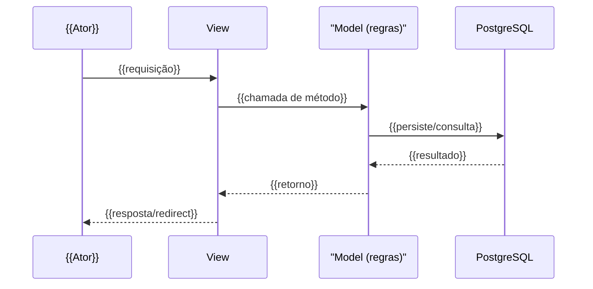

# Fluxo: {{Nome do fluxo}}

> {{1 frase: o que este fluxo realiza, do ponto de vista do ator.}}

- **Ator(es):** {{quem inicia}} — ver [README → Atores e papéis](../README.md#atores-e-papéis)
- **Gatilho:** {{ação do usuário / evento / agendamento}}
- **Pré-condições:** {{estado necessário antes}}
- **Pós-condições:** {{estado/efeitos após o sucesso}}
- **Depende de:** {{fluxo(s) que precisam ocorrer antes — [link](outro-fluxo.md), ou _nenhum_}}
- **Habilita:** {{fluxo(s) que este destrava — [link](outro-fluxo.md), ou _nenhum_}}
- **Entrada no código:** {{view+rota ou task Celery}}

## Sequência

_Fluxo assíncrono (Celery): inclua `participant W as Worker` e o disparo
`V->>W: enfileira task` + o processamento posterior._

## Observações

- {{regra/validação relevante, ponto de variação, idempotência se assíncrono}}
- {{> ⚠️ REVISAR: passo que o código não deixa explícito}}

---
_Gerado/atualizado via subagent `documentador` em {{AAAA-MM-DD}}._
