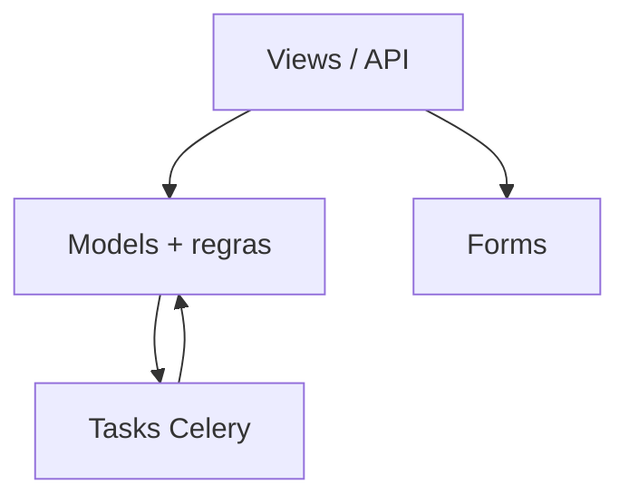
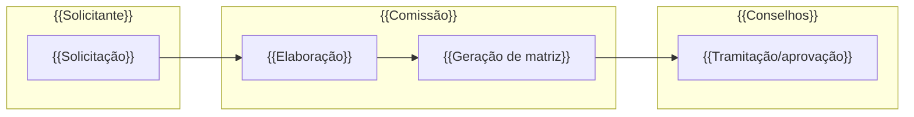

# HLA — {{Módulo}}

> High Level Architecture. Complementa o [README.md](README.md). Foco em contexto, blocos, fluxo e riscos. Baseado em arc42 (enxuto) + C4 + Mermaid.

## 1. Contexto e escopo

{{Quem usa, com quais sistemas/módulos troca dados. 2–3 frases.}}

> Atores definidos em [README.md → Atores e papéis](README.md#atores-e-papéis).

```mermaid
graph LR
    Ator[{{Ator/Usuário}}] --> Mod[{{Módulo}}]
    Mod --> Dep1[{{Módulo SUAP: edu/rh/comum}}]
    Mod --> DB[(PostgreSQL)]
```

## 2. Estratégia de solução

| Decisão | Escolha | Motivo |
|---|---|---|
| {{Persistência}} | {{`ModelPlus` / PostgreSQL}} | {{...}} |
| {{Processamento assíncrono}} | {{Celery / síncrono}} | {{...}} |
| {{Regras de negócio}} | {{fat models / utils}} | {{...}} |

## 3. Blocos de construção (componentes internos)



| Componente | Responsabilidade |
|---|---|
| {{Views/API}} | {{...}} |
| {{Models (fat)}} | {{entidades + regras de negócio + máquinas de estado}} |
| {{Tasks}} | {{...}} |

Modelo de dados (ERD): ver {{[modelo-de-dados.md](modelo-de-dados.md) ou [modelo-de-dados/](modelo-de-dados/)}}.

## 4. Fluxos principais

Cada fluxo feliz importante é documentado em um arquivo próprio sob
`docs/fluxos/`. Quantidade **dinâmica** conforme o tamanho do módulo (pequenos:
1–3; grandes como `edu`: muitos). Documente só fluxos felizes **importantes**, não
toda rota. Liste os mais centrais primeiro.

| Fluxo | Ator | Gatilho | Doc |
|---|---|---|---|
| {{Matrícula de aluno}} | {{Secretário}} | {{POST /.../matricular}} | [fluxos/matricula-aluno.md](fluxos/matricula-aluno.md) |

_Módulo sem fluxo de usuário (interno/assíncrono):_ documente os fluxos disparados
por outros módulos/tasks da mesma forma, com o ator sendo o sistema chamador.

### Mapa de fluxos (raias por ator)

Visão integrada: como os fluxos se **encadeiam** (quem dispara/precede quem). Raias
(`subgraph`) = ator principal; nós = fluxos; setas = dependência (derivada dos campos
`Depende de`/`Habilita` de cada fluxo). Os arquivos estão na tabela acima.



_Fluxos independentes (sem encadeamento entre si):_ diga isso e omita o diagrama.

## 5. Integrações

| Integração | Direção | Como | Onde |
|---|---|---|---|
| {{documento_eletronico / processo_eletronico / MinIO / Redis}} | {{in/out}} | {{model reusado / id / API}} | {{model/método}} |

_Nenhuma:_ `_N/A_`

Mapa completo de fronteira (dependências inbound/outbound + contratos): ver
[FRONTEIRA.md](FRONTEIRA.md).

## 6. Conceitos transversais

- **Transações:** {{onde há `transaction.atomic()` / boundaries}}
- **Locks / concorrência:** {{lock distribuído? idempotência?}}
- **Storage:** {{MinIO / FileField / PDF}}
- **Permissões:** {{grupos / `permissions.yaml` / papéis relacionais}}
- **Auditoria:** {{`LogModel` / history}}

## 7. Riscos e débito técnico

- {{Risco conhecido / ponto frágil / TODO arquitetural}}
- {{> ⚠️ REVISAR: incerteza que precisa de validação humana}}

## 8. Glossário

Linguagem ubíqua, siglas e mapa entidade↔negócio: ver [GLOSSARIO.md](GLOSSARIO.md).

---
_Gerado/atualizado via subagent `documentador` em {{AAAA-MM-DD}}._
