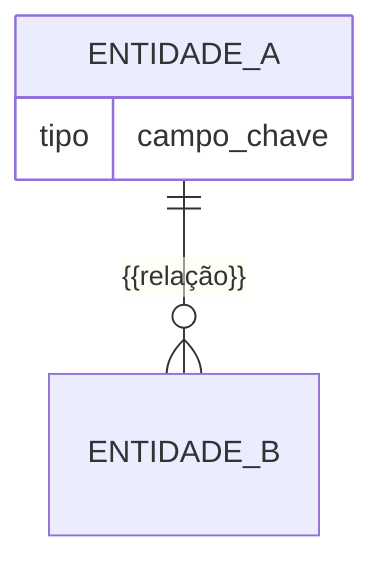

# Modelo de dados — {{Módulo ou Subdomínio}}

> ERD das entidades {{do módulo / da sub-área X}} (models herdam `ModelPlus` de
> `djtools.db`). FKs para entidades de outras áreas aparecem como **externas**.
> Termos: ver Glossário (`GLOSSARIO.md`; use `../GLOSSARIO.md` se este arquivo
> estiver em subpasta).

## Entidades

| Entidade | Descrição | Relações-chave |
|---|---|---|
| {{Nome}} | {{1 linha}} | {{FK/M2M relevantes}} |

## Entidades externas referenciadas

| Entidade | Módulo/área de origem |
|---|---|
| {{Servidor}} | {{rh}} |

_Sem referências externas:_ `_N/A_`

---
_Gerado/atualizado via subagent `documentador` em {{AAAA-MM-DD}}._
