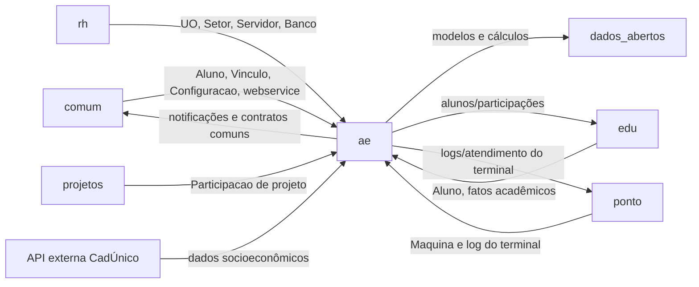

# Atividades Estudantis — Fronteira

## Mapa de fronteira

## Dependências de entrada (inbound)

| Consumidor | Símbolos/contrato consumido | Tipo |
|---|---|---|
| `auxilioemergencial` | `Caracterizacao`, `DocumentoInscricaoAluno`, `IntegranteFamiliarCaracterizacao`, `Participacao`, `CaracterizacaoForm` | Modelos e formulário para o fluxo emergencial. |
| `comum.webservice` | `ae.webservice.exposed` | Registro do método XML-RPC de refeições offline. |
| `dados_abertos.endpoints.ae` | `Participacao`, `TipoPrograma`, `calcula_valor_*` | Modelos e funções de cálculo de transporte, refeição, trabalho e programa genérico. |
| `edu.censup` | `Caracterizacao` e subtipos de `Participacao` | Exportação/integração acadêmica. |
| Comandos de `edu` | `AgendamentoRefeicao`, `DadosBancarios`, `Inscricao`, `InscricaoCaracterizacao`, históricos e documentos | Consultas e exportações acadêmicas. |
| `edu.views.alunos` | `AgendamentoRefeicao`, `DemandaAlunoAtendida`, `DocumentoInscricaoAluno` | Exibição de informações no contexto do aluno. |
| `processo_seletivo.views` | `Participacao` | Consulta de participação durante processo seletivo. |
| `projetos.forms/views` | `CategoriaBolsa`, `ParticipacaoBolsa`, formulário de participação | Integração com bolsa/projetos. |
| `ponto.admin` | `ae.views` | Reuso de views relacionadas ao terminal/atendimento. |
| `saude.admin/views` | `RendaChoices`, `Caracterizacao`, `Participacao`, `TipoAreaResidencial` | Filtros e dados de saúde/atendimento. |
| `rh.views` | `ParticipacaoTrabalho` | Consulta de participação de trabalho. |
| `pesquisa.models` | `DadosBancarios` | Dados bancários usados no domínio de pesquisa. |

## Dependências de saída (outbound)

| Dependência | Como `ae` usa | Contrato/observação |
|---|---|---|
| `comum` | `PessoaFisica`, `Vinculo`, `Configuracao`, `Raca`, salário mínimo, notificações e webservice | Chaves estrangeiras, configuração por chave e método exposto. |
| `rh` | `UnidadeOrganizacional`, `Setor`, `Servidor`, `Banco` | Campus, permissões de escopo, alocação e dados bancários. |
| `edu` | `Aluno`, matrícula/situação, mensagens e dados acadêmicos | `Aluno` é referência estrutural da maioria das transações. |
| `ponto` | `Maquina`, `MaquinaLog` | Terminal deve estar marcado como cliente de refeitório e corresponder ao IP atual. |
| `projetos` | Participação/categoria de bolsa | Relação opcional usada na geração/consulta de bolsas. |
| `beat` | `Intervalo`, `carregar_call_command` | Agenda e execução dos comandos recorrentes. |
| `dados_abertos` | Cálculos públicos | Consome funções de `ae.utils` e modelos do domínio. |
| CadÚnico | `APIExterna.CADUNICO` | Integração externa condicional; formato e disponibilidade não são definidos pelo módulo. |
| Cache/arquivos privados | Cache Django/Redis e storage privado | Disponibilidade, relatórios, folha e evidências documentais. |

## Contratos publicados

### Webservice

`ae.webservice.exposed` publica `registrar_refeicoes_offline(registros, operador_id)`. O contrato recebe registros separados por `|`, cada um com `username;YYYY-MM-DD HH:MM:SS`; classifica café/almoço/jantar pelo horário, valida máquina de refeitório pelo IP, deduplica atendimento e retorna `ok` e `usernames_erro`. O processamento registra `MaquinaLog` e usa savepoint por aluno.

### Funções de cálculo

`ae.utils` publica quatro funções consumidas por `dados_abertos`: `calcula_valor_transporte`, `calcula_valor_refeicao`, `calcula_valor_trabalho` e `calcula_valor_programa_generico`. Todas consideram sobreposição de datas e regras de pró-rata; a função de refeição também retorna o número de beneficiados.

### Sinais

- `post_save(edu.Aluno)`: aluno inativo encerra inscrições e participações abertas.
- `post_save(ParticipacaoAlimentacao)`, `post_save(AgendamentoRefeicao)` e `post_save(HistoricoFaltasAlimentacao)`: invalidam o cache de configuração/disponibilidade de refeição do campus.

### Tasks e comandos

O beat publica, por nome, os comandos `importacao_cadunico`, `gerar_bolsas_ae`, `gerar_bolsas_ae_pesquisa`, `gera_faltas_alimentacao`, `ofertabolsa_ae_verificar_disponibilidade`, `gera_solicitacoes_comprovantes_mensais` e `edu_inativar_participacao_ae`. Os nomes são usados como contrato de agenda; mudanças exigem atualização da configuração do beat.

## Limites e lacunas

- Não foi identificado endpoint REST/Ninja próprio em `ae`; a integração externa exposta é o webservice XML-RPC registrado por `comum`.
- O formato completo do CadÚnico e o contrato do SISPNAES não estão versionados no módulo.
- O escopo de algumas views é composto por permissões declaradas em `permissions.yaml` e filtros de campus; a tabela deste documento resume os contratos, não substitui a matriz de permissões.
- Templates são consumidores internos das views; não foi identificado template de `ae` documentado como contrato público para outros módulos.

_Gerado/atualizado via subagent `documentador` em 2026-09-09._
