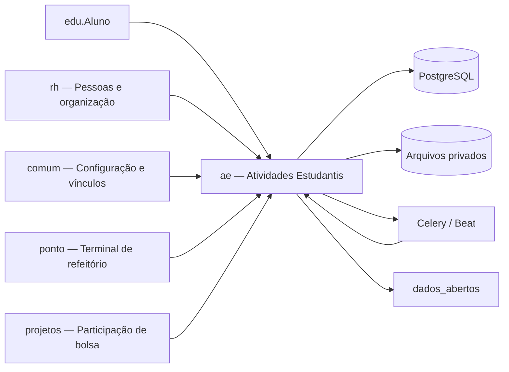
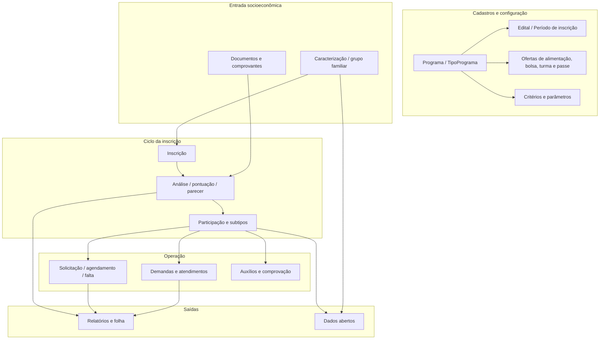
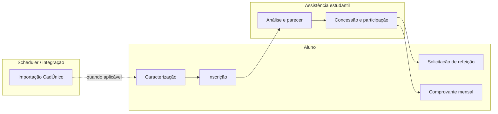

# Atividades Estudantis — HLA

## 1. Contexto e escopo

O `ae` é o módulo de Atividades Estudantis do SUAP. Ele coordena o ciclo de assistência estudantil: caracteriza a situação socioeconômica do aluno, recebe inscrições em programas, calcula análises de seleção, registra pareceres, abre participações e controla atendimentos, alimentação, auxílios, bolsas e comprovações.

O aluno e os servidores de assistência são os principais atores. `edu` fornece o aluno e fatos acadêmicos; `rh` fornece pessoas, vínculos, unidades, setores e servidores; `comum` fornece entidades transversais e configuração; `ponto` fornece máquinas de terminal; `projetos` é consultado para uma forma de participação de bolsa.

## 2. Estratégia e decisões

- O domínio está concentrado em [`ae/models.py`](../models.py), uma unidade legada com 96 modelos, incluindo cadastros, transações e relatórios.
- A interface web é síncrona, baseada em Django, `@rtr` e formulários `FormPlus`/`ModelFormPlus`; não foi identificado módulo de API próprio.
- Operações demoradas são delegadas a tasks Celery. A agenda de produção chama principalmente comandos Django por meio de `beat.utils.carregar_call_command`.
- O subtipo de inscrição/participação é selecionado pelo tipo de programa (`ALM`, `PAS`, `TRB`, `IDM`, `GEN`), combinando herança multi-tabela e composição por relações one-to-one.
- Documentos e comprovantes usam arquivos privados; dados de seleção e questionários são persistidos como registros e, em parte, JSON de snapshot.
- A disponibilidade alimentar é cacheada e invalidada por sinais após alterações de participações, agendamentos e faltas.

## 3. Blocos construtivos

| Bloco | Responsabilidade | Principais componentes |
|---|---|---|
| Cadastros | Definir programas, editais, períodos, ofertas e regras. | `Programa`, `Edital`, `PeriodoInscricao`, `Oferta*`, `CriterioSelecaoPrograma`, `ParametroSelecaoPrograma`. |
| Entrada socioeconômica | Manter dados e evidências do aluno e do grupo familiar. | `Caracterizacao`, `HistoricoCaracterizacao`, `InscricaoCaracterizacao`, `DocumentoInscricaoAluno`. |
| Inscrição e seleção | Registrar candidatura, snapshot, pontuação e decisão. | `Inscricao`, `AnaliseInscricao`, `AnaliseInscricaoAlimentacao`, `HistoricoAlteracaoParecer`. |
| Participação | Materializar o benefício e suas especializações. | `Participacao*`, `ParticipacaoBolsa`, `ComprovanteParticipacao`. |
| Alimentação | Controlar pedidos, agendamentos, consumo e faltas. | `SolicitacaoRefeicaoAluno`, `AgendamentoRefeicao`, `DemandaAlunoAtendida`, históricos de falta/suspensão. |
| Operação e relatórios | Registrar atendimento e produzir saídas gerenciais. | `AtendimentoSetor`, `AuxilioEventual`, `RelatorioGestao*`, tasks e comandos. |

O detalhamento das relações está no [índice do ERD particionado](modelo-de-dados/_indice.md).

## 4. Fluxos principais

| Fluxo | Atores | Entrada | Saída |
|---|---|---|---|
| [Caracterização socioeconômica](fluxos/caracterizacao-socioeconomica.md) | Aluno, Assistente Social | Formulário da caracterização | Caracterização vigente, histórico e renda. |
| [Inscrição em programa](fluxos/inscricao-em-programa.md) | Aluno, Assistente Social | Programa e período abertos | Inscrição documentada para análise. |
| [Análise e parecer](fluxos/analise-e-parecer.md) | Assistente Social, Coordenador | Inscrições e critérios | Snapshot pontuado e situação do parecer. |
| [Concessão e participação](fluxos/concessao-e-participacao.md) | Assistente Social, Coordenador | Inscrição deferida | Participação especializada e benefício ativo. |
| [Solicitação e controle de refeição](fluxos/solicitacao-e-controle-de-refeicao.md) | Aluno, avaliador, operador, scheduler | Pedido, oferta e agenda | Agendamento, consumo e eventual falta. |
| [Comprovação mensal](fluxos/comprovacao-mensal.md) | Scheduler, aluno, Assistente Social | Participação exigindo comprovante | Comprovante enviado e validável. |
| [Importação do CadÚnico](fluxos/importacao-cadunico.md) | Assistente Social, scheduler, CadÚnico | CPF e lote pendente | Caracterização enriquecida e lote concluído. |

## 5. Integrações

| Integração | Direção | Papel |
|---|---|---|
| `edu` | AE lê; `edu` consome | Aluno, situação acadêmica, mensagens e exportações que incorporam caracterização/participação. |
| `rh` | AE lê | Campus, setor, servidor, vínculo, banco e organização. |
| `comum` | AE lê; AE publica uso | Pessoa, vínculo, configuração, salário mínimo, notificações e webservice global. |
| `ponto` | AE lê e recebe | Máquina autorizada e log do terminal de refeitório. |
| `projetos` | AE lê | Categoria/participação de bolsa de projetos. |
| CadÚnico | AE chama condicionalmente | Importação de informações complementares por CPF. |
| `dados_abertos` | Consome AE | Participações/programas e cálculos financeiros públicos do módulo. |

Os contratos inbound/outbound e a lista de consumidores estão em [FRONTEIRA](FRONTEIRA.md).

## 6. Conceitos transversais

- **Campus/escopo:** permissões distinguem operação do próprio campus e visão sistêmica; os filtros são aplicados nas views e nos cadastros.
- **Auditoria:** alterações relevantes carregam `Vinculo` de criação/atualização, histórico de parecer/termo ou histórico de documento.
- **Privacidade:** caracterização, renda e documentos são informações sensíveis; arquivos são privados e devem seguir o controle de permissão da aplicação.
- **Tempo:** períodos de inscrição, vigência de ofertas, dias letivos/recesso, cortes de solicitação e pró-rata financeiro definem o comportamento.
- **Consistência alimentar:** agendamentos, demandas atendidas, faltas e suspensão alteram a disponibilidade cacheada.

## 7. Riscos e dívida técnica

- `models.py` concentra 96 modelos e mistura lookup tables, transações e relatórios, elevando o custo de navegação e manutenção.
- Há dependência de SQL bruto em `Inscricao.sub_instance`, inclusive lógica específica de herança/importação que merece teste de regressão.
- A pontuação é construída em task e também em métodos do modelo; a equivalência entre os caminhos deve ser preservada.
- Existem dois eixos de tipo de programa (`Programa.tipo` e `TipoPrograma`); a semântica e a fonte de verdade devem ser confirmadas.
- `DadosFincanceiros` mantém a grafia histórica do modelo; não deve ser renomeado sem migração e análise de consumidores.
- O comportamento do CadÚnico depende de API ativa e do formato externo; há tratamento de erro, mas não há contrato versionado no módulo.

> ⚠️ REVISAR: a modelagem foi particionada por agrupamento semântico em um único arquivo; confirmar os agrupamentos quando houver uma refatoração estrutural dos modelos.

## 8. Glossário

Consulte [GLOSSARIO.md](GLOSSARIO.md). O índice de fluxos desta página é a referência navegável para os processos documentados.

_Gerado/atualizado via subagent `documentador` em 2026-09-09._
