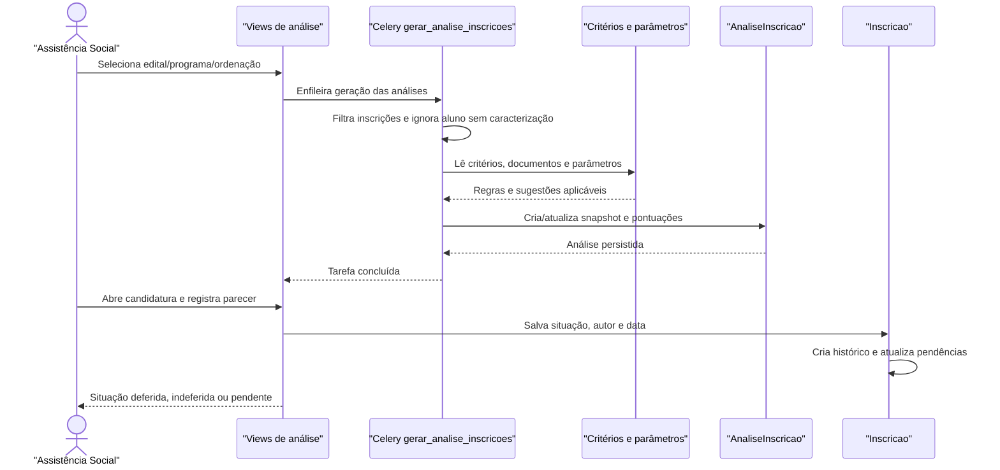

# Fluxo: Análise e parecer de inscrição

A equipe de assistência gera um snapshot da inscrição, calcula os critérios e registra o parecer administrativo que determina a continuidade da candidatura.

## Ator(es)

- Assistente Social, com atuação normalmente limitada ao campus.
- Coordenador de Atividades Estudantis, inclusive na visão sistêmica.
- Worker Celery, na geração/recalculo assíncrono.

## Gatilho

Consulta em `/ae/analise_inscricoes/` e POST em `/ae/gerar_analise_inscricoes/<edital_id>/<programa_id>/<ordenacao>/`; o segundo delega para `tasks.gerar_analise_inscricoes`.

## Pré-condições

- Existem inscrições no edital/programa, com aluno identificável.
- Há caracterização e dados/documentos suficientes para os critérios aplicáveis.
- Critérios e parâmetros de seleção estão configurados para o tipo de programa.

## Pós-condições

- `AnaliseInscricao` registra snapshot do aluno, inscrição, programa, campus e dados usados.
- Pontuações por critério, especificidade, total e sugestões são persistidas.
- `Inscricao.situacao_parecer`, autor, data e histórico refletem o parecer informado.
- Inscrições com documentação pendente permanecem identificadas para correção.

## Depende de

Inscrição, caracterização, documentos, `CriterioSelecaoPrograma`, `ParametroSelecaoPrograma` e `comum.salario_minimo`.

## Habilita

Seleção/priorização, concessão de participação, relatórios de análise e comunicação de pendências.

## Entrada de código

- [`views.analise_inscricoes`](../../views.py:9303)
- [`tasks.gerar_analise_inscricoes`](../../tasks.py:1108)
- [`Inscricao.salvar_parecer`](../../models.py:902)
- [`AnaliseInscricao.atualizar_pontuacao`](../../models.py:4159)

## Sequência principal

## Observações

- A pontuação é um snapshot: alterações posteriores na caracterização não reescrevem automaticamente a análise já gerada.
- `recalcular_pontuacao` atualiza análises a partir dos parâmetros; a equivalência entre esse caminho e `AnaliseInscricao.atualizar_pontuacao()` deve ser mantida.
- O parecer deferido sem recurso e o deferido comum são estados distintos do modelo.

_Gerado/atualizado via subagent `documentador` em 2026-09-09._
