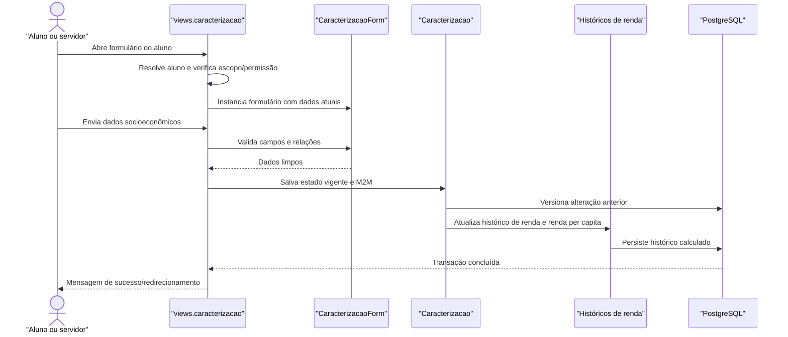

# Fluxo: Caracterização socioeconômica

O aluno ou um servidor autorizado preenche a caracterização socioeconômica; o módulo persiste a versão vigente, registra o histórico alterado e recalcula os dados de renda usados nas seleções.

## Ator(es)

- Aluno, limitado aos próprios dados.
- Assistente Social/Coordenador, conforme permissão de campus ou sistêmica.

## Gatilho

GET/POST em `/ae/caracterizacao/` (`views.caracterizacao`). A renovação pode incluir aluno e indicador de renovação na URL.

## Pré-condições

- O aluno existe em `edu.Aluno` e pode ser resolvido pelo identificador ou pelo usuário autenticado.
- O usuário tem permissão de edição do próprio campus, permissão sistêmica, ou é o aluno dono do registro.
- Os valores de referência (estado civil, escolaridade, situação de trabalho, renda etc.) estão cadastrados.

## Pós-condições

- `Caracterizacao` contém o estado socioeconômico vigente e suas relações M2M.
- Alterações em registro existente geram `HistoricoCaracterizacao`.
- `HistoricoRendaFamiliar` e `renda_per_capita` são atualizados conforme os dados informados.
- Mudanças nos dados-base do grupo familiar podem desassociar integrantes que deixaram de ser compatíveis.

## Depende de

`edu.Aluno`, cadastros de referência de `ae`, `comum.salario_minimo` e permissões de escopo.

## Habilita

Inscrição em programas que exigem caracterização, critérios de pontuação, ordenação por renda e importações/consultas socioeconômicas.

## Entrada de código

- [`views.caracterizacao`](../../views.py:1249)
- [`Caracterizacao`](../../models.py:2393)
- [`CaracterizacaoForm`](../../forms.py:628)

## Sequência principal

## Observações

- `Caracterizacao.save()` concentra versionamento e cálculo; a view também trata os relacionamentos M2M após o save.
- A importação por `Caracterizacao.importar_caracterizacao()` é um caminho distinto, usado por integração/edital, e não substitui a edição manual.
- Dados de renda, saúde e documentos são sensíveis; o controle de acesso é parte do fluxo, não apenas da navegação.

_Gerado/atualizado via subagent `documentador` em 2026-09-09._
