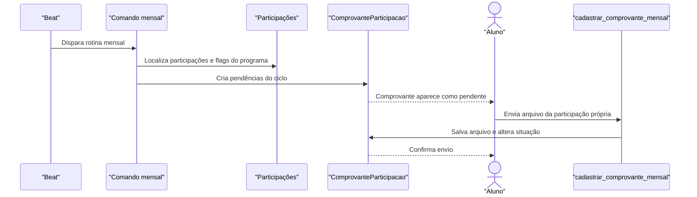

# Fluxo: Comprovação mensal de participação

Programas configurados para exigir evidência mensal recebem comprovantes pendentes por rotina; o aluno envia o arquivo e a equipe pode acompanhar a situação no módulo.

## Ator(es)

- Scheduler, que gera as solicitações.
- Aluno, que envia o comprovante da própria participação.
- Assistente Social/Coordenador, que acompanha a pendência.

## Gatilho

Comando agendado `gera_solicitacoes_comprovantes_mensais`; envio manual em `/ae/cadastrar_comprovante_mensal/<comprovante_id>/`.

## Pré-condições

- A participação está aberta no período de referência.
- O programa exige comprovante de pagamento ou folha de frequência.
- O aluno autenticado é o titular da participação e existe pendência de comprovante.

## Pós-condições

- `ComprovanteParticipacao` fica criado para o ciclo mensal e associado a aluno, programa, participação e unidade.
- O arquivo é armazenado de forma privada e a pendência é removida após o envio válido.
- A equipe pode identificar comprovantes não enviados para cobrança/controle.

## Depende de

Participação ativa, flags `exige_comprovante_pagamento`/`exige_folha_frequencia`, calendário do ciclo e storage privado.

## Habilita

Conferência administrativa, relatórios de participação e regularidade do benefício.

## Entrada de código

- [`management/commands/gera_solicitacoes_comprovantes_mensais.py`](../../management/commands/gera_solicitacoes_comprovantes_mensais.py:1)
- [`views.cadastrar_comprovante_mensal`](../../views.py:8881)
- [`ComprovanteParticipacao`](../../models.py:3972)
- [`beat.load_tasks_schedule`](../../beat.py:8)

## Sequência principal

## Observações

- A rotina deve ser repetível sem produzir pendências duplicadas para o mesmo ciclo; essa é a expectativa operacional do comando.
- A view de cadastro restringe o envio ao aluno titular e a comprovante pendente.
- A validação administrativa detalhada do conteúdo do arquivo não está centralizada em uma etapa única evidente no código consultado.

_Gerado/atualizado via subagent `documentador` em 2026-09-09._
