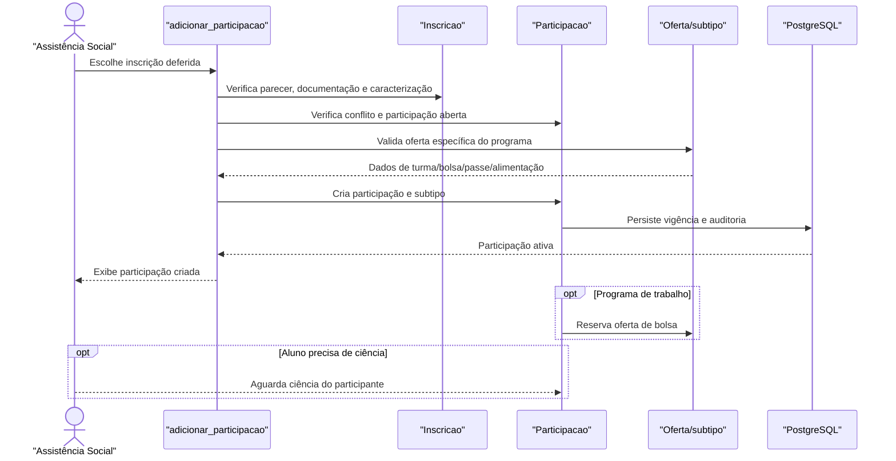

# Fluxo: Concessão e participação

Depois de deferida e documentada uma inscrição, a equipe cria a participação concreta do programa e preenche a especialização correspondente ao benefício.

## Ator(es)

- Assistente Social ou Coordenador de Atividades Estudantis.
- Aluno, quando precisa tomar ciência ou complementar dados da participação.

## Gatilho

GET/POST em `/ae/adicionar_participacao/<inscricao_id>/`; edição, ciência e revogação são fluxos relacionados em `/ae/editar_participacao/`, `/ae/registrar_ciencia_participacao/` e `/ae/revogar_participacao/`.

## Pré-condições

- A inscrição está deferida, documentada e sem participação aberta conflitante.
- A caracterização exigida está presente.
- A oferta do subtipo está configurada: turma de idioma, oferta de bolsa, dados de passe ou configuração de alimentação.

## Pós-condições

- `Participacao` é criada com período, aluno, programa e inscrição.
- O subtipo (`ParticipacaoAlimentacao`, `ParticipacaoIdioma`, `ParticipacaoTrabalho` ou `ParticipacaoPasseEstudantil`) recebe seus dados específicos.
- A participação passa a habilitar atendimentos, refeições, folha, comprovantes ou benefícios conforme o programa.

## Depende de

Inscrição deferida, documentos válidos, oferta/programa configurados e ausência de conflito de participação.

## Habilita

Atendimento/consumo, solicitação de refeição, geração de pagamentos, comprovante mensal e relatórios.

## Entrada de código

- [`views.adicionar_participacao`](../../views.py:799)
- [`views.revogar_participacao`](../../views.py:965)
- [`Participacao`](../../models.py:1359)
- [`Programa.estah_configurado`](../../models.py:217)

## Sequência principal

## Observações

- O método `sub_instance()` escolhe a especialização conforme o tipo de programa; dados faltantes do subtipo impedem a conclusão ou aparecem como pendência.
- Ao revogar, a view valida requisitos do subtipo antes de gravar a data/fundamento de encerramento.
- Participação de trabalho e oferta de bolsa têm sincronização própria de disponibilidade.

_Gerado/atualizado via subagent `documentador` em 2026-09-09._
