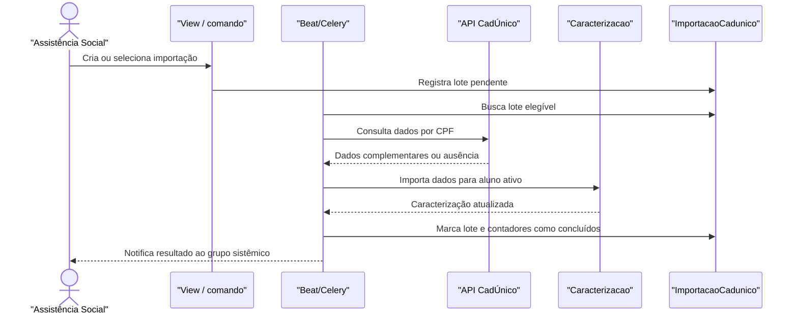

# Fluxo: Importação do CadÚnico

O módulo recebe uma solicitação/lote de importação, consulta a integração externa por CPF e incorpora dados complementares à caracterização do aluno, registrando o resultado do processamento.

## Ator(es)

- Assistente Social ou Coordenador sistêmico, que inicia/acompanha a importação.
- Scheduler, que processa lotes pendentes.
- API externa CadÚnico, fornecedora dos dados.

## Gatilho

Importação manual de caracterização/edital em `/ae/importar_caracterizacao_edital_ano/` ou comando agendado `importacao_cadunico`.

## Pré-condições

- `APIExterna.CADUNICO` está ativa e acessível.
- O aluno/pessoa possui CPF compatível e está elegível ao processamento.
- O lote `ImportacaoCadunico` está pendente e pertence ao ciclo corrente quando processado pelo comando.

## Pós-condições

- Dados recebidos são aplicados à caracterização quando o CPF resolve um aluno ativo.
- O lote é marcado como concluído e as quantidades processadas/sem correspondência são registradas.
- O grupo sistêmico responsável recebe notificação do resultado do processamento.

## Depende de

`APIExterna.CADUNICO`, `PessoaInfoComplementar`, `edu.Aluno`, `Caracterizacao` e permissões de importação.

## Habilita

Caracterização mais completa, análise por critérios socioeconômicos e auditoria do lote importado.

## Entrada de código

- [`views.importar_caracterizacao_edital_ano`](../../views.py:6299)
- [`views.importar_cadunico`](../../views.py:10702)
- [`management/commands/importacao_cadunico.py`](../../management/commands/importacao_cadunico.py:1)
- [`Caracterizacao.importar_caracterizacao`](../../models.py:2393)
- [`ImportacaoCadunico`](../../models.py:4600)

## Sequência principal

## Observações

- O comando limita o processamento a solicitações do dia e pode limitar a quantidade de alunos.
- Erros de comunicação/formato são tratados no caminho de importação manual; o contrato da API externa não é versionado pelo módulo.
- A importação não deve criar caracterização para pessoa que não resolve um aluno ativo.

> ⚠️ REVISAR: documentar o schema do retorno CadÚnico e o critério de merge quando o contrato da API externa estiver disponível.

_Gerado/atualizado via subagent `documentador` em 2026-09-09._
