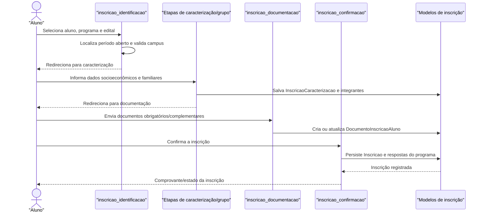

# Fluxo: Inscrição em programa

O aluno inicia uma inscrição em um período aberto, informa caracterização e grupo familiar, anexa documentos e confirma a candidatura para que ela possa ser analisada.

## Ator(es)

- Aluno, no fluxo de autoatendimento.
- Assistente Social/Coordenador, na operação administrativa e correção de pendências.

## Gatilho

`/ae/inscricao_identificacao/`, seguido pelas etapas `inscricao_caracterizacao`, `inscricao_grupo_familiar`, `inscricao_documentacao`, `inscricao_detalhamento` e `inscricao_confirmacao`.

## Pré-condições

- Existe `Programa` com `PeriodoInscricao` aberto para o aluno/campus.
- O aluno está apto a iniciar a inscrição e não possui inscrição ativa duplicada para o mesmo programa/período.
- O programa está configurado e as exigências de caracterização/documentação são conhecidas.

## Pós-condições

- `Inscricao` é criada ou atualizada com programa, aluno, período e respostas.
- `InscricaoCaracterizacao`, integrantes familiares e `DocumentoInscricaoAluno` ficam associados quando exigidos.
- A inscrição fica disponível para análise/parecer, respeitando pendências de documentação.

## Depende de

Caracterização do aluno quando exigida, cadastros de programa/edital/período, tipos de documento e grupo familiar.

## Habilita

Análise de inscrição, parecer, seleção e posterior concessão de participação.

## Entrada de código

- [`urls.py`](../../urls.py:36)
- [`views.inscricao_identificacao`](../../views.py:1437)
- [`views.inscricao_caracterizacao`](../../views.py:1474)
- [`views.inscricao_grupo_familiar`](../../views.py:1566)
- [`views.inscricao_documentacao`](../../views.py:1744)
- [`views.inscricao_confirmacao`](../../views.py:2343)
- [`Inscricao`](../../models.py:902)

## Sequência principal

## Observações

- O fluxo é composto por várias URLs; cada etapa valida a continuidade e redireciona para a próxima.
- A existência de pendência documental não necessariamente apaga a candidatura; ela altera o estado que será usado no parecer.
- A regra de múltiplos editais ativos depende da configuração `ae.permitir_varios_editais_ativos`.

_Gerado/atualizado via subagent `documentador` em 2026-09-09._
