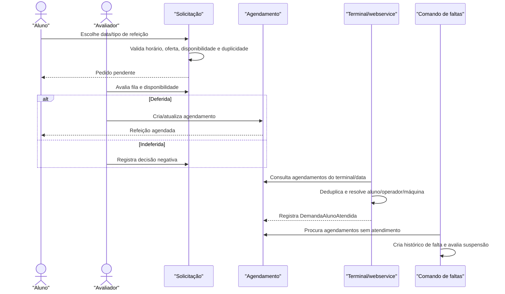

# Fluxo: Solicitação e controle de refeição

O aluno solicita uma refeição em dia e horário permitidos; a equipe avalia a capacidade, o sistema agenda, e o terminal ou webservice registra o consumo para posterior controle de faltas.

## Ator(es)

- Aluno, solicitante.
- Avaliador/Assistente Social, deferimento ou indeferimento.
- Operador do terminal, registro presencial.
- Scheduler, geração de faltas e atualização de participação.

## Gatilho

`/ae/solicitar_refeicao/<programa_id>/`, seguido de `/ae/avaliar_solicitacao_refeicao/<programa_id>/`; o consumo também pode entrar por `registrar_refeicoes_offline`.

## Pré-condições

- O aluno está autenticado e a solicitação é própria.
- Programa, campus, caracterização, horário, dia útil, oferta e disponibilidade permitem o pedido.
- Não há pedido/agendamento duplicado para o mesmo aluno, data e tipo.
- Para consumo offline, a máquina de origem está ativa e marcada como cliente de refeitório.

## Pós-condições

- `SolicitacaoRefeicaoAluno` representa o pedido e sua decisão.
- Deferimento cria/atualiza `AgendamentoRefeicao`.
- O consumo cria `DemandaAlunoAtendida` com terminal, campus e quantidade.
- O comando noturno cria `HistoricoFaltasAlimentacao` para ausências e pode suspender a participação.

## Depende de

Configuração de `OfertaAlimentacao`, horários, feriados/recessos, disponibilidade do programa e, quando aplicável, participação alimentar.

## Habilita

Controle de consumo, relatórios de alimentação, justificativa de falta e cálculo financeiro de refeições.

## Entrada de código

- [`views.solicitar_refeicao`](../../views.py:6362)
- [`views.avaliar_solicitacao_refeicao`](../../views.py:6567)
- [`webservice.registrar_refeicoes_offline`](../../webservice.py:15)
- [`management/commands/gera_faltas_alimentacao.py`](../../management/commands/gera_faltas_alimentacao.py:1)
- [`AgendamentoRefeicao`](../../models.py:2032)

## Sequência principal

## Observações

- Café, almoço e jantar são derivados no webservice pelo horário do registro: antes de 10h, entre 10h e 16h, e a partir de 16h.
- A avaliação prioriza documentação válida, prioridade social, renda per capita, situação de participação e hora do pedido.
- Sinais invalidam o cache de disponibilidade após alteração de participação alimentar, agendamento ou falta.
- `checa_inconsistencia_alimentacao` é uma ferramenta de auditoria/diagnóstico e não substitui a rotina de geração de faltas.

_Gerado/atualizado via subagent `documentador` em 2026-09-09._
