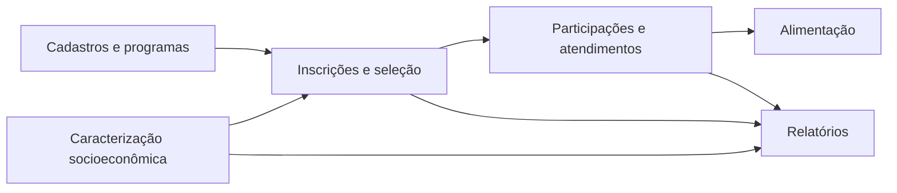

# Modelo de dados — Atividades Estudantis

O domínio de `ae` está concentrado em um único `models.py` com 96 classes. Como o volume excede o limite recomendado para um ERD único, os modelos foram particionados por subdomínio. Cada classe do arquivo foi incluída exatamente uma vez nos seis diagramas abaixo; relações para outros recortes aparecem como referência normal ou stub `EXT_*`.

> ⚠️ REVISAR: os agrupamentos são semânticos e foram inferidos a partir de nomes, relações, `Meta` e uso em views/admin. Confirmar a divisão com a área de negócio antes de uma futura separação física do arquivo.

| Recorte | Classes | Conteúdo |
|---|---:|---|
| [Cadastros e programas](cadastros-programas.md) | 23 | Tipos, programas, editais, períodos, ofertas, critérios e parâmetros. |
| [Caracterização socioeconômica](caracterizacao-socioeconomica.md) | 23 | Caracterização, família, renda, lookup tables e dados bancários. |
| [Inscrições e seleção](inscricoes-selecao.md) | 16 | Inscrição, documentos, questionários, análise e importação CadÚnico. |
| [Participações e atendimentos](participacoes-atendimentos.md) | 16 | Participações especializadas, demandas, atividades, auxílios e comprovantes. |
| [Alimentação](alimentacao.md) | 8 | Solicitações, agendamentos, horários, faltas e suspensões. |
| [Relatórios](relatorios.md) | 10 | Configuração, gráficos e especializações de relatórios de gestão. |
| **Total** | **96** | **Todas as classes declaradas em `ae/models.py`.** |

### Critério de leitura

- Entidades com prefixo `EXT_` pertencem a outro app e aparecem apenas para explicitar uma relação de fronteira.
- `RelatorioGestaoBase` é uma classe abstrata; está documentada como classe, embora não resulte em tabela própria.
- Heranças de inscrição/participação e de relatório são representadas por relações `herda` ou `base abstrata`.
- A cardinalidade é a observada na declaração de FK, O2O ou M2M; detalhes de `on_delete` relevantes estão na tabela de cada recorte.

_Gerado/atualizado via subagent `documentador` em 2026-09-09._
