# Modelo de dados — Alimentação

Este recorte descreve o ciclo operacional de refeição: pedidos do aluno, horários, agendamento, justificativa, faltas, suspensões e liberações excepcionais.

```mermaid
erDiagram
    AgendamentoRefeicao { int id }
    SolicitacaoAlimentacao { int id }
    SolicitacaoRefeicaoAluno { int id }
    HorarioSolicitacaoRefeicao { int id }
    HorarioJustificativaFalta { int id }
    HistoricoFaltasAlimentacao { int id }
    HistoricoSuspensoesAlimentacao { int id }
    DatasLiberadasFaltasAlimentacao { int id }
    EXT_Programa { int id }
    EXT_Aluno { int id }
    EXT_Vinculo { int id }
    EXT_AgendamentoRefeicao { int id }
    EXT_Participacao { int id }
    EXT_UnidadeOrganizacional { int id }

    AgendamentoRefeicao }o--|| EXT_Programa : "do programa"
    AgendamentoRefeicao }o--|| EXT_Aluno : "do aluno"
    AgendamentoRefeicao }o--o| EXT_Vinculo : "cancelado/atualizado por"
    AgendamentoRefeicao }o--o| EXT_Vinculo : "motivo registrado por"
    SolicitacaoRefeicaoAluno }o--|| EXT_Aluno : "do aluno"
    SolicitacaoRefeicaoAluno }o--|| EXT_Programa : "para programa"
    SolicitacaoRefeicaoAluno }o--o| EXT_Vinculo : "avaliada por"
    SolicitacaoRefeicaoAluno }o--o| AgendamentoRefeicao : "gera agendamento"
    HorarioSolicitacaoRefeicao }o--|| EXT_UnidadeOrganizacional : "configura campus"
    HorarioSolicitacaoRefeicao }o--o| EXT_Vinculo : "alterado por"
    HorarioJustificativaFalta }o--|| EXT_UnidadeOrganizacional : "configura campus"
    HorarioJustificativaFalta }o--o| EXT_Vinculo : "alterado por"
    HistoricoFaltasAlimentacao }o--|| EXT_Aluno : "do aluno"
    HistoricoFaltasAlimentacao }o--|| EXT_Participacao : "da participação"
    HistoricoFaltasAlimentacao }o--|| EXT_Programa : "do programa"
    HistoricoFaltasAlimentacao }o--o| EXT_Vinculo : "justificada por"
    HistoricoSuspensoesAlimentacao }o--|| EXT_Participacao : "suspende"
    HistoricoSuspensoesAlimentacao }o--o| EXT_Vinculo : "registrada por"
    DatasLiberadasFaltasAlimentacao }o--|| EXT_UnidadeOrganizacional : "libera campus"
    DatasLiberadasFaltasAlimentacao }o--o| EXT_Vinculo : "liberada por"
```

| Entidade | Descrição |
|---|---|
| `AgendamentoRefeicao` | Agendamento de café, almoço ou jantar para aluno/programa. |
| `SolicitacaoAlimentacao` | Dias da semana escolhidos para a participação alimentar. |
| `SolicitacaoRefeicaoAluno` | Pedido avulso do aluno, sua avaliação e eventual agendamento. |
| `HorarioSolicitacaoRefeicao` | Janela horária para solicitar refeição por campus. |
| `HorarioJustificativaFalta` | Prazo/janela para justificar falta. |
| `HistoricoFaltasAlimentacao` | Registro de ausência e justificativa. |
| `HistoricoSuspensoesAlimentacao` | Histórico de suspensão/liberação da participação alimentar. |
| `DatasLiberadasFaltasAlimentacao` | Datas excepcionadas do controle de faltas por unidade. |

## Referências externas

| Entidade | App/recorte | Uso |
|---|---|---|
| `Programa`, `Participacao` | `ae` | Benefício e participação que originam a operação alimentar. |
| `Aluno` | `edu` | Titular do pedido, agenda e falta. |
| `Vinculo` | `comum` | Avaliação, cancelamento, justificativa e auditoria. |
| `UnidadeOrganizacional` | `rh` | Configuração de horários e exceções por campus. |

_Gerado/atualizado via subagent `documentador` em 2026-09-09._
