# Modelo de dados — Cadastros e programas

Este recorte reúne os cadastros de referência e a configuração de programas, editais, períodos de inscrição, ofertas, critérios e parâmetros.

```mermaid
erDiagram
    CategoriaAlimentacao { int id }
    DemandaAluno { int id }
    CategoriaBolsa { int id }
    Programa { int id }
    TipoAtendimentoSetor { int id }
    OfertaAlimentacao { int id }
    OfertaValorRefeicao { int id }
    ValorTotalAuxilios { int id }
    ValorTotalBolsas { int id }
    OfertaTurma { int id }
    OfertaBolsa { int id }
    OfertaValorBolsa { int id }
    OfertaPasse { int id }
    TipoAtividadeDiversa { int id }
    Edital { int id }
    PeriodoInscricao { int id }
    MotivoSolicitacaoRefeicao { int id }
    DatasRecessoFerias { int id }
    TipoPrograma { int id }
    TipoBolsa { int id }
    TipoAuxilioEventual { int id }
    CriterioSelecaoPrograma { int id }
    ParametroSelecaoPrograma { int id }
    EXT_UnidadeOrganizacional { int id }
    EXT_Setor { int id }
    EXT_Idioma { int id }
    EXT_Vinculo { int id }

    Programa }o--o{ DemandaAluno : "oferece demandas"
    Programa }o--|| EXT_UnidadeOrganizacional : "sediado em"
    Programa }o--o{ EXT_UnidadeOrganizacional : "público alvo"
    Programa }o--|| TipoPrograma : "classificado por"
    Edital }o--o{ TipoPrograma : "abrange"
    PeriodoInscricao }o--|| Edital : "pertence a"
    PeriodoInscricao }o--|| EXT_UnidadeOrganizacional : "delimita campus"
    PeriodoInscricao }o--o{ Programa : "disponibiliza"
    OfertaAlimentacao }o--|| EXT_UnidadeOrganizacional : "configura campus"
    OfertaValorRefeicao }o--|| EXT_UnidadeOrganizacional : "vigora no campus"
    OfertaTurma }o--|| EXT_UnidadeOrganizacional : "ofertada no campus"
    OfertaTurma }o--|| EXT_Idioma : "ensina idioma"
    OfertaBolsa }o--|| EXT_UnidadeOrganizacional : "ofertada no campus"
    OfertaBolsa }o--|| EXT_Setor : "alocada no setor"
    OfertaValorBolsa }o--|| EXT_UnidadeOrganizacional : "vigora no campus"
    OfertaPasse }o--|| EXT_UnidadeOrganizacional : "vigora no campus"
    TipoAuxilioEventual }o--o{ EXT_UnidadeOrganizacional : "disponível em"
    CriterioSelecaoPrograma }o--o{ TipoPrograma : "pontua"
    CriterioSelecaoPrograma }o--|| EXT_Vinculo : "alterado por"
    ParametroSelecaoPrograma }o--|| TipoPrograma : "parametriza"
    ParametroSelecaoPrograma }o--|| EXT_UnidadeOrganizacional : "escopo campus"
    ParametroSelecaoPrograma }o--|| EXT_Vinculo : "alterado por"
```

| Entidade | Descrição |
|---|---|
| `CategoriaAlimentacao` | Categoria de alunos para alimentação. |
| `DemandaAluno` | Tipo de atendimento/demanda que um aluno pode receber. |
| `CategoriaBolsa` | Categoria de bolsa usada na participação de bolsa. |
| `Programa` | Programa de atividade estudantil, com tipo, campus, demandas, público e exigências. |
| `TipoAtendimentoSetor` | Tipo de auxílio/atendimento realizado por setor. |
| `OfertaAlimentacao` | Capacidade e configuração de refeições por dia e tipo no campus. |
| `OfertaValorRefeicao` | Valor de refeição com vigência por campus. |
| `ValorTotalAuxilios` | Valor total parametrizado para auxílios por período/campus. |
| `ValorTotalBolsas` | Valor total parametrizado para bolsas por período/campus. |
| `OfertaTurma` | Turma de idioma ofertada, com vagas, horário e professor. |
| `OfertaBolsa` | Vaga/oferta de bolsa por campus, setor, turno e função. |
| `OfertaValorBolsa` | Valor de bolsa com vigência por campus. |
| `OfertaPasse` | Valor de passe estudantil com vigência por campus. |
| `TipoAtividadeDiversa` | Classificação de atividade diversa. |
| `Edital` | Edital que agrupa tipos de programa. |
| `PeriodoInscricao` | Janela de inscrição por edital, campus e programas. |
| `MotivoSolicitacaoRefeicao` | Motivo usado em inscrição/solicitação de refeição. |
| `DatasRecessoFerias` | Datas de recesso/férias que influenciam calendário e faltas. |
| `TipoPrograma` | Cadastro configurável do tipo de programa, com auditoria. |
| `TipoBolsa` | Tipo de bolsa interna/externa associado a inscrições e participações. |
| `TipoAuxilioEventual` | Tipo de auxílio eventual disponível em unidades. |
| `CriterioSelecaoPrograma` | Regra de pontuação da seleção. |
| `ParametroSelecaoPrograma` | Parâmetro de sugestão/limite específico de seleção. |

## Referências externas

| Entidade | App | Uso |
|---|---|---|
| `UnidadeOrganizacional` | `rh` | Campus, sede, público e escopo de ofertas/períodos. |
| `Setor` | `rh` | Setor da oferta de bolsa. |
| `Idioma` | `ae` | Stub de relação; entidade está no recorte socioeconômico por ser lookup e referência de turma. |
| `Vinculo` | `comum` | Auditoria de critérios/parâmetros. |

_Gerado/atualizado via subagent `documentador` em 2026-09-09._
