# Modelo de dados — Caracterização socioeconômica

Este recorte contém o estado socioeconômico do aluno, integrantes familiares, renda histórica, dados bancários e as tabelas de referência usadas nos formulários e critérios.

```mermaid
erDiagram
    DadosBancarios { int id }
    DadosFincanceiros { int id }
    NecessidadeEspecial { int id }
    Idioma { int id }
    SituacaoTrabalho { int id }
    MeioTransporte { int id }
    ContribuinteRendaFamiliar { int id }
    CompanhiaDomiciliar { int id }
    TipoImovelResidencial { int id }
    TipoEscola { int id }
    TipoAreaResidencial { int id }
    TipoServicoSaude { int id }
    BeneficioGovernoFederal { int id }
    TipoEmprego { int id }
    TipoAcessoInternet { int id }
    RazaoAfastamentoEducacional { int id }
    EstadoCivil { int id }
    NivelEscolaridade { int id }
    HistoricoCaracterizacao { int id }
    Caracterizacao { int id }
    IntegranteFamiliarCaracterizacao { int id }
    InscricaoCaracterizacao { int id }
    HistoricoRendaFamiliar { int id }
    EXT_Aluno { int id }
    EXT_Raca { int id }
    EXT_Banco { int id }
    EXT_Vinculo { int id }

    Caracterizacao ||--|| EXT_Aluno : "caracteriza"
    Caracterizacao }o--|| EXT_Raca : "possui raça"
    Caracterizacao }o--|| EstadoCivil : "estado civil"
    Caracterizacao }o--|| RazaoAfastamentoEducacional : "razão afastamento"
    Caracterizacao }o--|| TipoEscola : "escola atual"
    Caracterizacao }o--|| SituacaoTrabalho : "situação trabalho"
    Caracterizacao }o--|| NivelEscolaridade : "escolaridade"
    Caracterizacao }o--|| CompanhiaDomiciliar : "companhia domiciliar"
    Caracterizacao }o--|| TipoImovelResidencial : "imóvel"
    Caracterizacao }o--|| TipoAreaResidencial : "área residencial"
    Caracterizacao }o--|| TipoServicoSaude : "serviço de saúde"
    Caracterizacao }o--|| TipoAcessoInternet : "acesso internet"
    Caracterizacao }o--o{ NecessidadeEspecial : "necessidades"
    Caracterizacao }o--o{ Idioma : "idiomas"
    Caracterizacao }o--o{ MeioTransporte : "transportes"
    Caracterizacao }o--o{ ContribuinteRendaFamiliar : "contribuintes"
    Caracterizacao }o--o{ BeneficioGovernoFederal : "benefícios"
    Caracterizacao ||--o{ HistoricoCaracterizacao : "versiona"
    Caracterizacao ||--o{ HistoricoRendaFamiliar : "calcula renda"
    InscricaoCaracterizacao }o--|| EXT_Aluno : "pertence ao aluno"
    InscricaoCaracterizacao }o--|| TipoImovelResidencial : "moradia"
    InscricaoCaracterizacao ||--o{ IntegranteFamiliarCaracterizacao : "agrupa"
    IntegranteFamiliarCaracterizacao }o--|| EXT_Aluno : "aluno relacionado"
    IntegranteFamiliarCaracterizacao }o--|| EstadoCivil : "estado civil"
    IntegranteFamiliarCaracterizacao }o--|| SituacaoTrabalho : "trabalho"
    HistoricoRendaFamiliar }o--|| EXT_Aluno : "histórico do aluno"
    DadosBancarios }o--|| EXT_Aluno : "conta do aluno"
    DadosBancarios }o--|| EXT_Banco : "banco"
    DadosBancarios }o--|| EXT_Vinculo : "atualizado por"
```

| Entidade | Descrição |
|---|---|
| `DadosBancarios` | Conta/dados bancários do aluno para benefícios. |
| `DadosFincanceiros` | Dados financeiros legados associados ao domínio; o nome mantém grafia histórica. |
| `NecessidadeEspecial` | Cadastro de necessidades especiais. |
| `Idioma` | Cadastro de idioma informado e usado por oferta de turma. |
| `SituacaoTrabalho` | Situação de trabalho do aluno ou familiar. |
| `MeioTransporte` | Meio de transporte utilizado. |
| `ContribuinteRendaFamiliar` | Papel/contribuição para composição da renda familiar. |
| `CompanhiaDomiciliar` | Companhia ou composição de moradia. |
| `TipoImovelResidencial` | Tipo de imóvel residencial. |
| `TipoEscola` | Tipo de escola informado na caracterização. |
| `TipoAreaResidencial` | Classificação da área residencial. |
| `TipoServicoSaude` | Serviço de saúde utilizado. |
| `BeneficioGovernoFederal` | Benefício social recebido. |
| `TipoEmprego` | Tipo de emprego. |
| `TipoAcessoInternet` | Forma de acesso à internet. |
| `RazaoAfastamentoEducacional` | Razão de eventual afastamento educacional. |
| `EstadoCivil` | Estado civil do aluno/familiar. |
| `NivelEscolaridade` | Nível de escolaridade do aluno/familiar. |
| `HistoricoCaracterizacao` | Snapshot dos valores anteriores da caracterização. |
| `Caracterizacao` | Estado vigente socioeconômico e educacional do aluno. |
| `IntegranteFamiliarCaracterizacao` | Integrante familiar informado na inscrição. |
| `InscricaoCaracterizacao` | Recorte de caracterização capturado para uma inscrição. |
| `HistoricoRendaFamiliar` | Série histórica de renda familiar em salários mínimos. |

## Referências externas

| Entidade | App | Uso |
|---|---|---|
| `Aluno` | `edu` | Dono da caracterização, renda e dados bancários. |
| `Raca` | `comum` | Referência racial da caracterização. |
| `Banco` | `rh` | Instituição bancária. |
| `Vinculo` | `comum` | Auditoria de dados bancários/históricos. |

_Gerado/atualizado via subagent `documentador` em 2026-09-09._
