# Modelo de dados — Inscrições e seleção

Este recorte representa a candidatura, documentos, questionários, análises de seleção e o registro de importação do CadÚnico.

```mermaid
erDiagram
    Inscricao { int id }
    InscricaoAlimentacao { int id }
    InscricaoIdioma { int id }
    InscricaoTrabalho { int id }
    InscricaoPasseEstudantil { int id }
    DocumentoInscricaoAluno { int id }
    HistoricoDocumentoInscricaoAluno { int id }
    PerguntaInscricaoPrograma { int id }
    OpcaoRespostaInscricaoPrograma { int id }
    RespostaInscricaoPrograma { int id }
    PerguntaParticipacao { int id }
    OpcaoRespostaPerguntaParticipacao { int id }
    RespostaParticipacao { int id }
    AnaliseInscricao { int id }
    AnaliseInscricaoAlimentacao { int id }
    ImportacaoCadunico { int id }
    EXT_Aluno { int id }
    EXT_Programa { int id }
    EXT_TipoPrograma { int id }
    EXT_Edital { int id }
    EXT_PeriodoInscricao { int id }
    EXT_InscricaoCaracterizacao { int id }
    EXT_IntegranteFamiliar { int id }
    EXT_Participacao { int id }
    EXT_SolicitacaoAlimentacao { int id }
    EXT_UnidadeOrganizacional { int id }
    EXT_Vinculo { int id }

    Inscricao }o--|| EXT_Programa : "candidata a"
    Inscricao }o--|| EXT_Aluno : "do aluno"
    Inscricao }o--|| EXT_PeriodoInscricao : "no período"
    Inscricao }o--o{ EXT_Vinculo : "auditada por"
    Inscricao ||--o| InscricaoAlimentacao : "especializa"
    Inscricao ||--o| InscricaoIdioma : "especializa"
    Inscricao ||--o| InscricaoTrabalho : "especializa"
    Inscricao ||--o| InscricaoPasseEstudantil : "especializa"
    Inscricao ||--o{ DocumentoInscricaoAluno : "possui documentos"
    Inscricao ||--o{ RespostaInscricaoPrograma : "recebe respostas"
    Inscricao ||--o{ AnaliseInscricao : "é analisada"
    DocumentoInscricaoAluno }o--|| EXT_Aluno : "do aluno"
    DocumentoInscricaoAluno }o--o| EXT_IntegranteFamiliar : "pode comprovar familiar"
    DocumentoInscricaoAluno }o--o| EXT_InscricaoCaracterizacao : "pode pertencer à caracterização"
    DocumentoInscricaoAluno }o--o| Inscricao : "pode pertencer à inscrição"
    HistoricoDocumentoInscricaoAluno }o--|| DocumentoInscricaoAluno : "versiona"
    HistoricoDocumentoInscricaoAluno }o--o| EXT_Vinculo : "alterado por"
    PerguntaInscricaoPrograma }o--|| EXT_TipoPrograma : "pergunta para tipo"
    OpcaoRespostaInscricaoPrograma }o--|| PerguntaInscricaoPrograma : "opção de"
    RespostaInscricaoPrograma }o--|| Inscricao : "resposta da inscrição"
    RespostaInscricaoPrograma }o--|| PerguntaInscricaoPrograma : "responde"
    RespostaInscricaoPrograma }o--o| OpcaoRespostaInscricaoPrograma : "escolhe"
    PerguntaParticipacao }o--|| EXT_TipoPrograma : "pergunta para tipo"
    OpcaoRespostaPerguntaParticipacao }o--|| PerguntaParticipacao : "opção de"
    RespostaParticipacao }o--|| EXT_Participacao : "resposta da participação"
    RespostaParticipacao }o--|| PerguntaParticipacao : "responde"
    RespostaParticipacao }o--o| OpcaoRespostaPerguntaParticipacao : "escolhe"
    AnaliseInscricao }o--|| EXT_Edital : "do edital"
    AnaliseInscricao }o--|| EXT_Programa : "do programa"
    AnaliseInscricao }o--|| EXT_TipoPrograma : "do tipo"
    AnaliseInscricao }o--|| EXT_Aluno : "do aluno"
    AnaliseInscricao }o--|| EXT_UnidadeOrganizacional : "no campus"
    AnaliseInscricaoAlimentacao }o--|| AnaliseInscricao : "especializa"
    AnaliseInscricaoAlimentacao }o--o{ EXT_SolicitacaoAlimentacao : "pontua refeições"
    ImportacaoCadunico }o--o| EXT_Vinculo : "solicitada por"
```

| Entidade | Descrição |
|---|---|
| `Inscricao` | Candidatura do aluno a um programa, com parecer, situação, prioridade e termo. |
| `InscricaoAlimentacao` | Dados específicos da inscrição de alimentação. |
| `InscricaoIdioma` | Dados específicos, incluindo turmas de idioma escolhidas. |
| `InscricaoTrabalho` | Preferência de setor/turno, habilidades, banco e tipos de bolsa. |
| `InscricaoPasseEstudantil` | Dados do passe, custo diário, rota e gratuidade. |
| `DocumentoInscricaoAluno` | Documento privado, estado de pendência/validação e vínculo com inscrição/familiar. |
| `HistoricoDocumentoInscricaoAluno` | Histórico de alterações de documento. |
| `PerguntaInscricaoPrograma` | Pergunta configurada para a inscrição de um tipo de programa. |
| `OpcaoRespostaInscricaoPrograma` | Opção possível para pergunta da inscrição. |
| `RespostaInscricaoPrograma` | Resposta persistida pelo candidato. |
| `PerguntaParticipacao` | Pergunta configurada para dados da participação. |
| `OpcaoRespostaPerguntaParticipacao` | Opção de pergunta da participação. |
| `RespostaParticipacao` | Resposta persistida no cadastro da participação. |
| `AnaliseInscricao` | Snapshot de dados, critérios, pontos, seleção e sugestões. |
| `AnaliseInscricaoAlimentacao` | Complemento da análise para dias/refeições. |
| `ImportacaoCadunico` | Controle do lote/solicitação de importação do CadÚnico. |

## Referências externas

| Entidade | App | Uso |
|---|---|---|
| `Aluno` | `edu` | Candidato e titular dos documentos/análise. |
| `Programa`, `TipoPrograma`, `Edital`, `PeriodoInscricao` | `ae` | Stubs de relações para o recorte de cadastros. |
| `InscricaoCaracterizacao`, `IntegranteFamiliarCaracterizacao` | `ae` | Dados coletados na etapa socioeconômica. |
| `Participacao` | `ae` | Respostas de questionário pós-concessão. |
| `SolicitacaoAlimentacao` | `ae` | Preferências/dias usadas na análise alimentar. |
| `UnidadeOrganizacional` | `rh` | Campus do snapshot de seleção. |
| `Vinculo` | `comum` | Auditoria e solicitação do lote. |

_Gerado/atualizado via subagent `documentador` em 2026-09-09._
