# Modelo de dados — Participações e atendimentos

Este recorte cobre a execução do benefício após a seleção: participações especializadas, demandas atendidas, atividades, ações educativas, auxílios, históricos e comprovantes.

```mermaid
erDiagram
    Participacao { int id }
    ParticipacaoAlimentacao { int id }
    ParticipacaoIdioma { int id }
    ParticipacaoTrabalho { int id }
    ParticipacaoPasseEstudantil { int id }
    DemandaAlunoAtendida { int id }
    AtendimentoSetor { int id }
    ParticipacaoBolsa { int id }
    AtividadeDiversa { int id }
    AcaoEducativa { int id }
    SolicitacaoAuxilioAluno { int id }
    AuxilioEventual { int id }
    HistoricoAlteracaoParecer { int id }
    HistoricoAlteracaoTermoCompromisso { int id }
    ComprovanteParticipacao { int id }
    AlteracaoParticipacaoAlimentacao { int id }
    EXT_Inscricao { int id }
    EXT_Programa { int id }
    EXT_Aluno { int id }
    EXT_UnidadeOrganizacional { int id }
    EXT_Vinculo { int id }
    EXT_DemandaAluno { int id }
    EXT_Maquina { int id }
    EXT_Setor { int id }
    EXT_CategoriaAlimentacao { int id }
    EXT_SolicitacaoAlimentacao { int id }
    EXT_OfertaTurma { int id }
    EXT_OfertaBolsa { int id }
    EXT_DadosBancarios { int id }
    EXT_TipoAtendimentoSetor { int id }
    EXT_TipoAuxilioEventual { int id }
    EXT_CategoriaBolsa { int id }
    EXT_ParticipacaoProjeto { int id }

    Participacao }o--|| EXT_Programa : "em programa"
    Participacao }o--|| EXT_Aluno : "do aluno"
    Participacao }o--|| EXT_Inscricao : "concretiza"
    Participacao ||--o| ParticipacaoAlimentacao : "especializa"
    Participacao ||--o| ParticipacaoIdioma : "especializa"
    Participacao ||--o| ParticipacaoTrabalho : "especializa"
    Participacao ||--o| ParticipacaoPasseEstudantil : "especializa"
    ParticipacaoAlimentacao }o--|| EXT_CategoriaAlimentacao : "categoria"
    ParticipacaoAlimentacao ||--o{ EXT_SolicitacaoAlimentacao : "solicita dias"
    ParticipacaoIdioma }o--|| EXT_OfertaTurma : "seleciona turma"
    ParticipacaoTrabalho }o--o| EXT_OfertaBolsa : "ocupa oferta"
    ParticipacaoTrabalho }o--o| EXT_DadosBancarios : "recebe em conta"
    DemandaAlunoAtendida }o--|| EXT_DemandaAluno : "atende demanda"
    DemandaAlunoAtendida }o--o| EXT_Programa : "no programa"
    DemandaAlunoAtendida }o--|| EXT_Aluno : "do aluno"
    DemandaAlunoAtendida }o--|| EXT_UnidadeOrganizacional : "no campus"
    DemandaAlunoAtendida }o--o| EXT_Maquina : "registrada no terminal"
    DemandaAlunoAtendida }o--o| EXT_Vinculo : "responsável"
    AtendimentoSetor }o--|| EXT_UnidadeOrganizacional : "no campus"
    AtendimentoSetor }o--|| EXT_TipoAtendimentoSetor : "tipo"
    AtendimentoSetor }o--|| EXT_Setor : "realizado pelo setor"
    AtendimentoSetor }o--o{ EXT_Aluno : "atende alunos"
    ParticipacaoBolsa }o--|| EXT_Aluno : "do aluno"
    ParticipacaoBolsa }o--|| EXT_CategoriaBolsa : "categoria"
    ParticipacaoBolsa }o--|| EXT_Setor : "no setor"
    ParticipacaoBolsa }o--o| EXT_ParticipacaoProjeto : "participação projeto"
    AtividadeDiversa }o--|| EXT_UnidadeOrganizacional : "no campus"
    AtividadeDiversa }o--o{ EXT_Vinculo : "servidores"
    AcaoEducativa }o--|| EXT_UnidadeOrganizacional : "no campus"
    AcaoEducativa }o--o{ EXT_Vinculo : "servidores"
    SolicitacaoAuxilioAluno }o--|| EXT_Aluno : "do aluno"
    SolicitacaoAuxilioAluno }o--|| EXT_TipoAuxilioEventual : "tipo"
    SolicitacaoAuxilioAluno }o--o| EXT_Vinculo : "avaliada por"
    AuxilioEventual }o--|| EXT_Aluno : "do aluno"
    AuxilioEventual }o--|| EXT_TipoAuxilioEventual : "tipo"
    AuxilioEventual }o--|| EXT_UnidadeOrganizacional : "no campus"
    AuxilioEventual }o--o| EXT_Vinculo : "concedido por"
    HistoricoAlteracaoParecer }o--|| EXT_Inscricao : "altera parecer"
    HistoricoAlteracaoParecer }o--|| EXT_Vinculo : "alterado por"
    HistoricoAlteracaoTermoCompromisso }o--|| EXT_Inscricao : "altera termo"
    HistoricoAlteracaoTermoCompromisso }o--|| EXT_Vinculo : "alterado por"
    ComprovanteParticipacao }o--|| EXT_Aluno : "do aluno"
    ComprovanteParticipacao }o--|| EXT_UnidadeOrganizacional : "no campus"
    ComprovanteParticipacao }o--|| EXT_Programa : "do programa"
    ComprovanteParticipacao }o--|| Participacao : "comprova"
    ComprovanteParticipacao }o--o| EXT_Vinculo : "validado por"
    AlteracaoParticipacaoAlimentacao }o--|| Participacao : "altera"
    AlteracaoParticipacaoAlimentacao }o--|| EXT_UnidadeOrganizacional : "no campus"
    AlteracaoParticipacaoAlimentacao }o--o| EXT_SolicitacaoAlimentacao : "nova configuração"
    AlteracaoParticipacaoAlimentacao }o--|| EXT_Vinculo : "alterado por"
```

| Entidade | Descrição |
|---|---|
| `Participacao` | Benefício concretizado, com vigência, auditoria e motivos de entrada/saída. |
| `ParticipacaoAlimentacao` | Participação com categoria, horários/dias e suspensão/liberação. |
| `ParticipacaoIdioma` | Participação vinculada a turma e idioma. |
| `ParticipacaoTrabalho` | Participação vinculada a oferta de bolsa, setor e ciência. |
| `ParticipacaoPasseEstudantil` | Participação com tipo e valor concedido de passe. |
| `DemandaAlunoAtendida` | Atendimento efetivamente utilizado, inclusive consumo do terminal. |
| `AtendimentoSetor` | Atendimento de setor para um ou mais alunos, com data/valor/observação. |
| `ParticipacaoBolsa` | Participação de bolsa ligada à categoria, setor e projeto quando aplicável. |
| `AtividadeDiversa` | Atividade diversa promovida pela unidade e servidores. |
| `AcaoEducativa` | Ação educativa promovida pela unidade e servidores. |
| `SolicitacaoAuxilioAluno` | Pedido de auxílio eventual pelo aluno. |
| `AuxilioEventual` | Concessão/registro do auxílio eventual. |
| `HistoricoAlteracaoParecer` | Histórico de alteração do parecer de inscrição. |
| `HistoricoAlteracaoTermoCompromisso` | Histórico de alteração/validação do termo. |
| `ComprovanteParticipacao` | Comprovante periódico associado à participação. |
| `AlteracaoParticipacaoAlimentacao` | Histórico de alteração da configuração alimentar. |

## Referências externas

Os `EXT_*` representam entidades definidas nos outros recortes de `ae` ou nos apps `edu`, `rh`, `comum`, `ponto` e `projetos`; as relações mostram os contratos sem duplicar essas classes neste ERD.

_Gerado/atualizado via subagent `documentador` em 2026-09-09._
