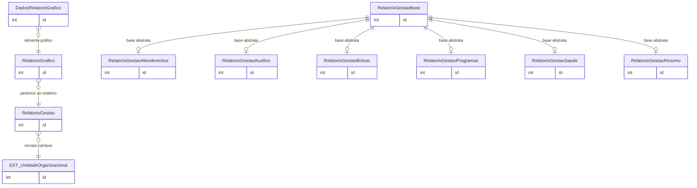

# Modelo de dados — Relatórios

Este recorte reúne a configuração de relatórios gerenciais, gráficos e as especializações de relatório oferecidas pelo módulo.

| Entidade | Descrição |
|---|---|
| `RelatorioGestao` | Configuração/raiz de relatório de gestão, com unidade e parâmetros. |
| `RelatorioGestaoBase` | Classe abstrata compartilhada pelas especializações de relatório. |
| `RelatorioGrafico` | Configuração de gráfico pertencente a um relatório. |
| `DadosRelatorioGrafico` | Dados persistidos para renderização de um gráfico. |
| `RelatorioGestaoAtendimentos` | Relatório especializado de atendimentos. |
| `RelatorioGestaoAuxilios` | Relatório especializado de auxílios. |
| `RelatorioGestaoBolsas` | Relatório especializado de bolsas. |
| `RelatorioGestaoProgramas` | Relatório especializado de programas. |
| `RelatorioGestaoSaude` | Relatório especializado de saúde. |
| `RelatorioGestaoResumo` | Relatório especializado de resumo gerencial. |

## Referências externas

| Entidade | App | Uso |
|---|---|---|
| `UnidadeOrganizacional` | `rh` | Escopo organizacional do relatório. |

_Gerado/atualizado via subagent `documentador` em 2026-09-09._
