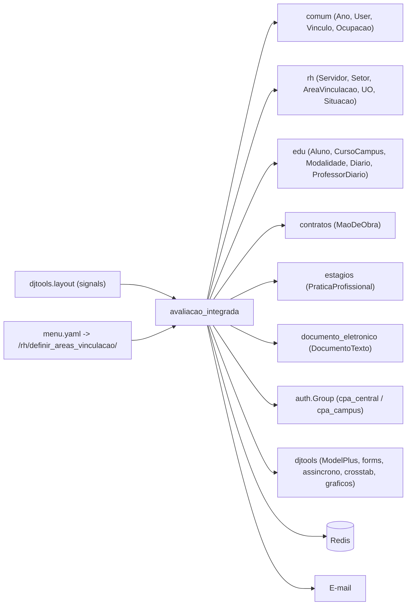

# Fronteiras — Avaliação Integrada

> Superfície do módulo: o que entra, o que sai e os contratos com o resto do SUAP.
> Complementa o [HLA.md](HLA.md) (§1 contexto, §5 integrações).

## Mapa

## Dependências de entrada (inbound)

`grep -rl "import avaliacao_integrada\|from avaliacao_integrada" . --include=*.py`, excluindo o próprio
módulo e `migrations/`, retorna **vazio**; `module_dependencies.json` também não lista este app como
dependência de ninguém.

| Módulo consumidor | O que consome | Acoplamento |
|---|---|---|
| — | — | `_N/A — folha`: nenhum app importa este |

O módulo **é alcançado**, porém, por três caminhos que não são `import`:

| Caminho | Como | Observação |
|---|---|---|
| `djtools.layout` (tela inicial e rodapé público) | Signals: `@layout.inscricao()` → quadro "Fique atento!"; `@layout.servicos_anonimos()` → "Serviços de Acesso Público › Avaliações" | O SUAP chama de volta as views `index_inscricoes` e `servicos_anonimos`; quebra de contrato aqui afeta a home de todos os usuários |
| `suap/urls.py` | Auto-discovery de `urls.py` sob `/avaliacao_integrada/` | Não há registro manual |
| `menu.yaml` | 12 entradas, 9 apontando para `/admin/avaliacao_integrada/...` | Duas apontam para o app `rh` — ver outbound |

## Dependências de saída (outbound)

`module_dependencies.json` declara: `comum`, `rh`, `edu`, `documento_eletronico`, `contenttypes`.
⚠️ REVISAR: **faltam `contratos` e `estagios`**, ambos importados em `models.py`
(`from contratos.models import MaoDeObra`, `from estagios.models import PraticaProfissional`) —
verificável por `python manage.py module_dependencies --check --all`.

| Depende de | O quê | Tipo |
|---|---|---|
| `comum` | `Ano` (FK em `Avaliacao`, M2M em `Indicador`), `User` (FK em `Respondente`, `CurrentUserField`), `Vinculo` (M2M em `ComissaoCPA`), `Ocupacao` (M2M em `Avaliacao`), `BusinessRuleFailure` | módulo interno (declarado) |
| `rh` | `AreaVinculacao` (M2M em `Avaliacao` e `Indicador`), `UnidadeOrganizacional` (FK/M2M), `Setor` (FK em `ComissaoCPA`), `Servidor` + `ServidorQueryset` e `Situacao` (público-alvo) | módulo interno (declarado) |
| `rh` (URLs) | `menu.yaml` publica `"/rh/definir_areas_vinculacao/"` e `"/rh/areas_vinculacao_setor/"` sob **Gestão de Pessoas**, gatilhadas pela permissão `avaliacao_integrada.change_eixo` | acoplamento por **URL + permissão cruzada**, sem import. Renomear a rota em `rh` quebra o menu deste módulo; e a permissão que libera as telas de RH é deste app |
| `edu` | `Modalidade` (M2M), `Aluno`/`Aluno.ativos`, `CursoCampus`, `Diario`, `Turma`, `ProfessorDiario`, `MatriculaPeriodo`, `MatriculaDiario`, `SituacaoMatricula`, `FormaIngresso` | módulo interno (declarado). `Iterador.objeto` guarda `'edu.CursoCampus'`, `'edu.Modalidade'`, `'edu.Professor'`, `'edu.Turma'` como **string** |
| `contratos` | `MaoDeObra` — prestadores de serviço e empresas prestadoras (público-alvo de sociedade civil) | módulo interno **não declarado** |
| `estagios` | `PraticaProfissional` — supervisores de estágio em andamento | módulo interno **não declarado** |
| `documento_eletronico` | `DocumentoTexto` (FK `ComissaoCPA.documento_portaria`) | módulo interno (declarado); import direto, **não** condicional a `INSTALLED_APPS` |
| `django.contrib.contenttypes` | `ContentType` + `GenericForeignKey` em `Resposta` | framework |
| `django.contrib.auth` | `Group` — **escrita** em `cpa_central`/`cpa_campus` | framework (efeito colateral) |
| `djtools` | `ModelPlus` e campos, `forms`/`FormPlus`/`ModelFormPlus`, `ReCaptchaField`, `TinyMCEFormField`, `ModelAdminPlus`/`TabularInlinePlus`, `assincrono.task`, `crosstab.TabelaBidimensional` + `XLSXCrosstabExporter`, `html.graficos` (Bar/Pie/StackedGroupedColumn), `layout`, `utils` (`rtr`, `httprr`, `permission_required`, `send_mail`, `retira_acentos`, `JsonResponse`), `middleware.threadlocals` | framework SUAP |
| Redis | `django.core.cache.get_or_set` (TTL 1 h / 24 h) e `@cache_page(1800)` | infraestrutura |
| SMTP | `djtools.utils.send_mail` | infraestrutura |
| reCAPTCHA | `ReCaptchaField` no formulário público | serviço externo |
| `numpy`, `xlsxwriter` | medidas-resumo e geração de XLSX | bibliotecas |

## Contratos publicados

O que outros módulos (ou o próprio SUAP) podem acoplar a este — mude com cuidado:

- **Signals emitidos/ouvidos:**
  - *ouvidos:* `m2m_changed` em `ComissaoCPA.vinculos_membros.through` → `adiciona_ou_remover_membros_no_grupo`
    (registrado no fim de `models.py`, não há `signals.py`).
  - *conectados ao layout:* `@layout.inscricao()` (`views.index_inscricoes`) e
    `@layout.servicos_anonimos()` (`views.servicos_anonimos`) — o SUAP os invoca ao renderizar a tela
    inicial e o rodapé público. `servicos_anonimos` já trata `TransactionManagementError` para não
    derrubar o rodapé.
  - *não emite* signals próprios.
- **Escrita em dados de outro app:** `user.groups.add/remove` para `cpa_central` e `cpa_campus`. É o
  único efeito deste módulo fora do seu schema — e os grupos precisam existir previamente.
- **Models reusados por outros módulos:** nenhum (folha). Internamente, `Respondente` é o ponto de
  extensão natural: qualquer integração de "quem deve responder" passa por ele.
- **URLs públicas (sem autenticação)** — contrato com o mundo externo, não só com o SUAP:
  - `"/avaliacao_integrada/avaliacao_externa/<token>"` e `"/avaliacao_integrada/avaliacao_externa/<token>/<segmento_id>/"`;
  - `"/avaliacao_integrada/respondente_externo_check/"` (POST, JSON);
  - `"/avaliacao_integrada/remover_respostas_avaliacao/<token>/"`.
  O formato do token (`urlsafe_base64(json)` com `avaliacao_id` e, opcionalmente, `respondente_id` e
  `dados_usuario_externo`) é contrato de fato: links divulgados externamente continuam válidos
  enquanto a avaliação estiver vigente. ⚠️ REVISAR: token **sem assinatura nem expiração** — ver
  [HLA §7](HLA.md#7-riscos-e-débito-técnico).
- **Permissões publicadas:** 10 permissões customizadas em `Avaliacao.Meta` + `pode_replicar_indicador`
  em `Indicador.Meta`, e os três grupos de `permissions.yaml`. `avaliacao_integrada.change_eixo` é
  usada **fora** do módulo, como gate das duas telas de `rh` no menu — um acoplamento pouco óbvio.
- **Tasks das quais outros dependem:** nenhuma externamente; as três tasks são disparadas apenas pelas
  views deste módulo.
- **Constantes que funcionam como contrato de dados:** as PKs de `Segmento` (1..14) e de
  `TipoAvaliacao.AVALIACAO_PLANEJAMENTO_PDI` (10), `EscalaLikert.ESCALA_PADRAO` (5) e os códigos de
  cargo ETEP (`701079`, `701058`, `701060`) estão fixos no código e precisam existir na base com
  esses mesmos ids. Cargas iniciais e migrações de dados dos commands assumem isso.
- **Templates/JS públicos:** `avaliacao_integrada/templates/*.html` (9) e
  `static/avaliacao_integrada/js/*.js` (4) são usados apenas por este módulo; as views sem template
  próprio (`avaliacao_enviar_email`, `relatorio_xlsx`) caem no `djtools/templates/default.html` por
  fallback do `@rtr()`.

---
_Gerado/atualizado via subagent `documentador` em 2026-08-05._
