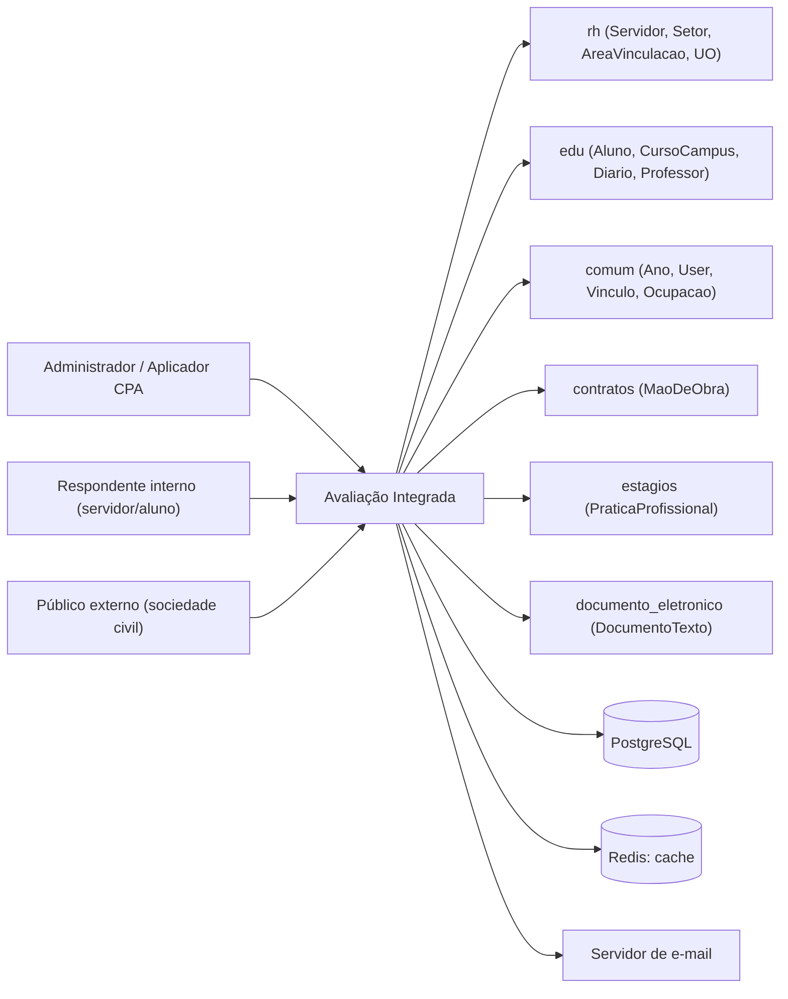
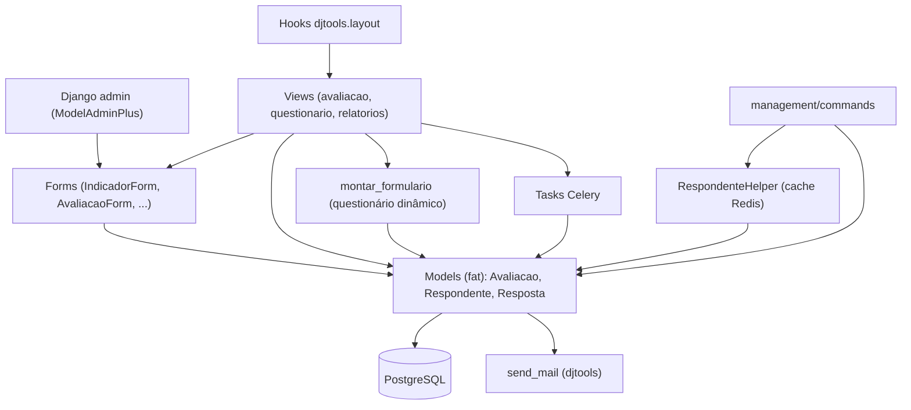
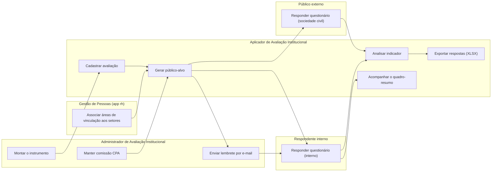

# HLA — Avaliação Integrada

> High Level Architecture. Complementa o [README.md](README.md). Foco em contexto, blocos, fluxo e riscos. Baseado em arc42 (enxuto) + C4 + Mermaid.

## 1. Contexto e escopo

O módulo é operado pela CPA/Desenvolvimento Institucional (administradores e aplicadores), respondido
por servidores e estudantes autenticados no SUAP e, no caso das avaliações com segmento de Sociedade
Civil, por pessoas **sem conta** que chegam por um link público tokenizado. Ele não possui cadastro
próprio de pessoas: lê `rh` (servidores, setores, áreas de vinculação, campi), `edu` (alunos, cursos,
diários, professores), `contratos` (mão de obra terceirizada e empresas) e `estagios` (supervisores)
para montar o público-alvo, e `documento_eletronico` para anexar a portaria da comissão.

> Atores definidos em [README.md → Atores e papéis](README.md#atores-e-papéis).

## 2. Estratégia de solução

| Decisão | Escolha | Motivo |
|---|---|---|
| Persistência | `ModelPlus` / PostgreSQL, `models.py` único | Módulo nasceu pequeno e cresceu no mesmo arquivo; nenhum particionamento em pacote foi feito |
| Interface de gestão | Django admin (`ModelAdminPlus`) | 9 das 12 entradas de `menu.yaml` apontam para `/admin/`; só as telas de avaliação, questionário e relatórios têm view própria |
| Regras de negócio | Fat models | Público-alvo, seleção de indicadores, percentuais, tokens e e-mails vivem em `Avaliacao`, `Respondente` e `Resposta` |
| Questionário | Formulário dinâmico construído em runtime (`views.montar_formulario` + `Indicador.get_form_field`) | O conjunto de perguntas varia por respondente; não há model de "formulário montado" — a identidade do campo é a string `indicador::respondente::variavel::content_type::object` |
| Repetição de perguntas por objeto | `Iterador` + `GenericForeignKey` em `Resposta` | Permite a mesma pergunta valer para cada curso/modalidade/professor/turma do respondente sem duplicar o `Indicador` |
| Público externo | Token `urlsafe_base64(json)` na URL + reCAPTCHA, sem login | Requisito de negócio: pais, egressos e empresas não têm conta no SUAP |
| Processamento pesado | Celery via `djtools.assincrono.task` (geração de público-alvo e XLSX); `method='thread'` no crosstab | Geração de público-alvo percorre toda a instituição; o crosstab carrega objetos não serializáveis |
| Desempenho de leitura | `@cache_page` (30 min) no quadro-resumo e cache Redis no `RespondenteHelper` | O quadro-resumo cruza campus × segmento sobre todos os respondentes |

## 3. Blocos de construção (componentes internos)

| Componente | Responsabilidade |
|---|---|
| Django admin + `forms.py` | Manutenção do instrumento, das avaliações e das comissões. `SegmentacaoForm` divide o M2M `segmentos` em três caixas (servidores / alunos / sociedade civil) e o `SegmentoSaveMixin` as recombina no `save_model` |
| `views.py` | Tela da avaliação (público-alvo, ações, filtros), questionário interno e externo, relatórios e exportações. Também expõe os dois hooks de layout do SUAP |
| `montar_formulario` | Núcleo do questionário: resolve indicadores aplicáveis, expande por objeto iterável, agrupa em objeto → eixo → dimensão → macroprocesso, injeta respostas anteriores como `initial` e persiste via `Resposta.processar` |
| Models (fat) | `Avaliacao` (público-alvo, token, e-mails), `Respondente` (indicadores aplicáveis, percentuais, dados do usuário externo), `Resposta` (parse do identificador, persistência atômica), `ComissaoCPA` (unicidade + grupos) |
| `tasks.py` | Reprocessamento do público-alvo e geração de XLSX |
| `RespondenteHelper` | Reimplementação cacheada (Redis + cache local de processo) de `get_indicadores`/percentual, usada **apenas** pelo command `recalcular_percentual_respondentes` |
| `management/commands` | Cargas, migrações de dados e correções pontuais — ver [README](README.md#commands) |

Modelo de dados (ERD): ver [modelo-de-dados/](modelo-de-dados/).

## 4. Fluxos principais

| Fluxo | Ator | Gatilho | Doc |
|---|---|---|---|
| Gerar público-alvo | Aplicador / Administrador | `GET /avaliacao_integrada/avaliacao/<pk>/?identificar_respondentes` | [fluxos/gerar-publico-alvo.md](fluxos/gerar-publico-alvo.md) |
| Responder questionário (público interno) | Respondente | `GET/POST /avaliacao_integrada/questionario/<pk>/` | [fluxos/responder-questionario-interno.md](fluxos/responder-questionario-interno.md) |
| Responder questionário (sociedade civil) | Público externo | `GET /avaliacao_integrada/avaliacao_externa/<token>` | [fluxos/responder-questionario-externo.md](fluxos/responder-questionario-externo.md) |
| Montar o instrumento | Administrador | Admin de Eixo → Dimensão → Macroprocesso → Indicador | [fluxos/montar-instrumento.md](fluxos/montar-instrumento.md) |
| Cadastrar avaliação | Aplicador / Administrador | `POST /admin/avaliacao_integrada/avaliacao/add/` | [fluxos/cadastrar-avaliacao.md](fluxos/cadastrar-avaliacao.md) |
| Enviar lembrete por e-mail | Administrador | `POST /avaliacao_integrada/avaliacao/<pk>/enviar-email/` | [fluxos/enviar-lembrete-email.md](fluxos/enviar-lembrete-email.md) |
| Analisar indicador | Aplicador / Visualizador | `GET /avaliacao_integrada/relatorio/` → `/relatorio/<pk>/<pk_avaliacao>/` | [fluxos/analisar-indicador.md](fluxos/analisar-indicador.md) |
| Acompanhar o quadro-resumo | Aplicador / Administrador | `GET /avaliacao_integrada/avaliacao/<pk>/quadro-resumo/<bloco>/` | [fluxos/acompanhar-quadro-resumo.md](fluxos/acompanhar-quadro-resumo.md) |
| Exportar respostas (XLSX) | Aplicador / Administrador | `GET /avaliacao_integrada/relatorio_xlsx/` | [fluxos/exportar-respostas-xlsx.md](fluxos/exportar-respostas-xlsx.md) |
| Manter comissão CPA | Administrador | Admin de `ComissaoCPA` | [fluxos/manter-comissao-cpa.md](fluxos/manter-comissao-cpa.md) |

### Mapa de fluxos (raias por ator)

`F0` não é um fluxo deste módulo: a view vive em `rh` ("/rh/definir_areas_vinculacao/"), mas o módulo
publica a entrada de menu e depende dela como pré-condição — ver [FRONTEIRA.md](FRONTEIRA.md).

## 5. Integrações

| Integração | Direção | Como | Onde |
|---|---|---|---|
| `rh` | out | Models reusados (`Servidor`, `Setor`, `AreaVinculacao`, `UnidadeOrganizacional`, `Situacao`) + M2M/FK | `models.py` (público-alvo, `Indicador.uos`, `ComissaoCPA.setor`) |
| `edu` | out | Models reusados (`Aluno`, `CursoCampus`, `Modalidade`, `Diario`, `ProfessorDiario`, `MatriculaPeriodo`) | `models.py` (público-alvo de alunos e pais, iteradores) |
| `comum` | out | `Ano`, `User`, `Vinculo`, `Ocupacao`, `BusinessRuleFailure` | `models.py`, `views.py` |
| `contratos` | out | `MaoDeObra` — prestadores e empresas prestadoras de serviço | `Avaliacao._obter_publicoalvo_sociedade_civil` |
| `estagios` | out | `PraticaProfissional` — supervisores de estágio em andamento | `Avaliacao._obter_publicoalvo_sociedade_civil` |
| `documento_eletronico` | out | FK `DocumentoTexto` (portaria da comissão) | `ComissaoCPA.documento_portaria` |
| `auth.Group` | out (escrita) | `Group.objects.get(name='cpa_central' \| 'cpa_campus')` + `user.groups.add/remove` | `ComissaoCPA.membros_atualizar_grupos_de_usuarios` (signal `m2m_changed`) |
| Redis | out | `cache.get_or_set` (TTL 1 h / 24 h) e `@cache_page(1800)` | `respondente_helper.py`, `views.avaliacao_quadro_resumo_bloco` |
| E-mail (SMTP) | out | `djtools.utils.send_mail` | `Avaliacao.enviar_emails` |
| reCAPTCHA | in | `djtools.forms.ReCaptchaField` | `AvaliacaoExternaForm` |
| Layout do SUAP | in | Signals de `djtools.layout` — `@layout.servicos_anonimos()` (rodapé público) e `@layout.inscricao()` (quadro "Fique atento!") | `views.servicos_anonimos`, `views.index_inscricoes` |

Mapa completo de fronteira (dependências inbound/outbound + contratos): ver [FRONTEIRA.md](FRONTEIRA.md).

## 6. Conceitos transversais

- **Transações:** `@transaction.atomic` em `Resposta.processar`, `Avaliacao._gerar_respondentes_segmento`
  e `ComissaoCPA.delete`; bloco `with transaction.atomic()` na limpeza que antecede a geração de
  respondentes (falha → `AvaliacaoDataCleanupError`) e na exclusão de respostas por token.
- **Locks / concorrência:** não há lock distribuído. A reentrância da geração de público-alvo é obtida
  por `get_or_create` + tratamento explícito de `MultipleObjectsReturned` (mantém o respondente mais
  antigo já finalizado e apaga os duplicados **com suas respostas**).
- **Storage:** nenhum `FileField`. Os XLSX são `NamedTemporaryFile` entregues por
  `task.finalize(..., file_path=...)`.
- **Permissões:** três grupos em `permissions.yaml` + 10 permissões customizadas em `Avaliacao.Meta`
  e 1 em `Indicador.Meta`. As views usam `@permission_required` do `djtools`; os métodos
  `Avaliacao.pode_*` repetem a checagem para o template, caindo no usuário do threadlocal quando
  nenhum é passado (`tl_get_user`). Papel relacional: ser `Respondente.user` basta para responder.
- **Anonimização:** a listagem de respondentes esconde nome e identificação de quem não tem
  `pode_ver_dados_identificaveis` (o template exibe "Anônimo"/"---").
- **Auditoria:** `criado_em`/`atualizado_em` + `CurrentUserField` (`cadastrado_por`) em `Avaliacao`,
  `Respondente` e `Resposta`. Não há `LogModel`.
- **Cache:** duas camadas independentes (Redis do `RespondenteHelper`, `@cache_page` do quadro-resumo)
  sem invalidação explícita — expiram por TTL.

## 7. Riscos e débito técnico

**Defeitos reproduzidos e medidos** (não corrigidos aqui):

- **Primeiro acesso do respondente externo sempre falha.** `views.py:387` chama
  `Respondente.get_or_create(...)` (classmethod de `ModelPlus`, que retorna `(obj, created)`) e
  **descarta o retorno**; `respondente` continua `None` e `views.py:517`
  (`finalizado = respondente.finalizado`) estoura `AttributeError`. O registro já foi criado, então o
  segundo acesso funciona — comportamento descrito como "falha conhecida do primeiro acesso" em
  [usuario.md](usuario.md).
- **`ZeroDivisionError` com público-alvo pequeno.** `models.py:1334` calcula
  `contador_respondentes % (total_respondentes // 100)`; com menos de 100 respondentes o divisor é 0 e
  a geração de público-alvo aborta. Afeta campi/segmentos pequenos e qualquer ambiente de teste.

**Defeitos inferidos do código (não executados):**

- `Avaliacao._obter_publicoalvo_alunos` chama `alunos.exlude(...)` (sem o "c") em três pontos
  (`models.py:1003`, `:1009`, `:1015`). O caminho só é alcançado quando `envolve_campus_ead`,
  `envolve_campus_produtivos` ou `envolve_campus_nao_produtivos` estão **desmarcados** — nesse caso a
  geração de público-alvo levanta `AttributeError`.
- `Avaliacao.enviar_emails` só retorna um número dentro do `if enviar_email:`. Chamado pelo lembrete
  manual fora das janelas de data (criação, `data_inicio`, ≈75% do prazo, véspera do término), ele
  retorna `None` e `views.py:1229` (`if enviados > 0`) levanta `TypeError`. Na mesma função,
  `hoje.replace(day=hoje.day + int(tempo_total * 0.75))` faz aritmética de dia sem normalizar o mês e
  levanta `ValueError: day is out of range` sempre que a soma passar do último dia do mês.
- `views.py:276` faz `return BusinessRuleFailure(...)` em vez de `raise` (o irmão em `:269` levanta
  corretamente). No caminho "excluir e identificar respondentes" com setores sem área, o usuário recebe
  erro 500 em vez da mensagem de negócio.
- **Indicador do tipo "Conjunto de Variáveis" não renderiza.** `Variavel.get_form_field`
  (`models.py:636`, `:639`) usa `label=self.aspecto`, mas `aspecto` só existe em `Indicador`
  (`models.py:314`) — `Variavel` tem `sigla`, `nome`, `tipo`, `valor_minimo`, `valor_maximo`. Como
  `Indicador.get_form_field` delega a esse método exatamente no ramo `CONJUNTO_VARIAVEIS`, montar um
  questionário com esse tipo levanta `AttributeError`. Explica por que `formula`/`Variavel` parecem
  funcionalidade morta.
- **Pré-visualização de terceiros sem checagem efetiva (IDOR).** `views.py:562` calcula
  `eh_previsualizacao = respondente.avaliacao.pode_visualizar_questionario_terceiros and request.user != respondente.user`
  — o método é referenciado **sem parênteses**, então o operando é o objeto-método (sempre verdadeiro)
  e a expressão vira apenas "não sou o dono". Consequências: qualquer usuário autenticado abre
  `/avaliacao_integrada/questionario/<pk>/` de outra pessoa, escapando também da verificação de prazo,
  e o POST subsequente grava respostas em nome do respondente daquele `pk`. A permissão
  `pode_visualizar_questionario_terceiros` não é exigida na prática.
- `views.escalalikert` exige `@permission_required('rh.view_escalalikert')`, mas `EscalaLikert` é model
  **deste** módulo e `rh` não tem model homônimo: a permissão não existe e a tela — apontada por
  `EscalaLikert.get_absolute_url()` — só abre para superusuário. `permissions.yaml` concede
  `avaliacao_integrada.view_escalalikert`.
- **`percentual_resposta` nunca é persistido no fluxo de resposta.** `Resposta.processar` chama
  `respondente.atualizar_percentual_resposta(commit=False)` e é o **único** chamador do método no
  código de runtime; o `save(update_fields=['finalizado', 'atualizado_em'])` grava apenas o
  `finalizado`. O campo é lido por `views.index_inscricoes` (ordenação e mensagem de 100%) e pelo bloco
  "Respondido 100% mas não enviados" do quadro-resumo, e só é atualizado pelo command
  `recalcular_percentual_respondentes`. ⚠️ REVISAR: [usuario.md](usuario.md) descreve a aba Resumo e a
  barra de percentual como se fossem atualizadas em tempo real — a divergência precisa de validação
  humana (pode haver recálculo agendado fora do repositório).

**Débito e riscos arquiteturais:**

- **Token não assinado.** `Avaliacao.gerar_token` é `urlsafe_base64_encode(json.dumps(dados))` — sem
  HMAC nem expiração. Quem forjar um token com `respondente_id` arbitrário aciona
  `remover_respostas_avaliacao` (apaga respostas de terceiros) e o fluxo de troca de segmento em
  `avaliacao_externa`, que exclui respondente e respostas. O reCAPTCHA protege apenas a identificação
  inicial.
- **`enviar_emails(criacao=True)` no fim de `gerar_respondentes`:** cada reprocessamento de
  público-alvo dispara e-mail para todo o público não finalizado, sem confirmação.
- **Dependências não declaradas:** `contratos` e `estagios` faltam em `module_dependencies.json`
  (verificável por `python manage.py module_dependencies --check --all`).
- **PKs de `Segmento` são constantes no código** (`Segmento.GESTOR = 3`, `ESTUDANTE = 7`, …) e o
  agrupamento em `SERVIDORES`/`ALUNOS`/`SOCIEDADE_CIVIL` é feito por essas listas. Um segmento criado
  pela tela não participa de nenhuma regra; renumerar registros quebra silenciosamente os filtros.
  `Segmento.LISTA_EMAIL` ainda repete `ALUNO_EGRESSO` (presente em `ALUNOS` e em `SOCIEDADE_CIVIL`).
- **Duas implementações da mesma regra:** `Respondente.get_indicadores` (runtime) e
  `RespondenteHelper.get_indicadores` (cacheada, usada só por um command) já divergem — a primeira só
  aplica o corte por `periodo_curso` do estudante **dentro** do `if avaliacao.modalidades.exists()`,
  enquanto a segunda o aplica incondicionalmente. Em avaliações sem modalidades, o percentual
  recalculado pelo command usa um denominador diferente do que o respondente viu na tela.
- **Regras de negócio embutidas em strings:** os indicadores autocalculados casam pela **denominação
  exata** (`Indicador.INDICADORES_AUTOCALCULADOS`), o segmento ETEP casa por códigos de cargo
  (`701079`, `701058`, `701060`) e por área com a palavra "ensino", e várias modalidades são excluídas
  por nome (`'FIC'`, `'Mestrado'`, …). Renomear um cadastro muda o comportamento sem erro.
- **`models.py` monolítico (2.397 linhas)** com métodos longos e `logger.debug` em profusão
  (vários dentro de `if logger.getEffectiveLevel() == logging.DEBUG` que executam `count()` extra).
- **Sem testes de regressão:** só 2 arquivos `.feature` (cadastros) e a suíte `tests/doc/` de captura
  de telas. Nenhum dos defeitos acima seria detectado pela suíte atual.
- `Indicador.filtrar_respondentes` é um stub (`pass`) sem chamador; `montar_formulario` declara retorno
  de 5 elementos e devolve 6; `Avaliacao.token` está marcado como campo em desuso desde 24/09/2024.

## 8. Glossário

Linguagem ubíqua, siglas e mapa entidade↔negócio: ver [GLOSSARIO.md](GLOSSARIO.md).

---
_Gerado/atualizado via subagent `documentador` em 2026-08-05._
