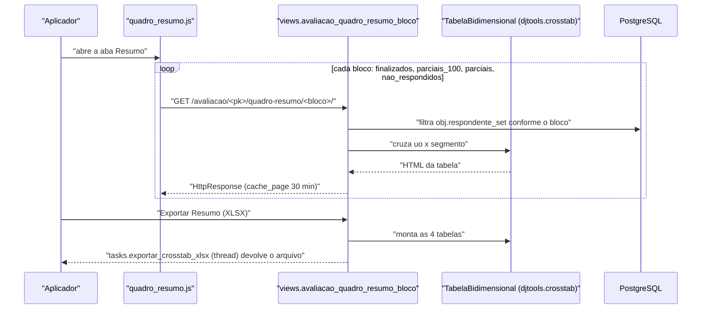

# Fluxo: Acompanhar o quadro-resumo

> Ver, durante a coleta, quantos respondentes já finalizaram, quantos estão parciais e quantos não começaram — cruzando campus × segmento.

- **Ator(es):** Aplicador ou Administrador de Avaliação Institucional (`pode_ver_quadro_resumo`) — ver [README → Atores e papéis](../README.md#atores-e-papéis)
- **Gatilho:** aba "Resumo" da tela da avaliação, que carrega cada bloco por `GET /avaliacao_integrada/avaliacao/<pk>/quadro-resumo/<bloco>/` (`static/avaliacao_integrada/js/quadro_resumo.js`)
- **Pré-condições:** público-alvo gerado
- **Pós-condições:** nenhuma escrita — fluxo somente de leitura
- **Depende de:** [Gerar público-alvo](gerar-publico-alvo.md), [Responder questionário (interno)](responder-questionario-interno.md)
- **Habilita:** [Enviar lembrete por e-mail](enviar-lembrete-email.md) (decisão de cobrar), [Exportar respostas (XLSX)](exportar-respostas-xlsx.md)
- **Entrada no código:** `views.avaliacao_quadro_resumo_bloco` (um bloco por requisição) e `views.quadro_resumo_xlsx` (os quatro blocos num arquivo)

## Sequência

## Observações

- **Os quatro blocos** (`views.avaliacao_quadro_resumo_bloco`):
  - `finalizados` → `finalizado=True`;
  - `parciais_100` → `finalizado=False, percentual_resposta=100` ("Respondido 100% mas não enviados");
  - `parciais` → `finalizado=False, resposta__isnull=False`;
  - `nao_respondidos` → `finalizado=False, resposta__isnull=True`.
  Qualquer outro valor de `<bloco>` → `Http404`.
- **Carga preguiçosa:** cada bloco é uma requisição própria, por isso a aba "vai se completando"; a
  resposta é cacheada por 30 minutos (`@cache_page(60 * 30)`), sem invalidação — números recém-mudados
  podem demorar a aparecer.
- O cruzamento é feito por `TabelaBidimensional` (`vertical_key='uo'`, `horizontal_key='segmento'`,
  incluindo a linha de `uo` nula — respondentes externos costumam não ter campus).
- **`parciais_100` depende do campo `percentual_resposta`,** que não é atualizado no fluxo de resposta
  (só pelo command `recalcular_percentual_respondentes`). Enquanto o recálculo não roda, esse bloco
  tende a subestimar — ver [HLA §7](../HLA.md#7-riscos-e-débito-técnico).
- A exportação usa a permissão **`pode_exportar_respostas`** (não `pode_ver_quadro_resumo`) e a task
  roda em thread, porque `TabelaBidimensional` não é serializável para a fila do Celery.

---
_Gerado/atualizado via subagent `documentador` em 2026-08-05._
