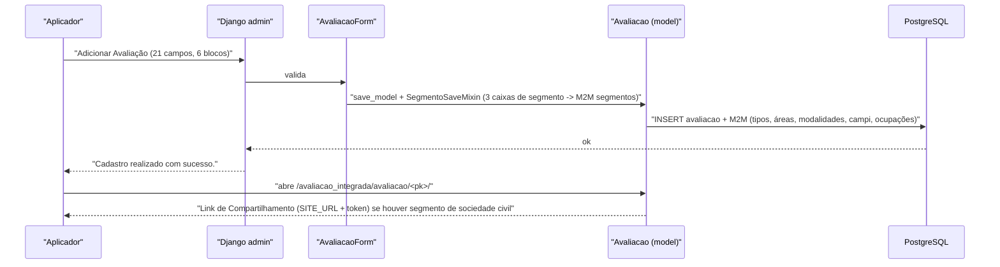

# Fluxo: Cadastrar avaliação

> Abrir um período de coleta: definir ano, prazo, públicos, recortes (áreas, campi, modalidades) e os textos de instrução que cada público lerá.

- **Ator(es):** Aplicador ou Administrador de Avaliação Institucional — ver [README → Atores e papéis](../README.md#atores-e-papéis)
- **Gatilho:** `POST /admin/avaliacao_integrada/avaliacao/add/` (menu Des. Institucional › Avaliação Integrada › Avaliações)
- **Pré-condições:** instrumento montado com indicadores marcados para o **ano de referência** e para os **tipos** da avaliação; `comum.Ano` cadastrado
- **Pós-condições:** `Avaliacao` criada, ainda **sem público-alvo**. Se algum segmento de Sociedade Civil foi marcado, a avaliação ganha link público e passa a aparecer no rodapé "Serviços de Acesso Público" enquanto estiver vigente
- **Depende de:** [Montar o instrumento](montar-instrumento.md)
- **Habilita:** [Gerar público-alvo](gerar-publico-alvo.md), [Responder questionário (sociedade civil)](responder-questionario-externo.md)
- **Entrada no código:** `admin.AvaliacaoAdmin` + `forms.AvaliacaoForm`; visualização em `views.avaliacao` (`/avaliacao_integrada/avaliacao/<pk>/`)

## Sequência

## Observações

- **Ano de referência** é o filtro mais restritivo: `Respondente.get_indicadores` só considera
  indicadores cujo M2M `anos_referencia` contenha o ano da avaliação.
- **Áreas de Vinculação vazias bloqueiam o público interno.** `Respondente.possui_area_vinculacao`
  retorna `False` quando `avaliacao.areas_vinculacao` está vazio, e `views.questionario` recusa a
  entrada com mensagem de erro. Marcar ao menos uma área é obrigatório na prática, embora o campo seja
  opcional no formulário.
- **Segmento de Sociedade Civil é o que cria a porta pública:**
  `Avaliacao.possui_segmento_sociedade_civil()` é consultado por `views.servicos_anonimos` (rodapé) e
  por `views.avaliacao_externa` (acesso ao link).
- **Modalidades dos cursos participantes** (`respondentes_pais_modalidades`) só valem para o segmento
  Pais/Responsável — definem de quais cursos vêm os alunos cujos responsáveis serão consultados.
  Valor inicial: Integrado, Integrado EJA e FIC Integrado EJA.
- **Ocupações do prestador** (`respondente_prestador_ocupacoes`) é um M2M para `comum.Ocupacao`
  descrito como recorte dos profissionais prestadores. ⚠️ REVISAR: o campo não é lido por
  `_obter_publicoalvo_sociedade_civil`, que filtra `MaoDeObra` apenas por desligamento nulo e CPF
  presente — o recorte por ocupação parece não estar implementado.
- **Prazo:** `data_inicio`/`data_termino` alimentam `Avaliacao.vigentes()` (link público e quadro
  "Fique atento!") e o bloqueio de resposta fora do prazo.
- Os três **textos de instrução** (servidores / alunos / sociedade civil) são campos TinyMCE e são
  escolhidos em runtime pelo segmento do respondente.

---
_Gerado/atualizado via subagent `documentador` em 2026-08-05._
