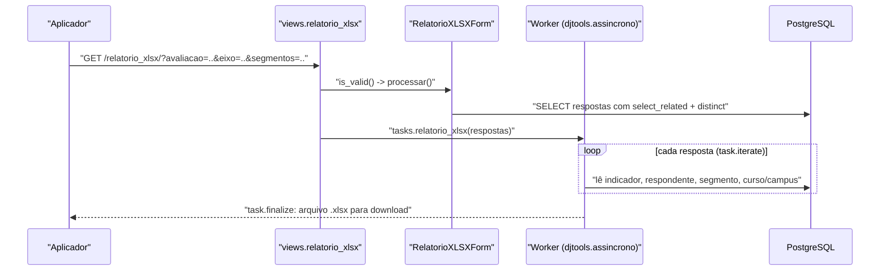

# Fluxo: Exportar respostas (XLSX)

> Levar as respostas para uma planilha, uma linha por resposta, com o recorte escolhido nos filtros.

- **Ator(es):** Aplicador ou Administrador de Avaliação Institucional (`pode_exportar_respostas`) — ver [README → Atores e papéis](../README.md#atores-e-papéis)
- **Gatilho:** botão "Exportar respostas para Excel" na tela de Relatórios → `GET /avaliacao_integrada/relatorio_xlsx/?<filtros>`
- **Pré-condições:** existirem respostas que satisfaçam os filtros
- **Pós-condições:** arquivo `.xlsx` gerado em área temporária e entregue pelo mecanismo de tarefas do SUAP; nenhuma escrita de domínio
- **Depende de:** [Analisar indicador](analisar-indicador.md) (é de onde se chega ao formulário) e, na origem dos dados, os fluxos de resposta
- **Habilita:** _nenhum_ — é uma saída terminal
- **Entrada no código:** `views.relatorio_xlsx` + `forms.RelatorioXLSXForm.processar` → `tasks.relatorio_xlsx`

## Sequência

## Observações

- **Colunas:** `#`, Indicador (o `aspecto`), Subsídio p/ Avaliações, Modalidade, ID Respondente, Eixo,
  Dimensão, Macroprocesso, Segmento, Campus, Curso, Resposta. O respondente sai **pelo id**, não pelo
  nome — a exportação não revela identidade.
- **Múltipla escolha vira várias linhas:** o valor armazenado (`a::b::c`) é desmembrado, uma linha por
  item escolhido.
- **Filtros com semântica por segmento** (`RelatorioXLSXForm.processar`): área de vinculação só recorta
  respondentes de segmentos de servidores; campus recorta servidores e alunos; modalidade e curso
  recortam apenas alunos. Nos três casos, os demais segmentos são **preservados** por união de
  querysets (`exclude(...) | filter(...)`), o que evita que um filtro de servidor apague as respostas
  da sociedade civil.
- ⚠️ REVISAR: em `tasks.relatorio_xlsx`, o preenchimento das colunas Campus/Curso usa `if`/`if`/`elif`
  encadeados de forma assimétrica — alunos do segmento `ESTUDANTE` produzem uma célula a mais que os
  demais, o que pode deslocar as colunas Curso/Resposta nessas linhas.
- A geração é assíncrona (`@task('Relatório em XLSX')`), com progresso por `task.iterate`; o arquivo é
  um `NamedTemporaryFile` entregue por `task.finalize(..., file_path=...)`.
- Exportação **do quadro-resumo** é outro caminho, com a mesma permissão: ver
  [Acompanhar o quadro-resumo](acompanhar-quadro-resumo.md).

---
_Gerado/atualizado via subagent `documentador` em 2026-08-05._
