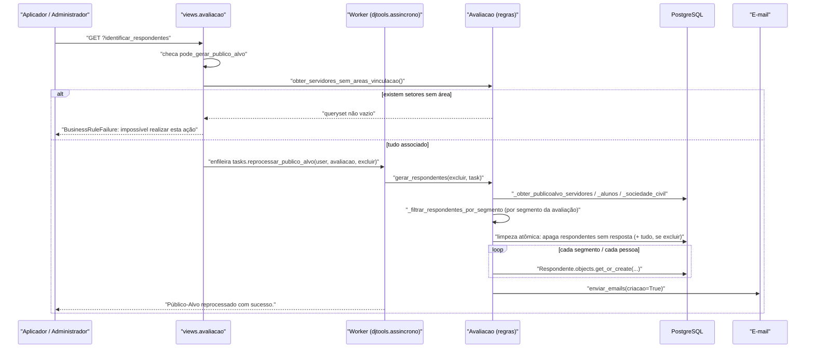

# Fluxo: Gerar público-alvo

> Percorrer a instituição aplicando os filtros da avaliação e materializar um `Respondente` para cada pessoa apta a responder.

- **Ator(es):** Aplicador (sem exclusão) ou Administrador (com exclusão) de Avaliação Institucional — ver [README → Atores e papéis](../README.md#atores-e-papéis)
- **Gatilho:** `GET /avaliacao_integrada/avaliacao/<pk>/?identificar_respondentes` (botão "Reprocessar Público-Alvo") ou `?excluir_e_identificar_respondentes` (botão "Reprocessar Público-Alvo e Respostas"); também pelo command `gerar_respondentes_avaliacao --gerar --avaliacao_id <id>`
- **Pré-condições:**
  - avaliação cadastrada com segmentos, ano e recortes;
  - **nenhum** servidor técnico ativo em setor sem área de vinculação — a associação é feita em `"/rh/definir_areas_vinculacao/"` (app `rh`, entrada de menu publicada por este módulo);
  - para os segmentos CPA, a comissão do tipo correspondente precisa estar ativa
- **Pós-condições:** `Respondente` criado por pessoa × segmento; respondentes **sem respostas** são apagados antes; com `excluir=True`, todas as respostas e respondentes anteriores são removidos. Ao final, e-mail de convite é enviado a todo o público não finalizado
- **Depende de:** [Cadastrar avaliação](cadastrar-avaliacao.md), [Manter comissão CPA](manter-comissao-cpa.md) (para os segmentos CPA) e a associação de áreas de vinculação em `rh`
- **Habilita:** [Responder questionário (interno)](responder-questionario-interno.md), [Responder questionário (sociedade civil)](responder-questionario-externo.md), [Enviar lembrete por e-mail](enviar-lembrete-email.md), [Acompanhar o quadro-resumo](acompanhar-quadro-resumo.md)
- **Entrada no código:** `views.avaliacao` → `tasks.reprocessar_publico_alvo` → `Avaliacao.gerar_respondentes`

## Sequência

## Observações

- **Quem entra, por segmento** (`_filtrar_respondentes_por_segmento`):
  - `GESTOR`: servidor ativo com função vigente (`servidorfuncaohistorico__data_fim_funcao__isnull=True`);
  - `DOCENTE`: `eh_docente=True`;
  - `TECNICO`: técnico administrativo, **exceto** os cargos ETEP em setor de área "ensino";
  - `ETEP`: cargos `701079`/`701058`/`701060` **em** setor de área "ensino";
  - `ESTUDANTE`: `Aluno.ativos` com `ano_letivo__ano <= ano da avaliação`;
  - `CPA_CENTRAL`/`CPA_CAMPUS`: membros (`vinculos_membros`) da comissão ativa do tipo equivalente;
  - Sociedade civil: pais de alunos cursando nas modalidades escolhidas; egressos concluintes dos
    últimos 2 anos; prestadores (`MaoDeObra` sem desligamento, com CPF); empresas (contrato vigente,
    PJ ativa); supervisores de estágio em andamento.
- Todo servidor é previamente filtrado por: ativo, docente **ou** técnico, e não `ATIVO_EM_OUTRO_ORGAO`
  nem `CEDIDO_REQUISITADO`; depois pelos campi (`uos`) e pelas flags de tipo de campus.
- **Idempotência parcial:** os respondentes são criados por `get_or_create` e os duplicados de execuções
  anteriores são consolidados no tratamento de `MultipleObjectsReturned` (mantém o mais antigo,
  preferindo os finalizados, e apaga os demais **com suas respostas**). Já o e-mail **não** é
  idempotente: cada reprocessamento chama `enviar_emails(criacao=True)`.
- A limpeza inicial é atômica; qualquer falha vira `AvaliacaoDataCleanupError` e aborta antes de gerar.
- O progresso é reportado via `task.start_progress` a cada 1% do total.
- ⚠️ Defeitos conhecidos deste fluxo (ver [HLA §7](../HLA.md#7-riscos-e-débito-técnico)):
  `ZeroDivisionError` quando o público tem menos de 100 pessoas (`models.py:1334`);
  `alunos.exlude(...)` (typo) quando alguma flag `envolve_campus_*` está desmarcada;
  `return BusinessRuleFailure(...)` em vez de `raise` no caminho "com exclusão" (`views.py:276`).

---
_Gerado/atualizado via subagent `documentador` em 2026-08-05._
