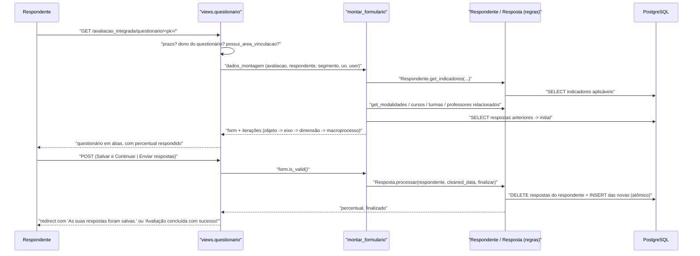

# Fluxo: Responder questionário (público interno)

> O servidor ou estudante identificado no público-alvo abre o questionário do seu perfil, salva parcialmente quantas vezes quiser e, ao completar, envia as respostas.

- **Ator(es):** Respondente (qualquer usuário que seja `Respondente.user`); em modo pré-visualização, quem tem `pode_visualizar_questionario_terceiros` — ver [README → Atores e papéis](../README.md#atores-e-papéis)
- **Gatilho:** clique no convite do quadro "Fique atento!" da tela inicial → `GET /avaliacao_integrada/questionario/<pk>/`; salvamento por `POST` na mesma URL
- **Pré-condições:** existir o `Respondente`; hoje ≤ `data_termino`; o setor do respondente casar com as áreas de vinculação da avaliação; haver ao menos um indicador aplicável
- **Pós-condições:** `Resposta` regravada para o respondente; com "Enviar respostas", `finalizado=True` (irreversível pela tela)
- **Depende de:** [Gerar público-alvo](gerar-publico-alvo.md)
- **Habilita:** [Analisar indicador](analisar-indicador.md), [Acompanhar o quadro-resumo](acompanhar-quadro-resumo.md)
- **Entrada no código:** `views.index_inscricoes` (convite) e `views.questionario` → `views.montar_formulario` → `Resposta.processar`

## Sequência

## Observações

- **Identidade do campo:** `Resposta.to_identificador` gera
  `indicador::respondente::variavel::content_type::object`; é o `name` do campo no formulário e o que
  permite `Resposta.processar` reconstruir os vínculos a partir do POST.
- **Persistência é destrutiva por design:** `Resposta.processar` apaga **todas** as respostas do
  respondente e recria a partir do POST, dentro de uma transação. Um POST parcial (formulário
  incompleto por erro de renderização) perderia o que não veio no corpo.
- **Agrupamento visual:** as perguntas são agrupadas por objeto (instituição = `None`, mais cada
  modalidade/curso/turma/professor do respondente) → eixo → dimensão → macroprocesso. Cada eixo vira
  uma aba, e `utils.atualizar_parametro_tab` avança a aba a cada "Salvar e Continuar".
- **Campos autocalculados** vêm preenchidos e `readonly` a partir dos métodos `Respondente.get_*`
  (unidade, modalidade e curso de vinculação, ano/forma de ingresso, série, cargo, função, regime,
  data de nascimento, ação afirmativa).
- **Pré-visualização de terceiros:** `views.questionario` calcula
  `eh_previsualizacao = respondente.avaliacao.pode_visualizar_questionario_terceiros and request.user != respondente.user`.
  ⚠️ REVISAR: o método **não é chamado** (falta `()`), então o valor é o objeto-método — sempre
  verdadeiro. Na prática, qualquer usuário autenticado que não seja o dono cai no ramo de
  pré-visualização e escapa da checagem de propriedade e de prazo. A permissão
  `pode_visualizar_questionario_terceiros` não é efetivamente exigida nesta view.
- Mensagens: abaixo de 100% mostra o progresso; a 100% sem envio, lembra do botão "Enviar respostas";
  após finalizar, exibe o agradecimento (`message_avaliacao_finalizada`).
- `percentual` exibido na tela é recalculado a cada montagem; o campo `percentual_resposta` do banco
  **não** é gravado neste fluxo — ver [HLA §7](../HLA.md#7-riscos-e-débito-técnico).

---
_Gerado/atualizado via subagent `documentador` em 2026-08-05._
