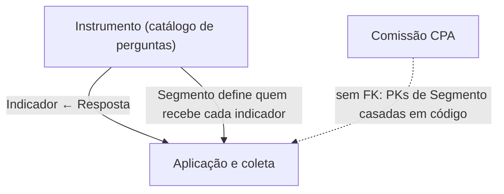

# Modelo de dados — Avaliação Integrada

> O módulo tem **15 models** num `models.py` único (não é pacote), acima do limiar de ≈12 para
> arquivo único. O modelo foi particionado por **subdomínio inferido** a partir de clusters de
> nome/relação e do agrupamento do `admin.py`/`menu.yaml`.
> ⚠️ REVISAR: o agrupamento é inferido — não há pacote `models/` que o comprove.
>
> Cada sub-área tem seu próprio ERD; este índice dá a visão macro e como as áreas se conectam.
> Termos: ver [GLOSSARIO.md](../GLOSSARIO.md).

## Subdomínios

| Subdomínio | Entidades principais | ERD |
|---|---|---|
| Instrumento | `Eixo`, `Dimensao`, `Macroprocesso`, `Indicador`, `Variavel`, `OpcaoResposta`, `Iterador`, `TipoAvaliacao`, `EscalaLikert`, `NivelEscalaLikert` (10) | [instrumento.md](instrumento.md) |
| Aplicação e coleta | `Avaliacao`, `Segmento`, `Respondente`, `Resposta` (4) | [aplicacao-e-coleta.md](aplicacao-e-coleta.md) |
| Comissão CPA | `ComissaoCPA` (1) | [comissao-cpa.md](comissao-cpa.md) |

Cobertura: 10 + 4 + 1 = **15 models**, cada um em exatamente um ERD.

## Como as áreas se conectam

- **Instrumento → Aplicação e coleta:** `Resposta.indicador` (FK) e `Resposta.variavel` (FK) são a
  única ligação por chave estrangeira. A seleção de quais indicadores um respondente vê é feita em
  consulta (`Respondente.get_indicadores`), cruzando os M2M do `Indicador` (segmentos, áreas de
  vinculação, modalidades, campi, anos de referência) com os dados da avaliação e do respondente.
- **`Segmento` é a chave da partição.** Ele é editado como cadastro do instrumento (`menu.yaml`
  › Cadastros › Segmentos), mas semanticamente pertence à coleta: define público-alvo, texto de
  instrução e porta de entrada. Foi alocado em *Aplicação e coleta* e aparece como entidade externa
  no ERD do instrumento.
- **Comissão CPA não tem FK para nenhuma das outras áreas.** O acoplamento é por **valor de PK
  casado em código**: `Avaliacao._filtrar_respondentes_por_segmento` traduz
  `Segmento.CPA_CENTRAL → ComissaoCPA.CPA_CENTRAL` e `Segmento.CPA_CAMPUS → ComissaoCPA.CPA_LOCAL`
  por um dicionário literal, e busca os membros da comissão ativa daquele tipo. É o contrato mais
  frágil do modelo — ver [HLA §7](../HLA.md#7-riscos-e-débito-técnico).

---
_Gerado/atualizado via subagent `documentador` em 2026-08-05._
