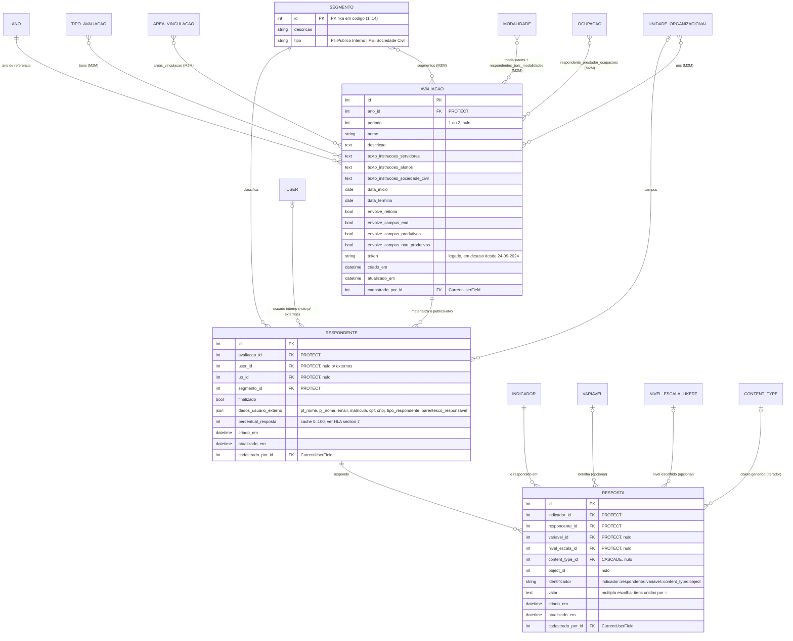

# Modelo de dados — Aplicação e coleta

> ERD das entidades que representam a aplicação do instrumento num período (`Avaliacao`), o público
> que deve respondê-la (`Segmento`, `Respondente`) e o que foi respondido (`Resposta`).
> Models herdam `ModelPlus` de `djtools.db`. FKs para entidades de outras áreas aparecem como
> **externas**. Termos: ver [GLOSSARIO.md](../GLOSSARIO.md).

## Entidades

| Entidade | Descrição | Relações-chave |
|---|---|---|
| `Avaliacao` | A aplicação do instrumento: ano/período, prazo, textos de instrução por público e todos os recortes do público-alvo. Concentra 10 permissões customizadas (`pode_gerar_publico_alvo`, `pode_ver_relatorios`, `pode_ver_dados_identificaveis`, …) e os métodos de geração de público-alvo, token e e-mail | FK `Ano`; M2M `TipoAvaliacao`, `Segmento`, `AreaVinculacao`, `Modalidade` (duas vezes: escopo geral e modalidades dos filhos, para o segmento Pais), `UnidadeOrganizacional`, `Ocupacao` |
| `Segmento` | Público respondente. As 14 PKs são constantes de classe e os agrupamentos (`SERVIDORES`, `ALUNOS`, `SOCIEDADE_CIVIL`, `LISTA_EMAIL`) são listas dessas constantes: **o comportamento não é derivado do banco** | ← `Respondente`, ← `Iterador`; M2M com `Avaliacao` e `Indicador` |
| `Respondente` | Par pessoa × avaliação × segmento. Para o público interno há `user` e `uo`; para o externo, os dados ficam no JSON `dados_usuario_externo` (e `user` é nulo). Guarda o estado de conclusão (`finalizado`) e o cache do percentual | FK `Avaliacao`, `User`, `UnidadeOrganizacional`, `Segmento`; ← `Resposta` |
| `Resposta` | Um valor respondido. A identidade lógica é a string `identificador`, que codifica indicador, respondente, variável, content type e id do objeto — é ela que amarra o campo do formulário ao registro | FK `Indicador`, `Respondente`, `Variavel`, `NivelEscalaLikert`; `GenericForeignKey` (`content_type` + `object_id`) |

## Observações do modelo

- **Sem unicidade declarada.** Não há `unique_together`/`UniqueConstraint` em `Respondente` nem em
  `Resposta`. A unicidade do respondente é obtida em runtime pelo `get_or_create` de
  `_gerar_respondentes_segmento` (chaves: avaliação + user + uo + segmento), com tratamento explícito
  de `MultipleObjectsReturned`. A de `Resposta` é obtida por `delete()` + recriação a cada
  `Resposta.processar`.
- **`dados_usuario_externo` é o "cadastro" do público externo.** É por dentro desse JSON que
  `Avaliacao.obter_respondentes`/`obter_respondentes_sociedade_civil` procuram matrícula, CPF, CNPJ e
  e-mail (`dados_usuario_externo__cpf`, `…__email`, …). Não há índice declarado sobre essas chaves.
- **`PROTECT` em toda parte.** `Resposta` protege `Indicador` e `Respondente`; `Respondente` protege
  `Avaliacao`, `User`, `UnidadeOrganizacional` e `Segmento`. Excluir qualquer um desses exige apagar
  antes as respostas — o que a geração "com exclusão" faz explicitamente.
- **`GenericForeignKey`** é o que permite a mesma pergunta ter uma resposta por curso, modalidade,
  professor ou turma (ver `Iterador` em [instrumento.md](instrumento.md)); quando a pergunta é da
  instituição, `content_type` e `object_id` ficam nulos.

## Entidades externas referenciadas

| Entidade | Módulo/área de origem |
|---|---|
| `Indicador`, `Variavel`, `NivelEscalaLikert`, `TipoAvaliacao` | Este módulo, subdomínio [Instrumento](instrumento.md) |
| `Ano`, `User`, `Ocupacao` | `comum` |
| `AreaVinculacao`, `UnidadeOrganizacional` | `rh` |
| `Modalidade` | `edu` |
| `ContentType` | `django.contrib.contenttypes` |

Além dos vínculos por FK, o público-alvo é **lido** (sem relação persistida) de `rh.Servidor`,
`edu.Aluno`/`MatriculaPeriodo`, `contratos.MaoDeObra` e `estagios.PraticaProfissional` — ver
[FRONTEIRA.md](../FRONTEIRA.md).

---
_Gerado/atualizado via subagent `documentador` em 2026-08-05._
