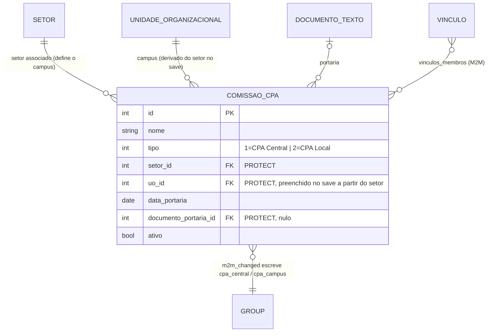

# Modelo de dados — Comissão CPA

> ERD da governança da avaliação: a Comissão Própria de Avaliação, central ou de campus.
> Model herda `ModelPlus` de `djtools.db`. FKs para entidades de outras áreas aparecem como
> **externas**. Termos: ver [GLOSSARIO.md](../GLOSSARIO.md).



## Entidades

| Entidade | Descrição | Relações-chave |
|---|---|---|
| `ComissaoCPA` | Comissão Própria de Avaliação designada por portaria, central (uma na instituição) ou local (uma por campus). `UniqueConstraint('tipo', 'ativo', 'uo')` com `condition=Q(ativo=True)` + `clean()` garantem uma única comissão ativa por tipo/campus. `save()` deriva `uo` de `setor.uo`; `delete()` é atômico e desfaz os grupos antes de apagar | FK `rh.Setor`, `rh.UnidadeOrganizacional`, `documento_eletronico.DocumentoTexto`; M2M `comum.Vinculo` |

## Efeito colateral: grupos de usuário

`ComissaoCPA.membros_atualizar_grupos_de_usuarios` é chamada pelo receiver `m2m_changed` registrado em
`vinculos_membros.through` (e por `delete()`):

- `post_add` com comissão **ativa** → adiciona o usuário ao grupo `cpa_central` (tipo Central) ou
  `cpa_campus` (tipo Local);
- `post_remove`, ou `post_add` com comissão **inativa** → remove o usuário do grupo, **exceto** se ele
  ainda pertencer a outra comissão ativa do mesmo tipo.

Os grupos precisam existir: `Group.objects.get(name=...)` levanta `DoesNotExist` se a base não
estiver semeada. Consequência de negócio: a participação na comissão é o que torna a pessoa
público-alvo dos segmentos `CPA Central`/`CPA Campus`.

## Acoplamento com a coleta (sem FK)

Não há chave estrangeira entre `ComissaoCPA` e `Avaliacao`/`Respondente`. A ligação é feita por
**valor de PK casado em código**, em `Avaliacao._filtrar_respondentes_por_segmento`:

```
{Segmento.CPA_CENTRAL: ComissaoCPA.CPA_CENTRAL, Segmento.CPA_CAMPUS: ComissaoCPA.CPA_LOCAL}
```

A partir daí, os membros da comissão ativa daquele tipo entram no público-alvo via
`Respondente.obter_dados_publico_alvo(..., qs=comissaocpa_qs)`, que anota os campos a partir de
`vinculos_membros`. ⚠️ REVISAR: renumerar `Segmento` ou os `TIPO_CHOICES` da comissão quebra esse
mapeamento silenciosamente.

## Entidades externas referenciadas

| Entidade | Módulo/área de origem |
|---|---|
| `Setor`, `UnidadeOrganizacional` | `rh` |
| `Vinculo`, `User` | `comum` |
| `DocumentoTexto` | `documento_eletronico` |
| `Group` | `django.contrib.auth` (escrita) |
| `Segmento` | Este módulo, subdomínio [Aplicação e coleta](aplicacao-e-coleta.md) — sem FK |

---
_Gerado/atualizado via subagent `documentador` em 2026-08-05._
