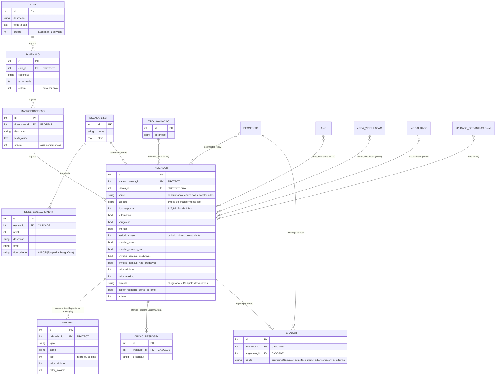

# Modelo de dados — Instrumento

> ERD das entidades do catálogo de perguntas: a árvore eixo → dimensão → macroprocesso → indicador
> e seus acessórios (variáveis, opções, iteradores, escalas Likert, tipos de avaliação).
> Models herdam `ModelPlus` de `djtools.db`. FKs para entidades de outras áreas aparecem como
> **externas**. Termos: ver [GLOSSARIO.md](../GLOSSARIO.md).

## Entidades

| Entidade | Descrição | Relações-chave |
|---|---|---|
| `Eixo` | Primeiro nível do instrumento; vira uma aba no questionário. `ordem` é atribuída automaticamente no `save()` quando vazia, e reordenada em bloco por `EixoForm.save` | ← `Dimensao` |
| `Dimensao` | Segundo nível | FK `Eixo` (PROTECT) |
| `Macroprocesso` | Terceiro nível; é o título sob o qual os indicadores aparecem | FK `Dimensao` (PROTECT) |
| `Indicador` | A pergunta. Concentra os filtros de aplicabilidade (segmentos, áreas, modalidades, campi, tipo de campus, período mínimo, anos de referência) e o tipo de resposta. `get_form_field()` constrói o campo Django correspondente, incluindo o comportamento especial dos autocalculados | FK `Macroprocesso`, FK `EscalaLikert`; M2M `TipoAvaliacao`, `Ano`, `Segmento`, `AreaVinculacao`, `Modalidade`, `UnidadeOrganizacional` |
| `Variavel` | Sub-campo numérico de um indicador do tipo "Conjunto de Variáveis"; a combinação é dada pela `formula` do indicador. ⚠️ REVISAR: `Variavel.get_form_field` referencia `self.aspecto`, campo que só existe em `Indicador` — na prática o tipo não renderiza (ver [HLA §7](../HLA.md#7-riscos-e-débito-técnico)) | FK `Indicador` (PROTECT) |
| `OpcaoResposta` | Alternativa dos tipos escolha única/múltipla | FK `Indicador` (CASCADE) |
| `Iterador` | Declara que, para determinado segmento, o indicador deve ser repetido para cada objeto de `edu` (curso, modalidade, professor ou turma) do respondente. `objeto` guarda o label do model como string | FK `Indicador` (CASCADE), FK `Segmento` (CASCADE) |
| `EscalaLikert` | Régua de resposta reutilizável. `em_uso()` indica se algum indicador a referencia; PK 5 é tratada como escala padrão (`ESCALA_PADRAO`) | ← `NivelEscalaLikert`; ← `Indicador` |
| `NivelEscalaLikert` | Nível da régua. `tipo_criterio` classifica o nível para padronizar gráficos e excluir "Desconheço"/"Não se aplica" das medidas-resumo | FK `EscalaLikert` (CASCADE); ← `Resposta.nivel_escala` |
| `TipoAvaliacao` | Finalidade a que o indicador serve e de que a avaliação é feita. PK 10 = `AVALIACAO_PLANEJAMENTO_PDI`, usada como valor inicial no formulário | M2M com `Indicador` (`subsidio_para`) e com `Avaliacao` (`tipos`) |

**Ordenação:** `Indicador.Meta.ordering` percorre a árvore inteira
(`macroprocesso__dimensao__eixo__ordem`, `…dimensao__ordem`, `macroprocesso__ordem`, `ordem`) — é o
que garante que o questionário e os relatórios saiam na sequência cadastrada.

## Entidades externas referenciadas

| Entidade | Módulo/área de origem |
|---|---|
| `Segmento` | Este módulo, subdomínio [Aplicação e coleta](aplicacao-e-coleta.md) |
| `Ano` | `comum` |
| `AreaVinculacao`, `UnidadeOrganizacional` | `rh` |
| `Modalidade`, `CursoCampus`, `Turma`, `Professor` | `edu` (as três últimas apenas como **string** em `Iterador.objeto` — não há FK) |

---
_Gerado/atualizado via subagent `documentador` em 2026-08-05._
