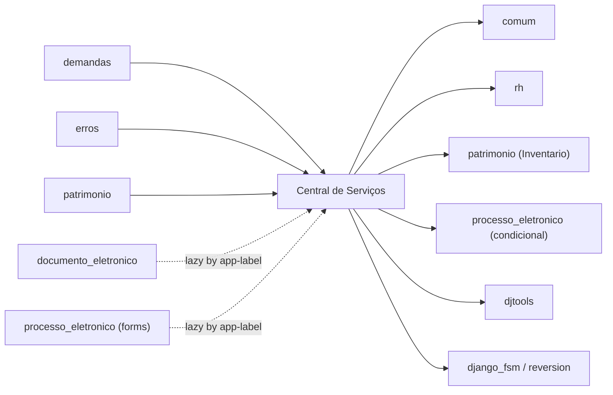

# Fronteiras — Central de Serviços

> Superfície do módulo: o que entra, o que sai e os contratos com o resto do SUAP.
> Complementa o [HLA.md](HLA.md) (§1 contexto, §5 integrações).

## Mapa

## Dependências de entrada (inbound)

Módulos que importam/usam este (`grep "from centralservicos" / "import centralservicos"`,
excluindo o próprio módulo e `migrations/`; registro do app em `settings_base.py` e listas
de config em `djtools`/`comum` foram excluídos por não serem consumidores de domínio).

| Módulo consumidor | O que consome | Acoplamento |
|---|---|---|
| `demandas` | `Chamado`, `GrupoAtendimento`, `AtendimentoAtribuicao`, `StatusChamado` (painéis do desenvolvedor; `Chamado.get_chamados_do_suporte`, `ATRIBUIDOS_A_OUTROS`) | Forte — import direto de models (`demandas/forms.py`, `demandas/views.py`); parte condicional/lazy |
| `patrimonio` | `Chamado` (chamados por patrimônio) | Forte — import direto (`patrimonio/views.py`) |
| `erros` | `Chamado` (reportar erro a partir do chamado); grupo `centralservicos Administrador` no admin | Médio — import lazy condicional (`erros/views.py`); acoplamento por nome de grupo |
| `documento_eletronico` | `BaseConhecimento` via `apps.get_model('centralservicos','BaseConhecimento')` (permissão de acesso a documento) | Fraco — lazy, condicional (`in INSTALLED_APPS`) |
| `processo_eletronico` | `BaseConhecimento` via `apps.get_model(...)` | Fraco — lazy, condicional |
| `gerenciador_projetos` | grupo `centralservicos Administrador` (`has_group_cached`) no admin | Fraco — acoplamento por nome de grupo |
| `comum` (`sync_suap`) | agenda o command `centralservicos_notificacoes_diarias` | Fraco — orquestração de jobs, condicional (`in installed_apps`) |

## Dependências de saída (outbound)

Confirmadas contra `module_dependencies.json` (`comum`, `rh`, `patrimonio`).

| Depende de | O quê | Tipo |
|---|---|---|
| `comum` | `User`, `AreaAtuacao`, `Publico`, `Comentario`, `Configuracao` | módulo interno |
| `rh` | `UnidadeOrganizacional` (campus) | módulo interno |
| `patrimonio` | `Inventario` (FK `patrimonio` do chamado) | módulo interno |
| `djtools` | `ModelPlus`, `ModelAdminPlus`, forms/widgets, `layout`, `send_notification`, `generate_pdf`, `BaseCommandPlus`, storages | framework SUAP |
| `beat` | agendamento de commands (`load_tasks_schedule`) | framework SUAP |
| `django_fsm` | `FSMIntegerField` + `@transition` no `Chamado` | biblioteca (máquina de estados) |
| `django-reversion` | versionamento da Base de Conhecimento (`create_revision`, `CompareVersionAdminPlus`) | biblioteca |
| `processo_eletronico` | `CriarProcessoComTramiteForm`; `add_processo` | integração condicional (`in INSTALLED_APPS`) |
| `erros` | reportar erro a partir do chamado | integração condicional (`in INSTALLED_APPS`) |

## Contratos publicados

O que outros módulos podem acoplar a este (mude com cuidado):

- **Signals emitidos/ouvidos:** internos ao módulo — `post_save`/`post_delete` de
  `GestorAreaServico` (sincroniza grupo `Gestor da Central de Serviços`) e `m2m_changed` de
  `GrupoAtendimento.atendentes`/`responsaveis` (sincroniza grupo `Atendente da Central de
  Serviços`). Não são consumidos por outros apps.
- **Models reusados por outros módulos:** `Chamado` (demandas, patrimonio, erros),
  `GrupoAtendimento` e `AtendimentoAtribuicao` (demandas), `StatusChamado` (demandas),
  `BaseConhecimento` (documento_eletronico, processo_eletronico — via app-label).
- **Funções / services públicos:** `Chamado.get_chamados_do_suporte(user, **kwargs)` e as
  constantes de atribuição (`ATRIBUIDOS_A_MIM`, `ATRIBUIDOS_A_OUTROS`, ...) são consumidas por
  `demandas`; `Chamado.get_chamados_por_patrimonio(patrimonios)` por `patrimonio`; `StatusChamado`
  como vocabulário de situações.
- **Tasks/agendamento que outros dependem:** `centralservicos_notificacoes_diarias` é
  agendado por `comum.sync_suap`; `centralservicos_verifica_sla_estourado` e
  `_notificacoes_diarias` são registrados em `beat.py`.
- **Grupos como contrato implícito:** o nome do grupo `centralservicos Administrador` é
  referenciado por `erros` e `gerenciador_projetos`; `Gestor`/`Atendente da Central de
  Serviços` são gerenciados por signals — renomeá-los quebra consumidores externos.
- > ⚠️ REVISAR: acoplamento por **nome de grupo** (`centralservicos Administrador`,
  > `Atendente/Gestor da Central de Serviços`) é um contrato implícito não tipado — alterações
  > nesses nomes exigem busca em todo o repositório, não só neste módulo.

---
_Gerado/atualizado via subagent `documentador` em 2026-06-08._
