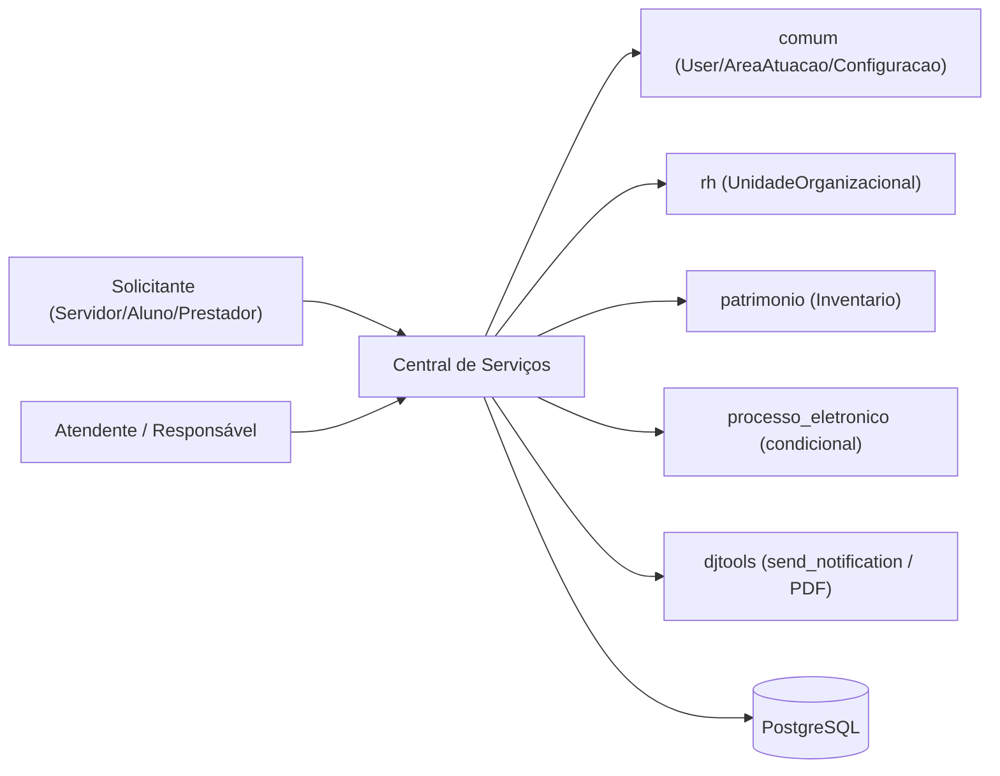
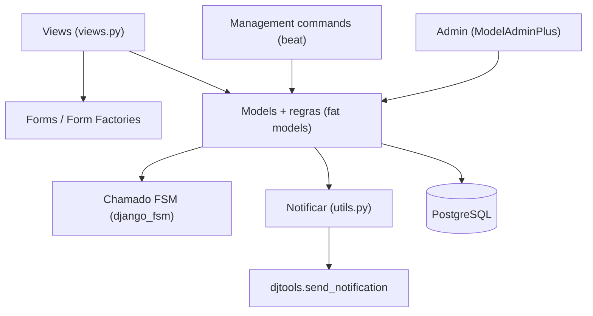
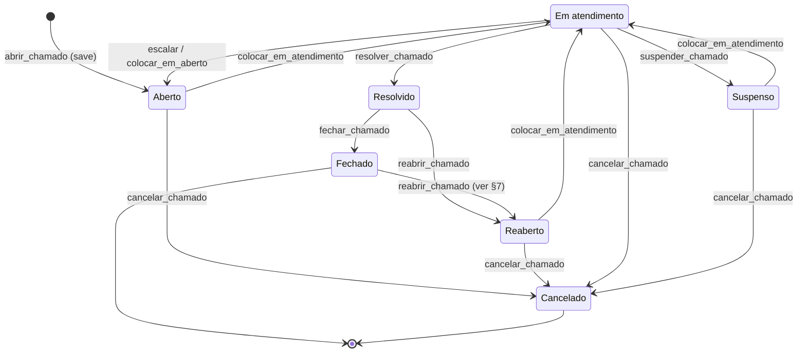
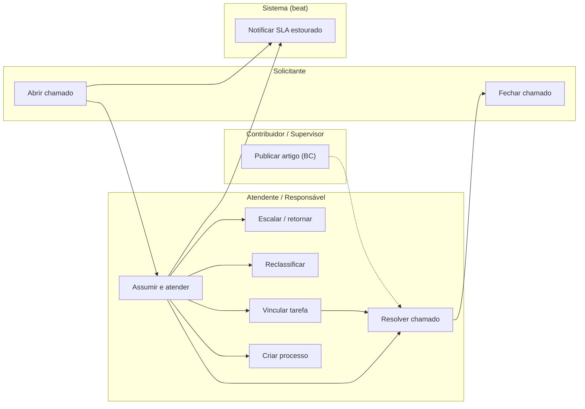

# HLA — Central de Serviços

> High Level Architecture. Complementa o [README.md](README.md). Foco em contexto, blocos, fluxo e riscos. Baseado em arc42 (enxuto) + C4 + Mermaid.

## 1. Contexto e escopo

A Central de Serviços é o service desk do SUAP. Solicitantes (servidores, alunos,
prestadores) abrem chamados; atendentes e responsáveis por grupos de atendimento os
atendem. O módulo lê pessoas/vínculos de `comum`/`rh`, campi de `rh`, bens de
`patrimonio`, e integra-se opcionalmente a `processo_eletronico` (criar processo a partir
do chamado) e `erros` (reportar erro). Notificações por e-mail/push são delegadas a
`djtools`.

> Atores definidos em [README.md → Atores e papéis](README.md#atores-e-papéis).

## 2. Estratégia de solução

| Decisão | Escolha | Motivo |
|---|---|---|
| Persistência | `ModelPlus` / PostgreSQL | Padrão SUAP; `models.py` único com 23 entidades |
| Máquina de estados do chamado | `django_fsm` (`FSMIntegerField` + `@transition`) | Garante transições válidas e permissões por transição |
| Regras de negócio | Fat models (`Chamado` concentra a lógica) | Padrão SUAP; transições, SLA, roteamento e permissões vivem no model |
| Processamento agendado | Management commands via `beat` (sem Celery próprio) | SLA e notificações diárias rodam como commands agendados |
| Notificações | `djtools.utils.send_notification` (classe `Notificar` em `utils.py`) | Reuso da infraestrutura de e-mail/push do SUAP |
| Versionamento de artigos | `django-reversion` na Base de Conhecimento | Histórico/comparação de versões dos artigos |
| API | Views funcionais + `JsonResponse` (sem django-ninja) | Endpoints AJAX internos, não API pública |

## 3. Blocos de construção (componentes internos)

| Componente | Responsabilidade |
|---|---|
| Views (`views.py`) | Entrypoints das URLs; orquestram forms e métodos do model; AJAX (`JsonResponse`); PDFs |
| Models (fat) | Entidades + regras de negócio + máquina de estados (`Chamado`) + permissões (`pode_*`) |
| Form factories (`forms.py`) | Formulários parametrizados por usuário/serviço/contexto (escopo de áreas, públicos) |
| `Notificar` (`utils.py`) | Monta e dispara todas as notificações por e-mail do módulo |
| Management commands (`beat`) | SLA estourado (horário), notificações/fechamento automático (diário), sincronizações |
| Admin (`admin.py`) | Cadastros do catálogo/atendimento/BC e ações sobre chamados/tarefas |

### Máquina de estados do Chamado

A espinha do módulo. Estados em `StatusChamado`; transições com `@transition` (`django_fsm`).

Modelo de dados (ERD): ver [modelo-de-dados/](modelo-de-dados/).

## 4. Fluxos principais

Fluxos felizes **importantes** (que mudam o estado do chamado, cruzam fronteira de módulo
ou têm ator distinto). Views puramente de leitura — `dashboard`, `indicadores`,
`meus_chamados`, `listar_*` — não são listadas como fluxos. Mais centrais primeiro.

| Fluxo | Ator | Gatilho | Doc |
|---|---|---|---|
| Abrir chamado | Solicitante | POST `/centralservicos/abrir_chamado/<servico_id>/` | [fluxos/abrir-chamado.md](fluxos/abrir-chamado.md) |
| Assumir e colocar em atendimento | Atendente | POST `/auto_atribuir_chamado/` + `/colocar_em_atendimento/` | [fluxos/atender-chamado.md](fluxos/atender-chamado.md) |
| Resolver chamado | Atendente | POST `/resolver_chamado/<chamado_id>/` | [fluxos/resolver-chamado.md](fluxos/resolver-chamado.md) |
| Fechar chamado | Solicitante / Responsável | POST `/fechar_chamado/<chamado_id>/` | [fluxos/fechar-chamado.md](fluxos/fechar-chamado.md) |
| Escalar / retornar atendimento | Responsável do grupo | POST `/escalar_atendimento_chamado/` ou `/retornar_atendimento_chamado/` | [fluxos/escalar-retornar-atendimento.md](fluxos/escalar-retornar-atendimento.md) |
| Reclassificar chamado | Atendente / Responsável | POST `/reclassificar_chamado/<chamado_id>/` | [fluxos/reclassificar-chamado.md](fluxos/reclassificar-chamado.md) |
| Vincular tarefa ao chamado | Atendente | POST `/vincular_tarefa_chamado/<chamado_id>/` | [fluxos/vincular-tarefa-chamado.md](fluxos/vincular-tarefa-chamado.md) |
| Criar processo a partir do chamado | Atendente | POST `/criar_processo_de_chamado/<chamado_id>/` | [fluxos/criar-processo-do-chamado.md](fluxos/criar-processo-do-chamado.md) |
| Publicar artigo na Base de Conhecimento | Contribuidor / Supervisor | salvar artigo + `/baseconhecimento/aprovar/<id>/` | [fluxos/publicar-base-conhecimento.md](fluxos/publicar-base-conhecimento.md) |
| Notificar SLA estourado | Sistema (beat) | command `centralservicos_verifica_sla_estourado` + `_notificacoes_diarias` | [fluxos/notificar-sla-estourado.md](fluxos/notificar-sla-estourado.md) |

### Mapa de fluxos (raias por ator)

Os fluxos se encadeiam ao longo do ciclo de vida do chamado: o estado deixado por um
habilita o próximo. Raias = ator principal; setas = dependência (campos `Depende de`/
`Habilita` de cada fluxo).

## 5. Integrações

| Integração | Direção | Como | Onde |
|---|---|---|---|
| `comum` | out | `User`, `AreaAtuacao`, `Publico`, `Comentario`, `Configuracao` (models reusados) | `models.py`, `views.py` |
| `rh` | out | `UnidadeOrganizacional` (campus do chamado/grupo) | `Chamado.campus`, `GrupoAtendimento.campus` |
| `patrimonio` | out | `Inventario` (FK `patrimonio`) | `Chamado.patrimonio` |
| `processo_eletronico` | out (condicional) | `CriarProcessoComTramiteForm`; PDF de extrato do chamado | `views.criar_processo_de_chamado`, `Chamado.pode_criar_processo` |
| `erros` | in/out (condicional) | reportar erro a partir do chamado; usa `Chamado` | `erros/views.py` |
| `documento_eletronico` / `processo_eletronico` | in (condicional) | `apps.get_model('centralservicos','BaseConhecimento')` (permissão de acesso a documento) | `*/forms.py` |
| `demandas` | in | `Chamado`, `GrupoAtendimento`, `AtendimentoAtribuicao`, `StatusChamado` (painéis do desenvolvedor) | `demandas/views.py`, `demandas/forms.py` |
| `djtools` | out | `send_notification` (e-mail/push), `generate_pdf` | `utils.Notificar`, `views.py` |

Mapa completo de fronteira (dependências inbound/outbound + contratos): ver
[FRONTEIRA.md](FRONTEIRA.md).

## 6. Conceitos transversais

- **Transações:** `Chamado.save`, as transições (`resolver_chamado`, `cancelar_chamado`,
  etc.), `reclassificar`, `alterar_status`, `marcar_para_correcao` e
  `criar_processo_de_chamado` usam `@transaction.atomic`.
- **Locks / concorrência:** sem lock distribuído. Idempotência nos commands agendados:
  SLA exclui `sla_estourado=True`; notificação diária guarda `notificacao_enviada=False`.
- **Storage:** anexos via `FileFieldPlus` (`ChamadoAnexo`, `BaseConhecimentoAnexo`, com
  validação de extensão e `can_view`); PDF de extrato gerado por `generate_pdf` + arquivo
  temporário.
- **Permissões:** grupos definidos em `permissions.yaml` + permissões customizadas em
  `Meta.permissions` de `Chamado`/`BaseConhecimento`; papéis relacionais (`GrupoAtendimento`
  responsáveis/atendentes, `GestorAreaServico`) sincronizados com grupos via signals; lógica
  fina em métodos `pode_*` / `eh_atendente` do `Chamado`.
- **Auditoria:** `HistoricoStatus` registra cada mudança de situação (com tempos);
  `django-reversion` versiona a Base de Conhecimento; `ACCESS_LOG_MODULES` inclui o módulo.

## 7. Riscos e débito técnico

- **Inconsistência reabrir a partir de Fechado:** a transição `reabrir_chamado_transition`
  declara `source=[RESOLVIDO, FECHADO]`, mas o guard `pode_reabrir` retorna
  `estah_resolvido() and not estah_fechado()` — ou seja, a reabertura a partir de Fechado
  nunca é permitida pelo guard, embora a transição a previsse. Verificar a intenção.
- **Campo legado `numero_patrimonio`** (depreciado na Demanda 1641) ainda coexiste com a FK
  `patrimonio`; migração via command `centralservicos_inicializar_patrimonio`.
- **`models.py` único e grande** (≈2900 linhas, 23 models): o particionamento do ERD por
  subdomínio é **inferido** por clusters de nome/relação + agrupamento do admin (ver índice
  do modelo de dados). Não há pacote `models/`.
- **`get_chamados_do_suporte`** concentra muitos filtros e subqueries (custo de
  desempenho já anotado no próprio código em consultas com `Subquery`/`Exists`).
- > ⚠️ REVISAR: a view `monitoramento` (painel por token) não exibe decorator de
  > permissão — confirmar o controle de acesso (token público?).

## 8. Glossário

Linguagem ubíqua, siglas e mapa entidade↔negócio: ver [GLOSSARIO.md](GLOSSARIO.md).

---
_Gerado/atualizado via subagent `documentador` em 2026-06-08._
