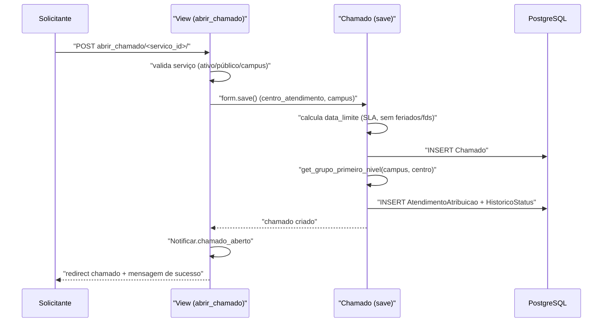

# Fluxo: Abrir chamado

> O solicitante registra uma requisição ou incidente para um serviço do catálogo, criando o chamado e seu roteamento inicial.

- **Ator(es):** Solicitante (Servidor / Aluno / Prestador de Serviço) — ver [README → Atores e papéis](../README.md#atores-e-papéis)
- **Gatilho:** POST `/centralservicos/abrir_chamado/<servico_id>/`
- **Pré-condições:** serviço ativo e acessível ao público do usuário (`Servico.pode_acessar_servico`); usuário com ocupação ativa (campus via `get_uo`); existe Grupo de Atendimento de 1º nível para a UO/centro; permissão `add_chamado`.
- **Pós-condições:** `Chamado` criado em situação **Aberto**; `AtendimentoAtribuicao` inicial para o grupo de 1º nível; `HistoricoStatus` inicial; `data_limite_atendimento` (SLA) calculada; interessados e responsáveis notificados por e-mail.
- **Depende de:** _nenhum_
- **Habilita:** [Assumir e colocar em atendimento](atender-chamado.md), [Notificar SLA estourado](notificar-sla-estourado.md)
- **Entrada no código:** `views.abrir_chamado` → `ChamadoFormFactory` → `Chamado.save` → `Notificar.chamado_aberto`

## Sequência

## Observações

- Tudo dentro de `Chamado.save` roda em `@transaction.atomic`; se não houver grupo de 1º nível, lança `ValidationError` e nada é gravado.
- Serviços marcados como `interno` só podem ser abertos por atendentes do(s) grupo(s) da área.
- Anexos só são salvos se `servico.permite_anexos`; patrimônio é exigido se `servico.requer_numero_patrimonio`.
- O e-mail de cópia ao interessado é condicionado a `enviar_copia_email` do formulário; responsáveis do grupo são sempre notificados.

---
_Gerado/atualizado via subagent `documentador` em 2026-06-08._
