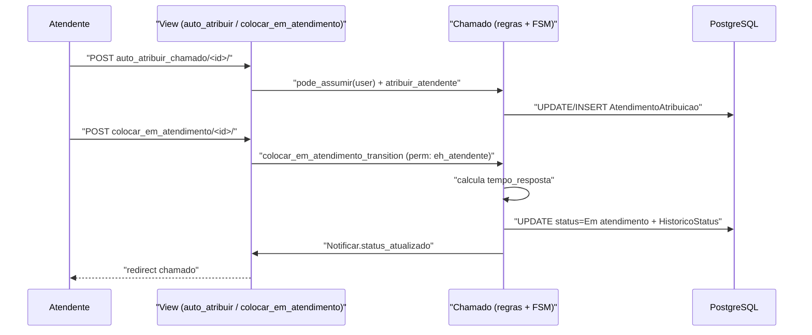

# Fluxo: Assumir e colocar em atendimento

> Um atendente do grupo assume o chamado para si e o coloca em atendimento, iniciando a contagem do tempo de atendimento.

- **Ator(es):** Atendente da Central de Serviços — ver [README → Atores e papéis](../README.md#atores-e-papéis)
- **Gatilho:** POST `/centralservicos/auto_atribuir_chamado/<chamado_id>/` e POST `/centralservicos/colocar_em_atendimento/<chamado_id>/`
- **Pré-condições:** chamado Aberto/Reaberto/Suspenso; o usuário pertence ao grupo de atendimento atual e tem `change_chamado` (`Chamado.pode_assumir`); para iniciar, `eh_atendente(user)` (transição com `permission`).
- **Pós-condições:** `AtendimentoAtribuicao` com `atribuido_para` = atendente; chamado em **Em atendimento**; `HistoricoStatus` registra `tempo_resposta`; interessados notificados.
- **Depende de:** [Abrir chamado](abrir-chamado.md)
- **Habilita:** [Resolver chamado](resolver-chamado.md), [Escalar / retornar](escalar-retornar-atendimento.md), [Reclassificar](reclassificar-chamado.md), [Vincular tarefa](vincular-tarefa-chamado.md), [Criar processo](criar-processo-do-chamado.md) (também permite suspender o chamado, via `Chamado.suspender_chamado`)
- **Entrada no código:** `views.auto_atribuir_chamado` → `Chamado.atribuir_atendente`; `views.colocar_em_atendimento` → `Chamado.colocar_em_atendimento` (`@transition`)

## Sequência

## Observações

- A transição `colocar_em_atendimento_transition` só é permitida se `eh_atendente(user)` (atribuído ao usuário e sem cancelamento).
- `atribuir_atendente` cancela a atribuição anterior (se houver outro atendente) e cria uma nova; notifica o novo atendente quando `atribuido_por != atribuido_para`.
- A contagem de tempo: ao colocar em atendimento, grava `tempo_resposta` (Aberto→Em atendimento); ao sair de Suspenso para Em atendimento, grava `tempo_suspensao`.

---
_Gerado/atualizado via subagent `documentador` em 2026-06-08._
