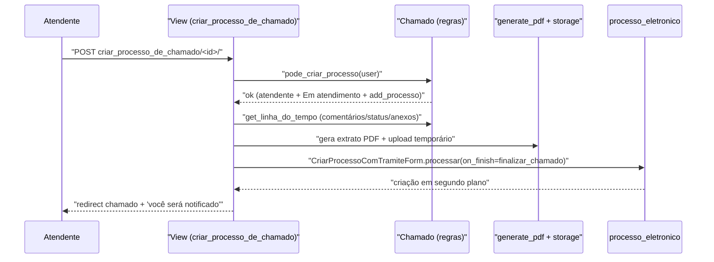

# Fluxo: Criar processo a partir do chamado

> O atendente gera um processo eletrônico a partir do chamado, anexando um extrato em PDF e os anexos do chamado.

- **Ator(es):** Atendente da Central de Serviços — ver [README → Atores e papéis](../README.md#atores-e-papéis)
- **Gatilho:** POST `/centralservicos/criar_processo_de_chamado/<chamado_id>/`
- **Pré-condições:** `processo_eletronico` instalado; usuário no grupo `Atendente da Central de Serviços`, atendente do chamado, chamado **Em atendimento**, e com `processo_eletronico.add_processo` (`Chamado.pode_criar_processo`).
- **Pós-condições:** PDF de extrato gerado e enviado a storage temporário; processo criado/tramitado em segundo plano (callback `finalizar_chamado` notifica o resultado); interessados do chamado tornam-se interessados do processo.
- **Depende de:** [Assumir e colocar em atendimento](atender-chamado.md)
- **Habilita:** _nenhum (cruza fronteira para `processo_eletronico`)_
- **Entrada no código:** `views.criar_processo_de_chamado` → `Chamado.get_linha_do_tempo` + `generate_pdf` → `processo_eletronico.forms.CriarProcessoComTramiteForm`

## Sequência

## Observações

- Se `processo_eletronico` não estiver em `INSTALLED_APPS`, a view retorna erro amigável.
- Toda a view roda em `@transaction.atomic`; erros são capturados (Sentry) e exibidos sem vazar detalhes (exceto em `DEBUG`).
- O nome da instituição no extrato vem de `comum.Configuracao` (`get_valor_por_chave('comum', 'instituicao')`).

---
_Gerado/atualizado via subagent `documentador` em 2026-06-08._
