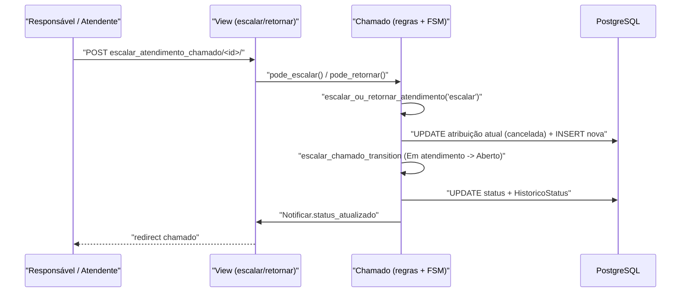

# Fluxo: Escalar / retornar atendimento

> Move o chamado entre níveis de atendimento: escalar (para o grupo superior) ou retornar (para o grupo inferior).

- **Ator(es):** Responsável pelo Grupo de Atendimento (ou atendente com `change_atendimentoatribuicao`) — ver [README → Atores e papéis](../README.md#atores-e-papéis)
- **Gatilho:** POST `/centralservicos/escalar_atendimento_chamado/<chamado_id>/` ou `/centralservicos/retornar_atendimento_chamado/<chamado_id>/`
- **Pré-condições:** chamado ativo (não Resolvido/Fechado/Cancelado/Suspenso); existe grupo superior (escalar) ou inferior (retornar); chamado atribuído a um atendente (`Chamado.pode_escalar` / `pode_retornar`); permissão `change_atendimentoatribuicao`.
- **Pós-condições:** a `AtendimentoAtribuicao` atual é cancelada (com justificativa de escalado/retornado); nova atribuição criada para o grupo destino; chamado volta para **Aberto** se não estava; notificação de status.
- **Depende de:** [Assumir e colocar em atendimento](atender-chamado.md)
- **Habilita:** [Assumir e colocar em atendimento](atender-chamado.md) (no novo grupo)
- **Entrada no código:** `views.escalar_atendimento_chamado` / `retornar_atendimento_chamado` → `Chamado.escalar_atendimento` / `retornar_atendimento` → `escalar_ou_retornar_atendimento`

## Sequência

## Observações

- A escolha do grupo destino: escalar usa `grupo_atendimento_superior`; retornar usa `get_grupo_antendimento_inferior` (que, havendo mais de um, decide pelo histórico de atribuições).
- Se o chamado não estava em Aberto/Reaberto, a transição `escalar_chamado_transition` o leva de volta para **Aberto** no novo nível.

---
_Gerado/atualizado via subagent `documentador` em 2026-06-08._
