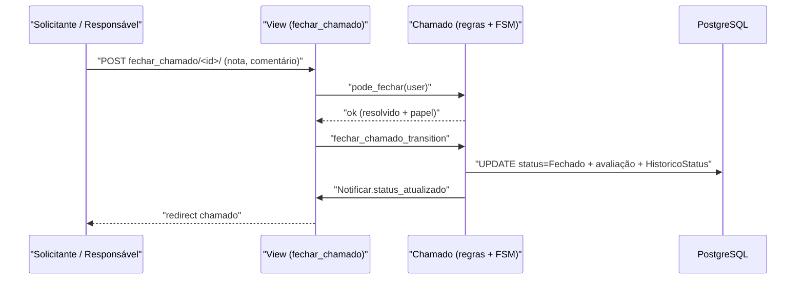

# Fluxo: Fechar chamado

> O solicitante (ou responsável pelo atendimento) confirma a resolução, avalia o atendimento e encerra o chamado.

- **Ator(es):** Solicitante (requisitante/interessado) ou Responsável pelo Grupo de Atendimento — ver [README → Atores e papéis](../README.md#atores-e-papéis)
- **Gatilho:** POST `/centralservicos/fechar_chamado/<chamado_id>/`
- **Pré-condições:** chamado **Resolvido**; usuário é superuser, requisitante/interessado ou responsável pelo grupo (`Chamado.pode_fechar`); permissão `close_chamado`.
- **Pós-condições:** chamado em **Fechado**; nota e comentário de avaliação gravados (se informados); `data_avaliacao` definida; `HistoricoStatus` registrado; notificação de fechamento.
- **Depende de:** [Resolver chamado](resolver-chamado.md)
- **Habilita:** _nenhum_ (estado final; reabertura é tratada por `reabrir_chamado` — ver §7 do HLA)
- **Entrada no código:** `views.fechar_chamado` → `Chamado.fechar_chamado` (wrapper de `fechar_chamado_transition`)

## Sequência

## Observações

- Só é possível fechar a partir de **Resolvido** (`fechar_chamado_transition` tem `source=[RESOLVIDO]`).
- O fechamento automático (command diário) usa o mesmo `fechar_chamado` com `fechado_automaticamente=True` para chamados Resolvidos há ≥ 90 dias.
- A notificação varia: se quem fecha não é o interessado, notifica os interessados; caso contrário, notifica o atendente (incluindo nota/comentário da avaliação).

---
_Gerado/atualizado via subagent `documentador` em 2026-06-08._
