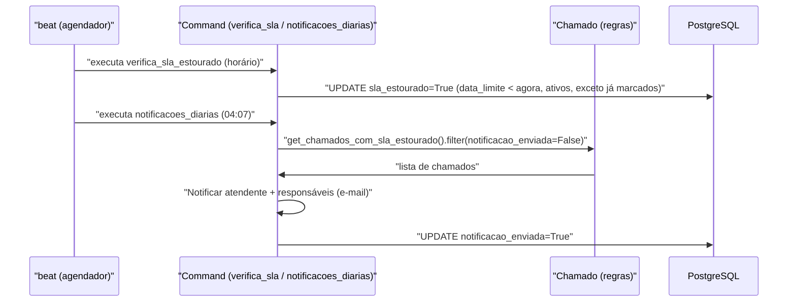

# Fluxo: Notificar SLA estourado

> O sistema identifica chamados cujo prazo-limite de atendimento foi ultrapassado e notifica atendentes e responsáveis.

- **Ator(es):** Sistema (agendamento via `beat`) — ator chamador, não há usuário direto. Ver [README → Atores e papéis](../README.md#atores-e-papéis)
- **Gatilho:** command `centralservicos_verifica_sla_estourado` (de hora em hora) marca o estouro; `centralservicos_notificacoes_diarias` (diário, 04:07) envia as notificações.
- **Pré-condições:** chamado ativo (Aberto/Em atendimento/Reaberto) com `data_limite_atendimento` no passado; notificação ainda não enviada (`notificacao_enviada=False`).
- **Pós-condições:** `sla_estourado=True` nos chamados estourados; e-mail ao atendente atribuído e aos responsáveis do grupo; `notificacao_enviada=True`.
- **Depende de:** [Abrir chamado](abrir-chamado.md) (e demais fluxos que mantêm o chamado ativo)
- **Habilita:** _nenhum_
- **Entrada no código:** `management/commands/centralservicos_verifica_sla_estourado.py`; `centralservicos_notificacoes_diarias.notificar_chamados_com_sla_estourado` → `Notificar.atendente_sobre_sla_estourado` / `responsavel_equipe_atendimento_sobre_sla_estourado`

## Sequência

## Observações

- **Idempotente:** o marcador exclui chamados já com `sla_estourado=True`; a notificação só processa `notificacao_enviada=False`.
- O command diário também: fecha automaticamente chamados Resolvidos há ≥ 90 dias e remove atendentes/responsáveis inativos dos grupos.
- O cálculo do prazo desconta fins de semana e feriados (`Chamado.calcula_data_limite_sem_feriados_fds`); o tempo ultrapassado desconta períodos suspensos (`get_tempo_ultrapassado`).

---
_Gerado/atualizado via subagent `documentador` em 2026-06-08._
