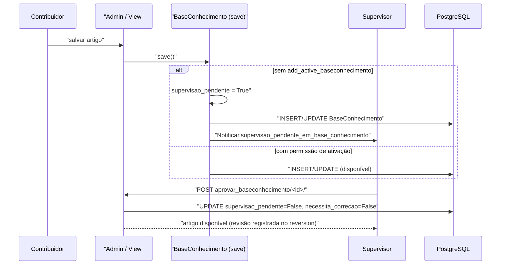

# Fluxo: Publicar artigo na Base de Conhecimento

> Um contribuidor cria/atualiza um artigo; se necessário, ele passa por supervisão antes de ficar disponível para uso nas resoluções.

- **Ator(es):** Contribuidor / Publicador / Supervisor da Base de Conhecimento — ver [README → Atores e papéis](../README.md#atores-e-papéis)
- **Gatilho:** salvar artigo no admin (`/admin/centralservicos/baseconhecimento/`) e, se pendente, POST `/centralservicos/baseconhecimento/aprovar/<id>/`
- **Pré-condições:** permissão `add_baseconhecimento`/`change_baseconhecimento`; para aprovar, `review_baseconhecimento`.
- **Pós-condições:** artigo gravado; se quem salvou não tem `add_active_baseconhecimento`, entra em `supervisao_pendente=True` e os supervisores são notificados; após aprovação, fica disponível para uso (e como FAQ se visibilidade pública).
- **Depende de:** _nenhum_
- **Habilita:** [Resolver chamado](resolver-chamado.md) (artigos disponíveis podem ser vinculados como bases usadas)
- **Entrada no código:** `BaseConhecimento.save` → `Notificar.supervisao_pendente_em_base_conhecimento`; `views.aprovar_baseconhecimento` (`@create_revision`, django-reversion)

## Sequência

## Observações

- `estah_disponivel_para_uso()` exige `not necessita_correcao and not supervisao_pendente`. A aprovação (`views.aprovar_baseconhecimento`, `@transaction.atomic`) zera ambos os flags de uma vez.
- Um supervisor pode marcar o artigo para correção (`marcar_para_correcao`), registrando `Comentario` e notificando o autor.
- Visibilidade: **Privada** (todos os atendentes), **Pública** (atendentes + FAQ), **Sigilosa** (restrita aos grupos de atendimento vinculados).
- Versionamento via `django-reversion` (`@create_revision`, `CompareVersionAdminPlus` no admin).

---
_Gerado/atualizado via subagent `documentador` em 2026-06-08._
