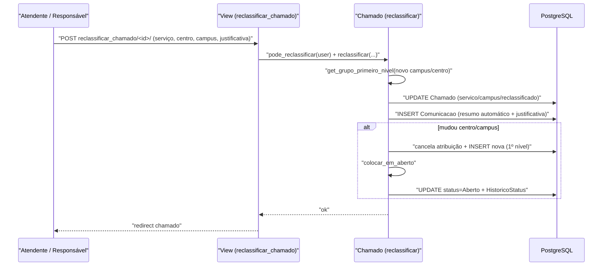

# Fluxo: Reclassificar chamado

> Corrige o enquadramento do chamado, trocando serviço, centro de atendimento e/ou campus, re-roteando o atendimento.

- **Ator(es):** Atendente do chamado ou Responsável pelo Grupo de Atendimento — ver [README → Atores e papéis](../README.md#atores-e-papéis)
- **Gatilho:** POST `/centralservicos/reclassificar_chamado/<chamado_id>/`
- **Pré-condições:** chamado Aberto, Reaberto ou Em atendimento; usuário é superuser, responsável do grupo ou atendente (`Chamado.pode_reclassificar`); existe Grupo de Atendimento de 1º nível para o novo serviço/centro/campus; permissão `reclassify_chamado`.
- **Pós-condições:** `Chamado.servico`/`campus` atualizados; `reclassificado` incrementado; duas `Comunicacao` registradas (resumo automático + justificativa); se mudou centro/campus, atribuição atual cancelada e re-roteada para o 1º nível do novo centro, voltando o chamado a **Aberto**.
- **Depende de:** [Abrir chamado](abrir-chamado.md) (e tipicamente [Assumir e colocar em atendimento](atender-chamado.md))
- **Habilita:** [Assumir e colocar em atendimento](atender-chamado.md) (no novo serviço/grupo)
- **Entrada no código:** `views.reclassificar_chamado` → `Chamado.reclassificar` (`@transaction.atomic`)

## Sequência

## Observações

- Falha com `ValidationError` se o chamado não estiver em estado reclassificável ou se não houver Grupo de Atendimento para o destino.
- O re-roteamento só ocorre quando muda o centro de atendimento ou o campus; mudança apenas de serviço (mesmo centro/campus) preserva a atribuição.

---
_Gerado/atualizado via subagent `documentador` em 2026-06-08._
