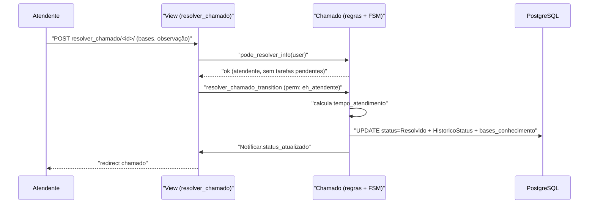

# Fluxo: Resolver chamado

> O atendente conclui o atendimento, marca o chamado como Resolvido e pode vincular as bases de conhecimento utilizadas.

- **Ator(es):** Atendente da Central de Serviços — ver [README → Atores e papéis](../README.md#atores-e-papéis)
- **Gatilho:** POST `/centralservicos/resolver_chamado/<chamado_id>/`
- **Pré-condições:** chamado **Em atendimento**; o usuário é o atendente (`eh_atendente`); **não** há tarefas vinculadas pendentes; chamado não fechado (`Chamado.pode_resolver_info`); permissão `solve_chamado`.
- **Pós-condições:** chamado em **Resolvido**; `HistoricoStatus` com `tempo_atendimento` (Em atendimento→Resolvido); bases de conhecimento utilizadas registradas no histórico; interessados e responsáveis notificados (com convite a fechar).
- **Depende de:** [Assumir e colocar em atendimento](atender-chamado.md), [Vincular tarefa ao chamado](vincular-tarefa-chamado.md) (tarefas pendentes bloqueiam a resolução)
- **Habilita:** [Fechar chamado](fechar-chamado.md)
- **Entrada no código:** `views.resolver_chamado` → `Chamado.resolver_chamado` (wrapper de `resolver_chamado_transition`, `@transition` com `permission`)

## Sequência

## Observações

- A resolução é bloqueada se existir `TarefaChamado` pendente (Aberta/Em Andamento/Suspensa) — ver `pode_resolver_info`.
- O wrapper `resolver_chamado` roda em `@transaction.atomic` e registra as bases de conhecimento usadas em `HistoricoStatus.bases_conhecimento` (alimenta os indicadores de utilização da BC).
- Após Resolvido, se ninguém fechar manualmente, o chamado é fechado automaticamente pelo command diário após 90 dias.

---
_Gerado/atualizado via subagent `documentador` em 2026-06-08._
