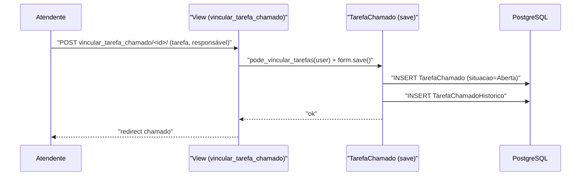

# Fluxo: Vincular tarefa ao chamado

> O atendente cria uma tarefa operacional ligada ao chamado, atribuindo um responsável e acompanhando sua situação.

- **Ator(es):** Atendente da Central de Serviços — ver [README → Atores e papéis](../README.md#atores-e-papéis)
- **Gatilho:** POST `/centralservicos/vincular_tarefa_chamado/<chamado_id>/`
- **Pré-condições:** usuário autenticado (`@login_required`) e atendente do chamado (`Chamado.pode_vincular_tarefas` → `eh_atendente`); existe `Tarefa` (cadastro prévio) para o serviço do chamado.
- **Pós-condições:** `TarefaChamado` criada (situação inicial **Aberta**), com responsável; `TarefaChamadoHistorico` gerado automaticamente no `save`.
- **Depende de:** [Assumir e colocar em atendimento](atender-chamado.md)
- **Habilita:** [Resolver chamado](resolver-chamado.md) (a resolução só é possível quando não restam tarefas pendentes)
- **Entrada no código:** `views.vincular_tarefa_chamado` → `TarefaChamadoAddFormFactory` → `TarefaChamado.save`

## Sequência

## Observações

- Cada `save` de `TarefaChamado` cria um `TarefaChamadoHistorico`, mantendo a trilha de mudanças de situação/responsável.
- Tarefas pendentes (Aberta/Em Andamento/Suspensa) impedem a resolução do chamado (`pode_resolver_info` e a condição da transição `resolver_chamado_transition`, que vale também para a resolução em conjunto e para a criação de processo).
- Só chamado que não está resolvido, fechado ou cancelado recebe tarefa (`Chamado.admite_tarefa_pendente`); nesses, a tarefa só pode ser finalizada ou cancelada, e `cancelar_chamado` cancela as pendentes.
- O responsável da tarefa ou o atendente do chamado pode atualizar a situação via `editar_tarefa_chamado` (`TarefaChamado.pode_atualizar_situacao`); o responsável atual segue válido no formulário mesmo fora do grupo atual.

---
_Gerado/atualizado via subagent `documentador` em 2026-06-08._
