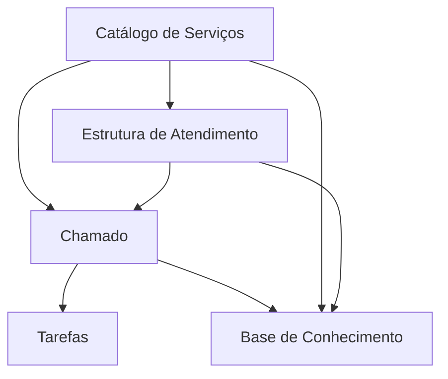

# Modelo de dados — Central de Serviços

> Módulo grande (23 models em um `models.py` **único**, sem pacote `models/`): o modelo
> está particionado por **subdomínio**. Como não há pacote, o agrupamento foi inferido por
> **clusters de nome/relação** + agrupamento do `admin.py` — marque `⚠️ REVISAR`.
>
> Cada sub-área tem seu próprio ERD; este índice dá a visão macro e como as áreas se
> conectam. FKs entre subdomínios aparecem como "entidades externas" em cada ERD.

## Subdomínios

| Subdomínio | Entidades principais | ERD |
|---|---|---|
| Catálogo de Serviços | `Servico`, `GrupoServico`, `CategoriaServico`, `CentroAtendimento`, `Tag`, `GestorAreaServico` | [catalogo-servicos.md](catalogo-servicos.md) |
| Estrutura de Atendimento | `GrupoAtendimento`, `Monitoramento`, `GrupoInteressado`, `RespostaPadrao` | [estrutura-atendimento.md](estrutura-atendimento.md) |
| Chamado | `Chamado`, `AtendimentoAtribuicao`, `HistoricoStatus`, `Comunicacao`, `ChamadoAnexo`, `Autorizacao` | [chamado.md](chamado.md) |
| Tarefas | `Tarefa`, `TarefaChamado`, `TarefaChamadoHistorico` | [tarefas.md](tarefas.md) |
| Base de Conhecimento | `BaseConhecimento`, `BaseConhecimentoAnexo`, `PerguntaAvaliacaoBaseConhecimento`, `AvaliaBaseConhecimento` | [base-conhecimento.md](base-conhecimento.md) |

> ⚠️ REVISAR: o agrupamento acima é **inferido** (não há pacote `models/`). Todos os 23
> models do módulo aparecem em exatamente um ERD. `Servico` e `GrupoAtendimento` são
> pontos de conexão entre subdomínios e reaparecem como entidades externas nos ERDs vizinhos.

---
_Gerado/atualizado via subagent `documentador` em 2026-06-08._
