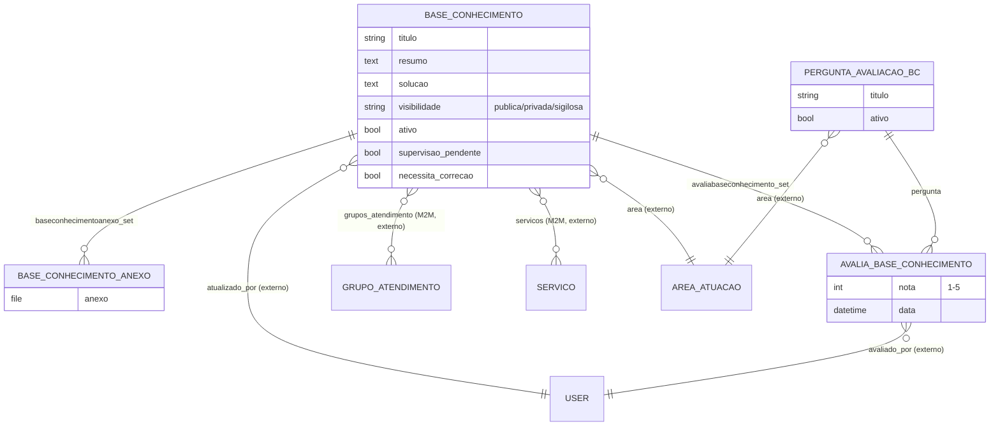

# Modelo de dados — Base de Conhecimento

> ERD dos artigos da Base de Conhecimento (BC), seus anexos e o sistema de avaliação. Models
> herdam `ModelPlus` de `djtools.db`. FKs para entidades de outras áreas/subdomínios aparecem
> como **externas**. Termos: ver `../GLOSSARIO.md`.

## Entidades

| Entidade | Descrição | Relações-chave |
|---|---|---|
| `BaseConhecimento` | Artigo da BC (privado/público/sigiloso); fluxo de supervisão e correção. | FK `area`, `atualizado_por`; M2M `grupos_atendimento`, `servicos` |
| `BaseConhecimentoAnexo` | Arquivo anexado a um artigo (extensões controladas). | FK `base_conhecimento` |
| `PerguntaAvaliacaoBaseConhecimento` | Critério de avaliação dos artigos, por área. | FK `area` |
| `AvaliaBaseConhecimento` | Nota (1–5) de um usuário a um artigo por pergunta; `unique(base_conhecimento, pergunta, avaliado_por)`. | FK `base_conhecimento`, `pergunta`, `avaliado_por` |

## Entidades externas referenciadas

| Entidade | Módulo/área de origem |
|---|---|
| `AreaAtuacao` | comum |
| `User` | comum |
| `Servico` | centralservicos (subdomínio Catálogo de Serviços) |
| `GrupoAtendimento` | centralservicos (subdomínio Estrutura de Atendimento) |

> Nota: `HistoricoStatus` e `Comunicacao` (subdomínio Chamado) referenciam `BaseConhecimento`
> via M2M (artigos usados na resolução/sugestão).

---
_Gerado/atualizado via subagent `documentador` em 2026-06-08._
