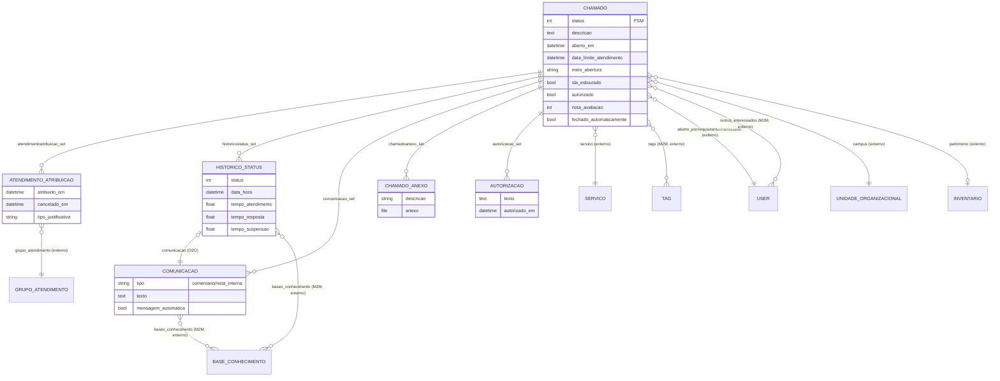

# Modelo de dados — Chamado

> ERD do núcleo do módulo: o chamado e seus registros associados (atribuições, histórico de
> situações, comunicações, anexos, autorizações). Models herdam `ModelPlus` de `djtools.db`.
> FKs para entidades de outras áreas/subdomínios aparecem como **externas**. Termos: ver
> `../GLOSSARIO.md`.

## Entidades

| Entidade | Descrição | Relações-chave |
|---|---|---|
| `Chamado` | Ticket de serviço; `status` é `FSMIntegerField` (`django_fsm`, protegido). | FK `servico`, `aberto_por`/`requisitante`/`interessado` (User), `campus`, `patrimonio`; M2M `outros_interessados`, `tags` |
| `AtendimentoAtribuicao` | Atribuição do chamado a um grupo (e atendente); cancelamento registra escalonamento/retorno. | FK `chamado`, `grupo_atendimento`, `atribuido_para`, `atribuido_por`, `cancelado_por` |
| `HistoricoStatus` | Registro de cada mudança de situação, com tempos de resposta/atendimento/suspensão. | FK `chamado`, `usuario`; O2O `comunicacao`; M2M `bases_conhecimento` |
| `Comunicacao` | Comentário (público) ou nota interna do chamado. | FK `chamado`, `remetente`; M2M `usuarios_citados`, `bases_conhecimento` |
| `ChamadoAnexo` | Arquivo anexado ao chamado (extensões e visibilidade controladas). | FK `chamado`, `anexado_por` |
| `Autorizacao` | Solicitação/registro de autorização vinculada a um chamado. | FK `chamado`, `enviado_por`, `enviado_para`, `autorizado_por` |

## Entidades externas referenciadas

| Entidade | Módulo/área de origem |
|---|---|
| `User` | comum |
| `UnidadeOrganizacional` | rh |
| `Inventario` | patrimonio |
| `Servico` | centralservicos (subdomínio Catálogo de Serviços) |
| `Tag` | centralservicos (subdomínio Catálogo de Serviços) |
| `GrupoAtendimento` | centralservicos (subdomínio Estrutura de Atendimento) |
| `BaseConhecimento` | centralservicos (subdomínio Base de Conhecimento) |

---
_Gerado/atualizado via subagent `documentador` em 2026-06-08._
