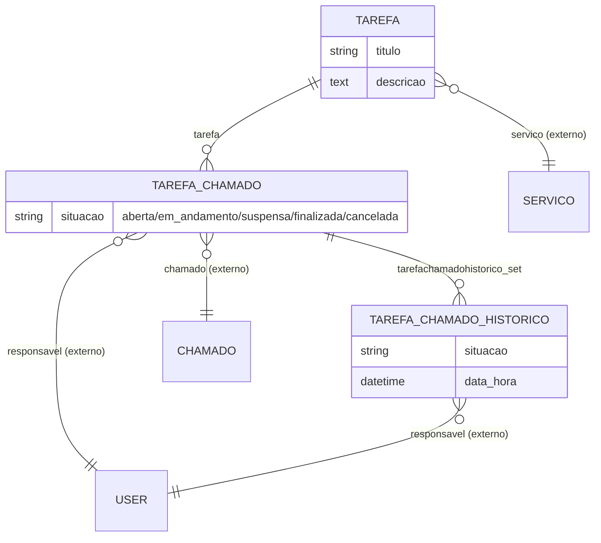

# Modelo de dados — Tarefas

> ERD das tarefas operacionais da Central de Serviços (cadastro prévio, vínculo a chamado e
> histórico de situações). Models herdam `ModelPlus` de `djtools.db`. FKs para entidades de
> outras áreas/subdomínios aparecem como **externas**. Termos: ver `../GLOSSARIO.md`.

## Entidades

| Entidade | Descrição | Relações-chave |
|---|---|---|
| `Tarefa` | Cadastro prévio (modelo) de uma tarefa associada a um serviço. | FK `servico` |
| `TarefaChamado` | Instância de tarefa vinculada a um chamado, com situação e responsável; `save` gera histórico. | FK `tarefa`, `chamado`, `responsavel` |
| `TarefaChamadoHistorico` | Registro de cada atualização de situação/responsável da tarefa de chamado. | FK `tarefa_chamado`, `responsavel` |

## Entidades externas referenciadas

| Entidade | Módulo/área de origem |
|---|---|
| `User` | comum |
| `Servico` | centralservicos (subdomínio Catálogo de Serviços) |
| `Chamado` | centralservicos (subdomínio Chamado) |

---
_Gerado/atualizado via subagent `documentador` em 2026-06-08._
