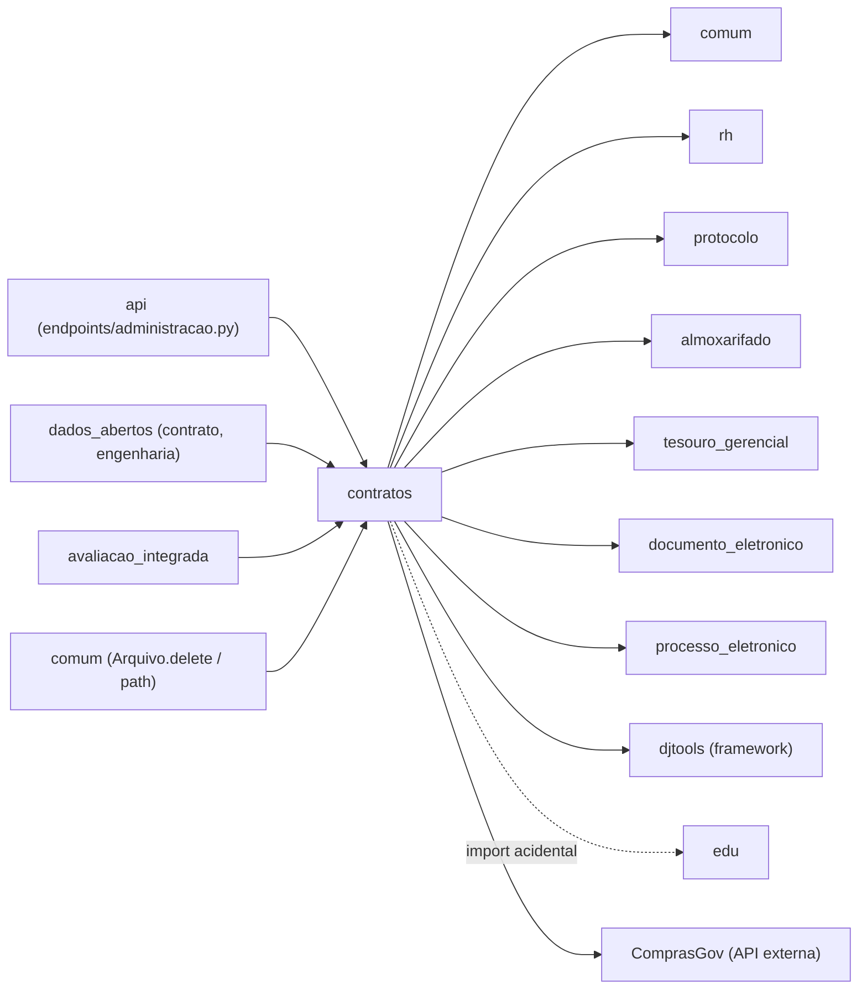

# Fronteiras — Contratos

> Superfície do módulo: o que entra, o que sai e os contratos com o resto do SUAP.
> Complementa o [HLA.md](HLA.md) (§1 contexto, §5 integrações).

## Mapa

## Dependências de entrada (inbound)

Módulos que importam/usam este (derivado de
`grep -rl "from contratos\|import contratos" --include=*.py .`, excluindo o próprio módulo e `migrations/`).

| Módulo consumidor | O que consome | Acoplamento |
|---|---|---|
| `api` (`api/endpoints/administracao.py`) | `Contrato` e `MaoDeObra` — endpoint de terceirizados filtra `MaoDeObra` por `Contrato.objects.ativos()` | **Forte** — depende dos models e do manager `ativos()`; qualquer mudança em `MaoDeObra` altera o contrato de API pública |
| `dados_abertos` (`endpoints/contrato.py`) | `Contrato` — endpoint público `/contratos/` filtra por ano de vigência | **Forte** — expõe campos do model em `ContratoSchema` (número, ano, campus, objeto, datas, valores, CNPJ e razão social da contratada) |
| `dados_abertos` (`endpoints/engenharia.py`) | `Contrato` — endpoint `/engenharia/` | **Forte e frágil** — filtra `Contrato.objects.filter(tipo=5)`, com o **id do tipo fixado no código**. ⚠️ REVISAR: acoplamento por id numérico; renumerar `TipoContrato` quebra o endpoint silenciosamente |
| `avaliacao_integrada` (`models.py`) | `MaoDeObra` — compõe os tipos `SociedadeCivilQuerySet`/`RespondenteQuerySet` e seleciona respondentes (`desligamento__isnull=True`, CPF não nulo) | **Forte** — usa `MaoDeObra` como população de respondentes da avaliação institucional |
| `comum` (`models.py`, `Arquivo`) | `Aditivo`, `AnexoContrato`, `Contrato`, `Ocorrencia`, `PublicacaoAditivo`, `PublicacaoContrato` — import **condicional** (`'contratos' in settings.INSTALLED_APPS_SUAP`) dentro de `Arquivo.delete()` e da resolução do caminho físico do arquivo | **Fraco por design, forte na prática** — o import é lazy e condicional, mas `comum` conhece a estrutura de diretórios do módulo (`contratos/contrato/<id>/aditivos/...`) e limpa os ponteiros ao apagar um `Arquivo`. ⚠️ REVISAR: dependência circular controlada |

**Observação:** `module_dependencies.json` não declara nenhum consumidor de `contratos` — a
direção inbound existe apenas no código.

## Dependências de saída (outbound)

Declaradas em `module_dependencies.json` para `contratos`: `protocolo`, `almoxarifado`, `rh`,
`comum`, `documento_eletronico`, `tesouro_gerencial`, `processo_eletronico`.

| Depende de | O quê | Tipo |
|---|---|---|
| `comum` | `Arquivo` (armazenamento dos PDFs), `Configuracao` (todas as chaves do módulo), `Vinculo` (contratada e autoria), `User`, `PrestadorServico` (mão de obra), `Ano`, `Notificador` e `NotificacaoSistema` (notificações), `APIExterna` (ComprasGov), `APIExternaService` | Módulo interno (fundacional) |
| `rh` | `Servidor` (fiscal), `Pessoa`/`PessoaJuridica` (contratada, incluindo `adicionar_pessoajuridica_importar_api_cnpj`), `UnidadeOrganizacional` (campi e campus gerenciador), `Setor` (setores gerenciadores) | Módulo interno (fundacional) |
| `protocolo` | `Processo` — processo do contrato, do aditivo e da medição | Módulo interno |
| `almoxarifado` | `Empenho` — vínculo legado em `Contrato.empenho` e `Aditivo.empenho` | Módulo interno |
| `tesouro_gerencial` | `DocumentoEmpenho` (valor, valor liquidado, valor pago, saldo restante) e `DocumentoBase.TIPO_NE` | Módulo interno |
| `documento_eletronico` | `DocumentoTexto`, `ModeloDocumento`, `Documento` (níveis de acesso), `DocumentoStatus`, `TipoDocumento`, `HipoteseLegal`, `NivelPermissao`, `CompartilhamentoDocumentoPessoa`, `TipoVinculoDocumento`, `VinculoDocumentoTexto`, `ListarDocumentosTextoForm`, `get_variaveis`/`processar_template_ckeditor` | Integração **condicional** (`'documento_eletronico' in settings.INSTALLED_APPS` verificado em `forms.ContratoForm`, `forms.ConfiguracaoForm` e `views.listar_documentos_adicionar_contrato`) — mas os imports em `models.py` e `views.py` são de topo, então na prática o app é obrigatório. ⚠️ REVISAR |
| `processo_eletronico` | `Processo` — vínculo opcional da movimentação de conta vinculada; a view de vincular documentos reusa o template `processo_eletronico/templates/listar_documentos_adicionar.html` | Módulo interno |
| `djtools` | `ModelPlus` e campos `*Plus` (`db`), `ModelAdminPlus`/`CustomTabListFilter` (`contrib.admin`), `FormPlus`/`ModelFormPlus` e widgets (`forms`), `assincrono.task`, `tables.get_table`, `html.graficos` (BarChart/LineChart), `layout` (quadros e serviços anônimos), utilitários (`httprr`, `rtr`, `render`, `permission_required`, `group_required`, `send_mail`, `send_notification`, `XlsResponse`, `JsonResponse`, `compare_model_objects`, `anonimizar_cpf`, `full_check_pdf`, `MultiFileField`), `choices` (Anos, Meses), `templatetags` (`format_`, `format_money`, `in_group`, `icon`), `management.commands.BaseCommandPlus` | Framework SUAP |
| `beat` | `beat.utils.carregar_call_command` — agendamento dos 4 comandos de notificação | Módulo interno (infra) |
| `suap` | `nomenclatura` (rótulos de campus/campi), `settings` | Núcleo |
| `edu` | `Configuracao` importada em `admin.py` (`from edu.models import Configuracao`) — na verdade um reexport de `comum.models.Configuracao` | ⚠️ REVISAR: **acoplamento acidental**, não declarado em `module_dependencies.json`; deveria importar de `comum` |
| ComprasGov (`contratos.comprasnet.gov.br/api`) | `GET contrato/id/<id>` e `GET contrato/<id>/itens` | Integração externa (HTTP), desligável por `APIExterna.ativo` |
| PostgreSQL / Redis / Celery | Persistência, broker e execução assíncrona | Infraestrutura |

## Contratos publicados

O que outros módulos podem acoplar a este (mude com cuidado):

- **Signals emitidos/ouvidos:** _nenhum_ — o módulo não define nem escuta signals; a propagação de estado é feita por chamadas explícitas a `contrato.save()` nos `save()`/`delete()` dos filhos.
- **Models reusados por outros módulos:**
  - `Contrato` — consumido por `api`, `dados_abertos` (dois endpoints) e `comum`. Campos publicados em API: `numero`, `data_inicio`, `data_fim`, `objeto`, `valor`, `valor_executado`, `campi`, dados da contratada. O manager `Contrato.objects.ativos()` (`concluido=False, cancelado=False`) faz parte do contrato de fato.
  - `MaoDeObra` — consumido por `api` (endpoint de terceirizados) e `avaliacao_integrada` (população de respondentes). O critério "ativo" é `desligamento__isnull=True`.
  - `Aditivo`, `AnexoContrato`, `Ocorrencia`, `PublicacaoContrato`, `PublicacaoAditivo` — referenciados por `comum.Arquivo.delete()` para limpar ponteiros.
- **Funções / services / templates públicos:**
  - `contratos.services.ApiContratosGovBRService` — registrado como *service* de `comum.APIExterna.CONTRATOSGOVBR` e obtido via `api_externa.get_service()`; `estah_acessivel()` é usado pelo healthcheck de APIs externas.
  - `contratos.utils.Notificar` — classe de notificações consumida pelos 4 management commands.
  - `contratos.utils.verificar_fiscal` — decorator de autorização por objeto.
  - `Contrato.get_absolute_url()` (`/contratos/contrato/<id>/`) — usado em e-mails e integrações.
  - Rotas públicas `/contratos/listar_contratos/` e `/contratos/contrato_publico/<id>/`, expostas no menu de serviços anônimos do SUAP.
- **Tasks/agendamento que outros dependem:** as 6 tasks de `tasks.py` são internas (só as views do módulo as chamam). Os 4 comandos agendados são registrados no `beat` e podem ser executados manualmente por `manage.py`.
- **Permissões e grupos publicados:** os 8 grupos de `permissions.yaml` (incluindo `Auditor`, com `app_manager: auditoria`, `Servidor`, com `app_manager: rh`, e `Prestador de Serviço`, com `app_manager: comum`) e as 19 permissões customizadas de `Contrato.Meta.permissions` (`pode_*`). Renomeá-las quebra `permissions.yaml` de outros apps e os decorators das views.
- **Configuração publicada:** as chaves de `comum.Configuracao` no app `contratos` (ver [README → Configuração](README.md#configuração)) — em especial `restringir_por_unidade`, que altera o comportamento de visibilidade em todo o módulo.
- ⚠️ REVISAR: **acoplamento por id numérico sem FK** — `dados_abertos/endpoints/engenharia.py` filtra `Contrato.objects.filter(tipo=5)` presumindo que o `TipoContrato` de id 5 é "obra"; `views.gerar_despacho_documentotexto` e `gerar_termo_definitivo_documentotexto` usam `HipoteseLegal.objects.filter(pk=6)`.
- ⚠️ REVISAR: **acoplamento por nome literal** — os modelos de documento são buscados por `nome` exato ("Relatório Circustanciado de Recebimento Provisório", "Termo Circunstanciado de Recebimento Definitivo", "Ofício de Solicitação de Fiscal", "Despacho Simples", "Ofício de Solicitação de Publicação de Portaria") e o tipo de documento por `nome='Contrato'`. Renomear um registro em `documento_eletronico` desativa o fluxo correspondente sem erro de código.
- ⚠️ REVISAR: **estrutura de diretórios de arquivos** é conhecida por `comum.models` (`contratos/contrato/<id>/aditivos/<id>/...`); mudar o layout de armazenamento exige alterar o outro módulo.

---
_Gerado/atualizado via subagent `documentador` em 2026-08-11._
