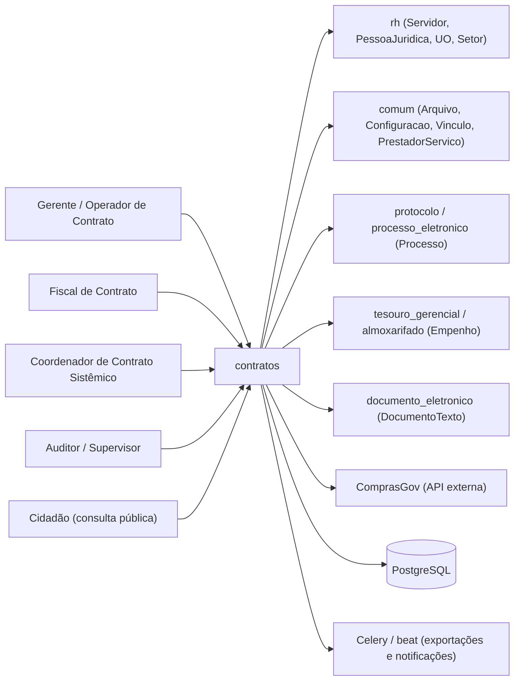
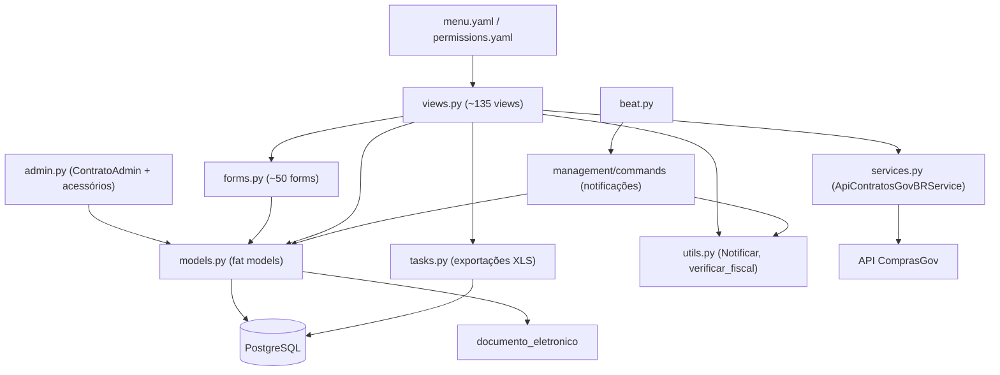
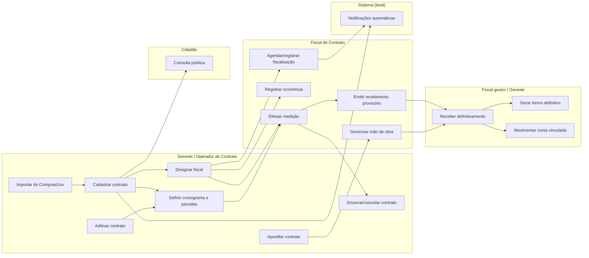

# HLA — Contratos

> High Level Architecture. Complementa o [README.md](README.md). Foco em contexto, blocos, fluxo e riscos. Baseado em arc42 (enxuto) + C4 + Mermaid.

## 1. Contexto e escopo

O módulo é operado por servidores da administração (gerentes, operadores e fiscais de contrato) e
por um coordenador sistêmico que mantém as tabelas acessórias; auditores e supervisores o consultam
em modo leitura e qualquer cidadão acessa a consulta pública. Ele lê pessoas e unidades de `rh`,
arquivos/configuração/prestadores de `comum`, processos de `protocolo`/`processo_eletronico` e notas
de empenho de `tesouro_gerencial`/`almoxarifado`; escreve documentos em `documento_eletronico`
(recebimento provisório e definitivo, ofícios e despachos) e importa contratos e itens do ComprasGov.

> Atores definidos em [README.md → Atores e papéis](README.md#atores-e-papéis).

## 2. Estratégia de solução

| Decisão | Escolha | Motivo |
|---|---|---|
| Persistência | `ModelPlus` (`djtools.db`) sobre PostgreSQL, `models.py` único com 44 models | Padrão do SUAP; o domínio cresceu por agregação em torno de `Contrato` sem quebrar o arquivo em pacote |
| Regras de negócio | Fat models — `Contrato` e `Medicao` concentram cálculos, máquinas de estado e autorização (`pode_*`) | Convenção do SUAP; permite reuso das mesmas regras entre views, admin e relatórios |
| Autorização | Combinação de grupos (`permissions.yaml`), permissões customizadas em `Contrato.Meta.permissions` e papel relacional (`Fiscal`) | Nem toda decisão é "tem a permissão X" — depende de ser fiscal *daquele* contrato e do campus gerenciador |
| Consistência de totais | Recalculo em `Contrato.save()` + propagação a partir dos filhos (`Aditivo`, `Parcela`, `Medicao`…) | Mantém `valor_executado`/`valor_total`/`data_vencimento` desnormalizados e sempre coerentes, ao custo de gravações em cascata |
| Processamento assíncrono | Celery apenas para **exportações XLS** (`djtools.assincrono.task`); notificações via `management commands` agendados no beat | As exportações são pesadas e o usuário acompanha o progresso; as notificações são varreduras diárias |
| Documentos oficiais | Gerados como `DocumentoTexto` nato-digital em `documento_eletronico`, a partir de `ModeloDocumento` + variáveis | Substituiu a impressão de HTML (ver `despacho_medicao`, marcado como legado no código) |
| Interface | Django clássico (views funcionais + `@rtr`), tela do contrato com 16 abas | Padrão do SUAP; cada aba é um agregado do contrato |
| Configuração | `comum.Configuracao` (banco), editável por formulário | Permite ajustar percentuais e políticas sem deploy |

## 3. Blocos de construção (componentes internos)

| Componente | Responsabilidade |
|---|---|
| Views (`views.py`) | Entrypoints das 96 rotas; orquestram forms, aplicam autorização contextual (`Contrato.pode_gerenciar_*`), montam a tela do contrato com suas abas e disparam tasks/documentos |
| Models (fat) (`models.py`) | Entidades, cálculos financeiros (saldos, percentuais, retenção da conta vinculada), máquina de estados da medição/recebimento e todas as regras de autorização por objeto |
| Forms (`forms.py`) | Validações de entrada e de negócio (vigência x base legal, saldo do contrato, unicidade do número, obrigatoriedade de justificativa) e restrição de *querysets* por campus/perfil |
| Admin (`admin.py`) | Cadastro do contrato (formulário principal), abas por situação (ativos, a vencer, expirados…), filtro "somente eu"/"meu setor" para fiscais, exportação XLS e restrição por unidade |
| Tasks (`tasks.py`) | Exportações XLS assíncronas com barra de progresso (`task.iterate`) |
| Commands + beat (`management/commands`, `beat.py`) | Varreduras diárias que notificam fiscais sobre expiração, garantia ausente, mão de obra não cadastrada e agenda de fiscalização |
| Utils (`utils.py`) | `Notificar` (montagem e envio das mensagens), `verificar_fiscal` (decorator que barra quem não é fiscal do contrato), `add_log_entry` (auditoria via `LogEntry`) |
| Services (`services.py`) | Cliente HTTP do ComprasGov (busca de contrato e de itens), com tratamento de timeout/erro |

Modelo de dados (ERD): ver [modelo-de-dados/](modelo-de-dados/).

## 4. Fluxos principais

| Fluxo | Ator | Gatilho | Doc |
|---|---|---|---|
| Cadastrar contrato | Gerente/Operador de Contrato | POST `/admin/contratos/contrato/add/` | [fluxos/cadastrar-contrato.md](fluxos/cadastrar-contrato.md) |
| Designar fiscal | Gerente/Operador de Contrato | POST `/contratos/adicionar_fiscal/<contrato_id>/` | [fluxos/designar-fiscal.md](fluxos/designar-fiscal.md) |
| Definir cronograma e parcelas | Gerente/Operador de Contrato | POST `/contratos/definir_cronograma/` + `/gerar_parcelas/` | [fluxos/definir-cronograma-e-parcelas.md](fluxos/definir-cronograma-e-parcelas.md) |
| Efetuar medição da parcela | Fiscal de Contrato | POST `/contratos/efetuar_medicao/<parcela_id>/<contrato_id>/` | [fluxos/efetuar-medicao.md](fluxos/efetuar-medicao.md) |
| Emitir recebimento provisório | Fiscal de Contrato | GET `/contratos/gerar_despacho_eletronico/<medicao_id>/<contrato_id>/` | [fluxos/emitir-recebimento-provisorio.md](fluxos/emitir-recebimento-provisorio.md) |
| Receber definitivamente a medição | Fiscal gestor / Gerente de Contrato | POST `/contratos/receber_definitivamente_medicao/<medicao_id>/` | [fluxos/receber-definitivamente-medicao.md](fluxos/receber-definitivamente-medicao.md) |
| Gerar termo de recebimento definitivo | Fiscal gestor / Gerente de Contrato | GET `/contratos/gerar_termo_definitivo_documentotexto/<medicao_id>/<contrato_id>/` | [fluxos/gerar-termo-recebimento-definitivo.md](fluxos/gerar-termo-recebimento-definitivo.md) |
| Movimentar conta vinculada | Fiscal / Gerente / Coordenador sistêmico | POST `/contratos/deposito_conta/` · `/saque_conta/` | [fluxos/movimentar-conta-vinculada.md](fluxos/movimentar-conta-vinculada.md) |
| Aditivar contrato | Gerente/Operador/Fiscal | POST `/contratos/adicionar_aditivo/<contrato_id>/` | [fluxos/aditivar-contrato.md](fluxos/aditivar-contrato.md) |
| Apostilar contrato | Gerente/Operador/Fiscal | POST `/contratos/adicionar_apostilamento/<contrato_id>/` | [fluxos/apostilar-contrato.md](fluxos/apostilar-contrato.md) |
| Gerenciar mão de obra terceirizada | Fiscal / Gerente / Coordenador sistêmico | POST `/contratos/adicionar_maodeobra/<contrato_id>/` | [fluxos/gerenciar-mao-de-obra.md](fluxos/gerenciar-mao-de-obra.md) |
| Registrar e notificar ocorrência | Fiscal / Gerente / Coordenador sistêmico | POST `/contratos/registrar_ocorrencia/<contrato_id>/` | [fluxos/registrar-ocorrencia.md](fluxos/registrar-ocorrencia.md) |
| Agendar e registrar fiscalização | Fiscal / Gerente / Coordenador sistêmico | POST `/contratos/adicionar_agenda/` · `/registrar_fiscalizacao/` | [fluxos/agendar-e-registrar-fiscalizacao.md](fluxos/agendar-e-registrar-fiscalizacao.md) |
| Encerrar ou cancelar contrato | Gerente/Operador de Contrato | POST `/contratos/concluir_contrato/` · `/cancelar_contrato/` | [fluxos/encerrar-contrato.md](fluxos/encerrar-contrato.md) |
| Importar contrato do ComprasGov | Gerente/Operador de Contrato | GET `/contratos/importar_novo_contrato_comprasgov/` | [fluxos/importar-contrato-comprasgov.md](fluxos/importar-contrato-comprasgov.md) |
| Consultar contratos (consulta pública) | Cidadão / anônimo | GET `/contratos/listar_contratos/` | [fluxos/consultar-contratos-publico.md](fluxos/consultar-contratos-publico.md) |
| Notificações automáticas de acompanhamento | Sistema (beat) | Crontab diário (`contratos/beat.py`) | [fluxos/notificacoes-automaticas.md](fluxos/notificacoes-automaticas.md) |

### Mapa de fluxos (raias por ator)

Visão integrada: como os fluxos se **encadeiam** (quem dispara/precede quem). Raias
(`subgraph`) = ator principal; nós = fluxos; setas = dependência (derivada dos campos
`Depende de`/`Habilita` de cada fluxo). Os arquivos estão na tabela acima.

## 5. Integrações

| Integração | Direção | Como | Onde |
|---|---|---|---|
| `documento_eletronico` | out | Cria `DocumentoTexto` a partir de `ModeloDocumento` + variáveis; vincula ao contrato (`DocumentoTextoContrato`) e à medição (`despacho_documentotexto`, `termo_definitivo_documentotexto`); registra `CompartilhamentoDocumentoPessoa` e `VinculoDocumentoTexto` (retificação) | `views.gerar_despacho_documentotexto`, `gerar_termo_definitivo_documentotexto`, `solicitacao_fiscal`, `gerar_despacho_fiscal`, `solicitacao_publicacao_portaria_fiscal`, `vincular_documento_contrato` |
| `documento_eletronico` | in | Lê o status do documento para decidir a máquina de estados do recebimento (`estah_assinado`, `estah_finalizado`, `estah_aguardando_assinatura`, `estah_cancelado`) | `Medicao.recebimento_provisorio_emitido`, `termo_definitivo_permite_atualizacao` |
| `processo_eletronico` | out | FK opcional do processo que embasa a movimentação de conta vinculada | `MovimentacaoContaContrato.processo_eletronico` |
| `protocolo` | in | Processo do contrato, do aditivo e da medição | `Contrato.processo`, `Aditivo.processo`, `Medicao.processo` |
| `tesouro_gerencial` | in | `DocumentoEmpenho` (valor, valor pago, saldo restante) e `DocumentoBase.TIPO_NE` | `DocumentoEmpenhoContrato`, `Contrato.get_total_empenhado/get_saldo_restante`, `views.relatorio_empenhos` |
| `almoxarifado` | in | `Empenho` legado referenciado por contrato e aditivo | `Contrato.empenho`, `Aditivo.empenho` |
| `rh` | in | `Servidor` (fiscal), `PessoaJuridica`/`Pessoa` (contratada), `UnidadeOrganizacional` (campi), `Setor` (setores gerenciadores) | models e forms |
| `comum` | in/out | `Arquivo` (upload de contrato, aditivo, publicação, medição, ocorrência), `Configuracao`, `Vinculo`, `PrestadorServico`, `Ano`, `Notificador`, `NotificacaoSistema`, `APIExterna` | models, views e commands |
| ComprasGov (`contratos.comprasnet.gov.br`) | out | HTTP GET autenticado via `APIExterna.CONTRATOSGOVBR`; busca o contrato por identificador e seus itens | `services.ApiContratosGovBRService`, `forms.BuscarContratoComprasGovForm`, `views.importar_*_comprasgov` |
| E-mail / notificações SUAP | out | `send_mail` e `send_notification` (`djtools.utils`) + `comum.Notificador` | `utils.Notificar`, `models.Ocorrencia.notificar`, `views.pendencias` |
| Celery | out | Exportações XLS assíncronas (`XlsResponse(rows, processo=task)`) | `tasks.py` |

Mapa completo de fronteira (dependências inbound/outbound + contratos): ver
[FRONTEIRA.md](FRONTEIRA.md).

## 6. Conceitos transversais

- **Transações:** `@atomic()` nas views `efetuar_medicao` e `atualizar_medicao`; `transaction.atomic()` em `views.excluir_medicao` (estorno + exclusão) e em `Medicao._persistir_calculo_conta_vinculada` (apaga e recria o cálculo e seus itens). O `importar_dados_contratos` roda sob `@transaction.atomic`.
- **Locks / concorrência:** não há lock distribuído nem `select_for_update`. O recalculo em cascata de `Contrato.save()` é lido-modificado-escrito sem trava — duas medições concorrentes na mesma parcela podem gravar totais defasados. ⚠️ REVISAR: risco de *lost update* em `valor_executado`/`valor_total`.
- **Idempotência:** as tasks são apenas de leitura/exportação. Já os comandos de notificação dependem de rodar uma vez por dia (só o de garantia consulta `NotificacaoSistema` antes de reenviar). A persistência do cálculo de conta vinculada é idempotente por construção (apaga os anteriores).
- **Storage:** dois mecanismos convivem — `comum.Arquivo` (conteúdo criptografado/armazenado fora do model, usado por contrato, aditivo, publicação, anexo, medição e ocorrência) e `FileFieldPlus`/`PrivateFileField` direto no model (garantia, penalidade, apostilamento, IMR, mão de obra, agenda, `arquivo_contrato`). Os `delete()` dos models removem explicitamente o `Arquivo` associado; `comum.Arquivo.delete()` desfaz os ponteiros no sentido inverso.
- **Permissões:** três camadas — grupos declarados em `permissions.yaml` (8 perfis), 19 permissões customizadas em `Contrato.Meta.permissions` (`pode_*`) e autorização por objeto nos métodos `Contrato.pode_gerenciar*`/decorator `verificar_fiscal`. A configuração `restringir_por_unidade` adiciona o recorte por campus gerenciador (e setores gerenciadores), do qual Auditor, Supervisor de Contratos e superusuário são isentos.
- **Auditoria:** `Medicao.historico_medicao` guarda um JSON versionado com o diff de cada alteração (`compare_model_objects`); `utils.add_log_entry` grava `LogEntry` do admin nas edições de mão de obra; `MedicaoTipoDocumentoComprobatorio` registra `avaliador_gerente`/`data_avaliacao`; `ContaVinculadaCalculo` guarda usuário, justificativa e o `dados_json` do cálculo; `Contrato` registra usuário e data/hora do cancelamento. Não há `LogModel` global no módulo.
- **Nomenclatura institucional:** rótulos de campus/campi vêm de `suap.nomenclatura`, nunca *hardcoded*.

## 7. Riscos e débito técnico

- **`models.py` e `views.py` monolíticos** (2.334 e 3.949 linhas) concentram 44 models e ≈135 views; a navegação e o teste isolado ficam caros. Quebrar em pacotes `models/` e `views/` seria a evolução natural, mas exigiria cuidado com os imports públicos já consumidos por `api`, `dados_abertos` e `avaliacao_integrada`.
- **Recalculo em cascata sem lock:** cada `save()` de filho reescreve os totais do contrato; além do risco de concorrência, gera gravações redundantes em operações em lote (ex.: geração de parcelas salva o contrato uma vez por parcela).
- **Duas formas de armazenar arquivo** (`comum.Arquivo` vs. `FileField`) na mesma tela, com regras de exclusão espalhadas pelos `delete()` — fácil deixar arquivo órfão ao adicionar um novo anexo.
- **Autorização espalhada:** as views combinam `@permission_required`, `@group_required`, checagens inline de grupo e métodos `pode_*` do model; há casos em que a permissão declarada não corresponde à ação (ex.: `notificar_ocorrencia` e `upload_ocorrencia` exigem `pode_submeter_medicao`). ⚠️ REVISAR.
- **Retornos de `PermissionDenied` sem `raise`:** em `notificar_ocorrencia`, `pre_visualizar_notificacao_ocorrencia` e `__upload_arquivo_ocorrencia` o código faz `return PermissionDenied` (retorna a classe em vez de levantar a exceção), de modo que a execução **continua**. ⚠️ REVISAR: possível bypass de autorização.
- **`views.contrato` assume fiscal existente:** `pode_gerenciar_todas_medicoes = pode_efetuar_medicao and fiscal.tipo...` só é seguro porque `pode_efetuar_medicao` já exige fiscal; qualquer refatoração dessa expressão quebra a tela com `AttributeError`. ⚠️ REVISAR.
- **Validações mortas em `ContratoForm.clean()`** comparando `tipo` (instância) com strings `'Despesa'`/`'Receita'` — o `# TODO` está no código e a regra de "empenho obrigatório para despesa" nunca é aplicada.
- **`ContratoQueryset.a_serem_licitados()`** usa intervalo degenerado (duas datas idênticas), tornando o relatório "Contratos a Serem Licitados" praticamente vazio. ⚠️ REVISAR.
- **Exceções silenciadas:** os comandos de notificação usam `except Exception: continue`, e o cálculo/lançamento da conta vinculada em `receber_definitivamente_medicao` está envolto em `try/except Exception` que devolve mensagem de sucesso ao usuário mesmo quando a persistência falha. ⚠️ REVISAR: falhas ficam invisíveis.
- **Acoplamento acidental a `edu`:** `admin.py` importa `Configuracao` de `edu.models` (reexport de `comum.models`); `edu` não consta em `module_dependencies.json` para `contratos`.
- **Manipulação de HTML por regex** para posicionar a tabela da conta vinculada no termo definitivo (`Medicao.posicionar_tabela_conta_vinculada_termo_definitivo` e helpers) é sensível a mudanças no modelo de documento.
- **`despacho_medicao`** permanece no `urls.py` embora o próprio código a marque como substituída pelo documento nato-digital (TODO da demanda 850); a view depende de `medicao.fiscal.servidor.setor.uo.setor.sigla` existir no mapa de campi, sob risco de `KeyError`.

## 8. Glossário

Linguagem ubíqua, siglas e mapa entidade↔negócio: ver [GLOSSARIO.md](GLOSSARIO.md).

---
_Gerado/atualizado via subagent `documentador` em 2026-08-11._
