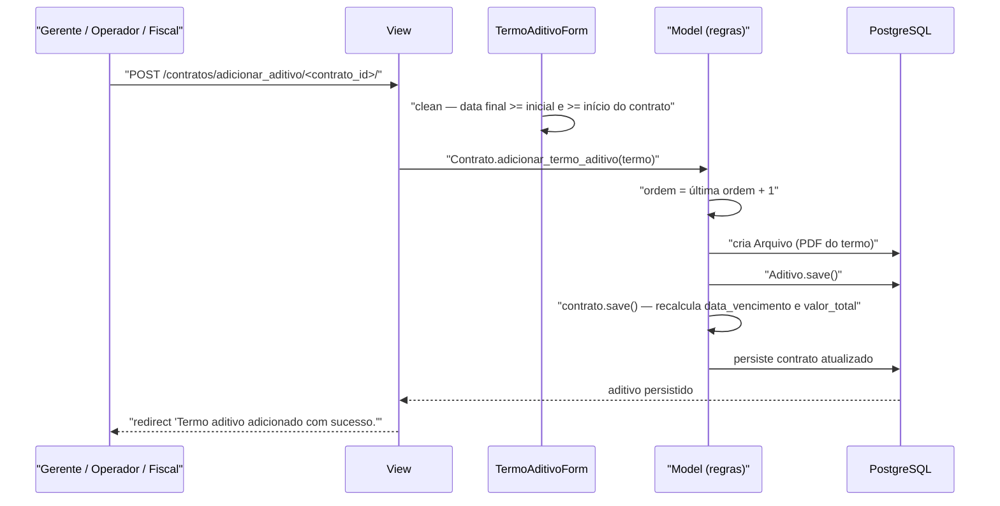

# Fluxo: Aditivar contrato

> Registra um termo aditivo que prorroga o prazo, altera o valor, troca fiscais ou modifica outras cláusulas do contrato.

- **Ator(es):** Gerente de Contrato, Operador de Contrato, Fiscal de Contrato (todos têm `pode_aditivar_contrato`) — ver [README → Atores e papéis](../README.md#atores-e-papéis)
- **Gatilho:** `POST /contratos/adicionar_aditivo/<contrato_id>/`
- **Pré-condições:** contrato cadastrado; termo aditivo assinado e digitalizado em PDF (o anexo é obrigatório na criação); data inicial do aditivo não anterior à do contrato
- **Pós-condições:** `Aditivo` criado com `ordem` sequencial; arquivo armazenado como `comum.Arquivo`; `Contrato.data_vencimento` e `valor_total` recalculados; a publicação do aditivo pode ser registrada em seguida
- **Depende de:** [cadastrar-contrato.md](cadastrar-contrato.md)
- **Habilita:** [definir-cronograma-e-parcelas.md](definir-cronograma-e-parcelas.md) (novas parcelas com o saldo/prazo ampliados), [designar-fiscal.md](designar-fiscal.md) (aditivo de fiscal)
- **Entrada no código:** `views.adicionar_aditivo`, `views.excluir_aditivo`, `views.aditivo` (ficha) — `@permission_required('contratos.pode_aditivar_contrato')`

## Sequência

## Observações

- **Tipos combináveis:** um mesmo aditivo pode ser de prazo, de valor, de fiscal e/ou de outros (quatro booleanos independentes). `Aditivo.get_tipo()` monta o rótulo exibido; sem nenhuma marca, aparece como "Indefinido".
- **Efeito no prazo:** `Contrato.get_data_vencimento()` adota a maior `data_fim` entre os aditivos **de prazo** posteriores ao fim original; é esse valor que alimenta os alertas de vencimento e a coluna "Data de Término" (exibida como "Prorrogado de … para …").
- **Efeito no valor:** `Contrato.get_valor_aditivado()` soma os aditivos **de valor** com `tipo_termo_aditivo = Majoração` e subtrai os de **Supressão**; o resultado entra em `valor_total`, ampliando (ou reduzindo) o saldo disponível para parcelas e medições.
- **Ordem sequencial:** atribuída em `Contrato.adicionar_termo_aditivo()` / `Aditivo.save()` via `get_proxima_ordem()`, com `unique_together (contrato, ordem)` garantindo a unicidade.
- **Anexo obrigatório na criação:** `arquivo_aditivo` é exigido ao adicionar; na edição o campo é ocultado e o arquivo pode ser trocado por `/contratos/upload_aditivo/<aditivo_id>/`. Aditivo sem anexo aparece nas pendências do contrato.
- **Publicação:** registrada em `/contratos/adicionar_publicacao_aditivo/<aditivo_id>/`, que **também** cria a `PublicacaoContrato` equivalente por espelhamento; o upload do arquivo replica o anexo nas duas.
- **Exclusão:** `Aditivo.delete()` remove antes as publicações do aditivo e o `Arquivo`, e ao final chama `contrato.save()` para desfazer os efeitos em prazo e valor.
- **Documento de apoio:** `/contratos/gerar_despacho_termo_aditivo/<termo_id>/` renderiza um despacho a partir do número do memorando e do despacho informados.
- **Contratos a serem aditivados:** o relatório `/contratos/contratos_a_serem_aditivados/` lista contratos contínuos e ativos com vencimento nos próximos 30 dias (`ContratoQueryset.a_serem_aditivados`).
- Alterações que **não** exigem termo aditivo (reajuste, repactuação, dotação) seguem por [apostilar-contrato.md](apostilar-contrato.md).

---
_Gerado/atualizado via subagent `documentador` em 2026-08-11._
