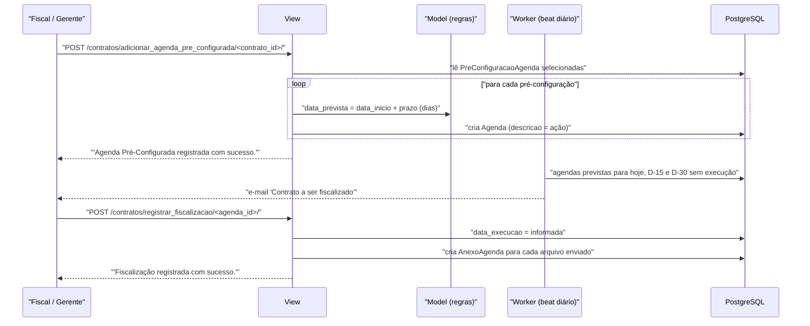

# Fluxo: Agendar e registrar fiscalização

> Programa as ações de fiscalização do contrato e registra sua execução com data e documentos comprobatórios.

- **Ator(es):** Fiscal de Contrato (do contrato), Gerente de Contrato, Coordenador de Contrato Sistêmico — ver [README → Atores e papéis](../README.md#atores-e-papéis)
- **Gatilho:** `POST /contratos/adicionar_agenda/<contrato_id>/` ou `POST /contratos/adicionar_agenda_pre_configurada/<contrato_id>/`; execução por `POST /contratos/registrar_fiscalizacao/<agenda_id>/`
- **Pré-condições:** contrato não cancelado; usuário é fiscal do contrato ou gerente/coordenador (`Contrato.pode_gerenciar_agenda_fiscalizacao`); para a agenda pré-configurada, existirem registros de `PreConfiguracaoAgenda`
- **Pós-condições:** `Agenda` criada com data prevista e fiscais responsáveis; ao registrar, `data_execucao` preenchida e os anexos gravados como `AnexoAgenda`; agendas não executadas passam a ser cobradas por e-mail
- **Depende de:** [designar-fiscal.md](designar-fiscal.md)
- **Habilita:** [notificacoes-automaticas.md](notificacoes-automaticas.md) — as agendas vencidas e não executadas alimentam a rotina diária
- **Entrada no código:** `views.adicionar_agenda`, `views.adicionar_agenda_pre_configurada`, `views.editar_agenda`, `views.registrar_fiscalizacao`

## Sequência

## Observações

- **Duas formas de criar:** manualmente (`AgendaForm`, com descrição, data prevista e escolha dos fiscais entre os do contrato) ou em lote a partir do catálogo de `PreConfiguracaoAgenda`, cuja `data_prevista` é calculada como `contrato.data_inicio + prazo` (em dias) e a descrição vem do campo `acao`.
- **Catálogo pré-configurado:** carregado pelo comando `importar_dados_contratos`, que lê `contratos/fixtures/pre_configuracao_agenda.csv` e cria os registros com gatilho `MOE` ("Possui dedicação de mão de obra exclusiva?"). ⚠️ REVISAR: o comando usa `bulk_create` sem deduplicação — reexecutar duplica o catálogo.
- **Registro da execução:** `RegistrarFiscalizacaoForm` pede a data de execução e aceita até 10 anexos em PDF (máx. 5 MB cada, via `MultiFileField`). Enquanto `data_execucao` for nula, a agenda é considerada pendente.
- **Cobrança automática:** o comando `notificar_fiscalizacao_contratos` (05:07 diariamente) seleciona agendas com `data_prevista` em hoje, D-15 ou D-30 e sem execução, e envia "Contrato a ser fiscalizado" com link direto para a aba `agenda_de_fiscalizacao`.
- **Destinatários:** os fiscais explicitamente associados à agenda; se nenhum for informado, **todos** os fiscais atuais do contrato (`Notificar.contratos_a_serem_fiscalizados`).
- **Autorização:** `Contrato.pode_gerenciar_agenda_fiscalizacao()` exige ser fiscal do contrato ou Gerente/Coordenador sistêmico, com o contrato não cancelado.
- ⚠️ REVISAR: `PreConfiguracaoAgenda.recorrente` está modelado e é exibido no admin, mas nenhuma rotina do módulo recria a agenda periodicamente — o campo parece não ter consumidor.

---
_Gerado/atualizado via subagent `documentador` em 2026-08-11._
